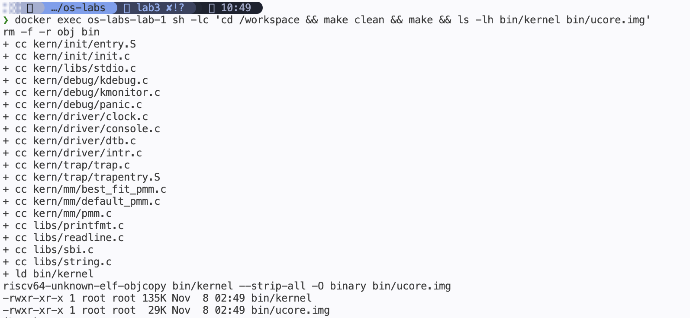
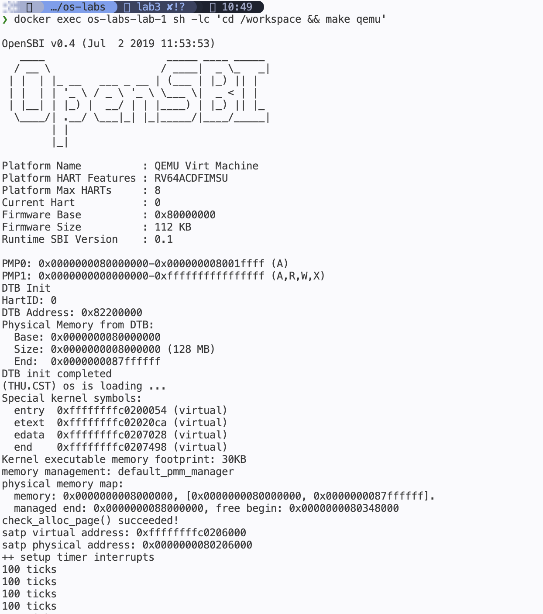
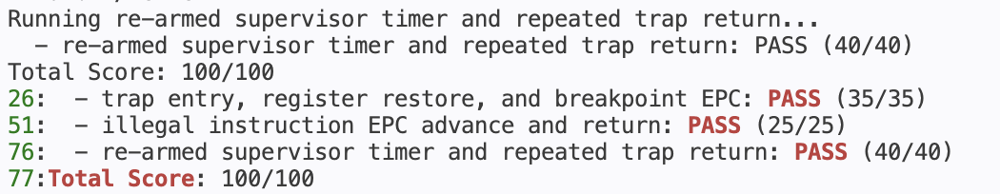

# 操作系统实验报告

## 实验基本信息

| 项目 | 内容 |
|------|------|
| **实验名称** | Lab 3：中断与异常 |
| **小组成员** | 2412439-崔迪、2412819-李子谦、2412852-梁靖泽 |
| **完成日期** | 2026-11-04 |
| **文档整理日期** | 2026-11-08 |

### 小组分工

| 成员 | 负责的练习/模块 |
|------|----------------|
| 2412439-崔迪 | `RESTORE_ALL`、`__alltraps` 和现场恢复验证 |
| 2412819-李子谦 | `interrupt_handler()`、时钟计数与关机、中断保护思考题、整体验证 |
| 2412852-梁靖泽 | `exception_handler()`、指令长度判断、异常与现场恢复联合验证、`stvec` 思考题；整理模块一说明、原理总结及报告附件 |

各自整理模块说明和测试结果，由梁靖泽汇总报告，截图由组长统一整理。


---

## 一、实验目的

1. 理解 RISC-V 中断与异常的区别，以及 Trap 现场保存、处理和返回的过程。
2. 实现中断分类、持续时钟中断、计数输出和自动关机。
3. 理解保存、恢复原中断状态对临界区的作用。
4. 根据 RISC-V 的 16/32 位指令编码处理异常返回位置，验证异常处理前后的通用寄存器和原栈保持一致。
5. 按 Lab 0.5 的四段式要求组织功能规格，把返回位置、现场保护和异常兜底转化为可以检查的条件。

---

## 二、实验环境

| 成员 | AI 编程工具 | 底层模型 | 备注 |
|------|------------|---------|------|
| 2412439-崔迪 | Codex 桌面应用；Claude Code | deepseek-v4-flash | 本次模块一在 Codex 对话中完成；历史工具信息参照 Lab 1、Lab 2 |
| 2412819-李子谦 | Claude Code | deepseek-v4-flash | 按 Lab 1、Lab 2 分支中的成员工具记录补充 |
| 2412852-梁靖泽 | Codex CLI | deepseek-v4-flash | 本次异常模块工具沿用已提交的记录，历史信息参照 Lab 1、Lab 2 |

成员开发环境

| 成员 | 宿主机与 Linux 环境 | RISC-V GCC / binutils | QEMU / GDB |
|------|---------------------|----------------------|------------|
| 崔迪 | macOS ARM64；Docker Ubuntu 22.04 / aarch64 | 10.2.0 / 2.35.1 | 4.1.1 / gdb-multiarch 12.1 |
| 李子谦 | Windows WSL2；Ubuntu 24.04.4 LTS / x86_64 | 10.2.0 / 2.35 | 4.1.1 / riscv64-unknown-elf-gdb 10.1 |
| 梁靖泽 | Windows WSL2；Ubuntu 22.04 / x86_64 | 15.1.0 / 2.45 | 4.1.1 / riscv64-unknown-elf-gdb 16.3.90.20250610-git |


---

## 三、实验整体逻辑分析

### 3.1 本章节的逻辑主线

本章要解决的是：发生中断或异常后，内核怎样处理事件，再回到原来的程序。Lab 2 已经提供内存和内核栈，但仅有这些还不够；处理器发生 Trap 时不会自动把所有通用寄存器保存到内存。如果入口直接调用 C，处理函数使用的寄存器就可能覆盖被打断程序的值。因此，本章先解决保存与恢复，再建立汇编到 C 的调用关系，最后实现具体事件的处理。

硬件记录 `sepc/scause/stval` 并更新状态位，入口汇编把通用寄存器和返回状态保存为 `trapframe`，C 函数根据原因处理事件，最后由汇编恢复现场并返回。异常处理位于这条流程的中间：它不重新构造现场，而是只修改保存的返回位置，再交给已有的恢复代码。

### 3.2 功能的逐步实现

1. **准备入口和事件。** `idt_init()` 将 `stvec` 设置为 `__alltraps`；`clock_init()` 安排第一次定时事件，`intr_enable()` 开启 S 态中断响应。
2. **形成软件现场。** 发生 Trap 后，硬件保存原因和返回位置，`SAVE_ALL` 在当前内核栈建立 frame，入口把它作为参数交给 `trap(tf)`。
3. **根据原因处理。** `trap_dispatch()` 用 cause 最高位分流。时钟分支重新设置事件并计数；异常分支对非法指令和断点输出诊断，并决定下一条指令的位置。
4. **按保存的状态返回。** C 处理函数返回后，`RESTORE_ALL` 恢复寄存器和返回 CSR，`sret` 完成控制流转移。本实验主要是 S 态内核被打断后回到 S 态，没有额外实现用户态切换。

两类处理对 EPC 的要求不同：异步中断不能使原程序少执行一条指令；本练习的断点和非法指令则必须跳过，否则返回后会再次触发同一个异常。

---

## 四、实验内容与实现

### 4.1 功能模块一：Trap 上下文恢复与入口

**负责人：** 2412439-崔迪

**说明整理：** 2412852-梁靖泽

#### 模块功能描述

RV64 的 Trap frame 包含 36 个槽，共 288 字节，保持 16 字节栈对齐。`RESTORE_ALL` 必须与已有 `SAVE_ALL` 的布局对应。

代码从第 32、33 槽恢复 `sstatus/sepc`，然后恢复 `x1`、`x3–x31`，最后从第 2 槽恢复原 `sp`。如果提前恢复栈指针，后续就无法继续按当前 frame 的位置读取寄存器。`x0` 恒为零，不需要恢复；`badvaddr/cause` 用于诊断，不回写对应 CSR。

`__alltraps` 通过 `mv a0, sp` 将 frame 地址传给 `trap()`，返回后进入 `__trapret`，恢复现场并执行 `sret`。返回特权级由保存的 SPP 决定，不能认为 `sret` 总是返回用户态。

#### 规格与提示词整理

这一模块的规格不能只写“恢复所有寄存器”，还要说明恢复的是哪个时刻、哪个位置的值。`SAVE_ALL` 建立 frame 后，当前 `sp` 是 frame 基址，第 2 槽才是 Trap 前的 `sp`；两者不能混用。对应关系如下。

| 槽位 | 保存内容 | 恢复要求 |
|------|----------|----------|
| 0～31 | x0～x31，含第 2 槽中的原 sp | 恢复可写 GPR，x0 恒零；恢复 sp 前必须完成对 frame 的其他访问 |
| 32、33 | sstatus、sepc | 使用 frame 中的返回状态，包含 C 处理函数对 epc 的修改 |
| 34、35 | badvaddr、cause | 用于诊断，不要求回写 CSR |

前置条件是当前栈上已经有符合 `SAVE_ALL` 布局的 frame；后置条件是 C 收到同一个 frame，返回后处理器恢复其记录的状态。288 字节也是 16 的整数倍，所以在原栈对齐的前提下，压入 frame 不破坏 C 调用所需的对齐。


#### 最终提示词（四段式整理）

````text
[PROMPT]
任务：我负责 Lab 3 功能模块一。请补全 code/kern/trap/trapentry.S 中的 RESTORE_ALL 和 __alltraps，使内核能够将保存的 Trap 现场交给 C 函数处理，并恢复现场、返回被打断的 S 态执行流。
操作要求：必须直接修改工程中的实际文件，只补充两处 lab3 function1 YOUR CODE。保留 lab3 function1 注释，将 YOUR CODE 替换为我的学号 2412439。SAVE_ALL、__trapret、sret、入口对齐、trapframe 定义、头文件、Makefile、trap.c 和课程测试均保持原样，不实现已经取消的用户态切换 Challenge。
输出要求：依据下面的真实布局、接口与行为规格实现，说明实际修改位置、栈与返回状态的一致性，以及已执行的验证。模块二尚未实现时，可以在临时副本中使用测试替身验证模块一，但不能把替身写回正式源码，也不能据此声称完整课程评分通过。

[RELY]
code/libs/riscv.h 已定义 LOAD、STORE、REGBYTES。RV64 下 LOAD 为 ld、STORE 为 sd、REGBYTES 为 8。
code/kern/trap/trap.h 中的相关接口为：
```c
struct trapframe {
    struct pushregs gpr;
    uintptr_t status;
    uintptr_t epc;
    uintptr_t badvaddr;
    uintptr_t cause;
};
void trap(struct trapframe *tf);
```
struct pushregs 的成员按 x0 到 x31 顺序排列，RV64 下每项 uintptr_t 占 8 字节。Trap frame 共 36 个槽、288 字节，偏移以 REGBYTES 为单位：第 0～31 槽对应 x0～x31，第 32～35 槽分别为 sstatus、sepc、badvaddr 和 scause。
现有 SAVE_ALL 已在当前内核栈分配 frame，并保存上述现场。当前 sp 指向 frame 基址；第 2 槽保存进入 Trap 之前的原 sp，其值来自 sscratch，不是减去 frame 大小之后的 sp。x0 恒为零。badvaddr/cause 是诊断信息，不是需要恢复的返回控制状态。
RISC-V 调用约定以 a0 传递第一个参数，函数调用会改变返回地址和部分通用寄存器。框架已经提供 __trapret：执行 RESTORE_ALL 后执行 sret。处理函数可通过 tf->epc 调整返回地址；sret 根据恢复的 sepc 和 sstatus 完成返回，不能认为它必然返回 U 态。

[GUARANTEE]
必须完成的汇编接口：
```asm
.macro RESTORE_ALL
    #lab3 function1 2412439
.endm

__alltraps:
    SAVE_ALL
    #lab3 function1 2412439
```
RESTORE_ALL 是无参数汇编宏，__alltraps 是框架已有的汇编入口标签，不将它们改写为新的 C 函数。二者共同对接已有 void trap(struct trapframe *tf) 和 __trapret，不新增公开接口或改动其他模块。

[SPECIFICATION]
## RESTORE_ALL
Pre-Condition：当前处于 S 态 Trap 返回路径，sp 指向有效、符合 SAVE_ALL 布局的 frame；C 处理函数已经返回且保持 frame 基址可用。frame 中的返回状态有效，恢复过程不得提前开启中断；本任务只处理当前纯内核的上下文。
Post-Condition：可写通用寄存器及返回 CSR 与 frame 记录一致，sp 恢复为第 2 槽保存的原值；后续已有 sret 能从 frame 指定的位置继续执行，且不破坏 frame 之外的内存。
Case 1：C 处理函数未修改现场时，被打断执行流的通用寄存器和原栈得到恢复；x0 保持硬件规定的零值。
Case 2：C 处理函数合法修改 tf->epc 时，返回使用修改后的地址，而不是入口时保存地址的另一份副本。
Case 3：中断发生前允许或屏蔽中断时，保留 frame 中的 SPP/SPIE 等返回状态，由 sret 按处理器规则完成返回；不得无条件开启中断或强制改为用户态。
Requirements：必须与 SAVE_ALL 的槽位一一对应。恢复所需的 frame 访问完成前，不能丢失其基址；原 sp 的处理必须与其他 GPR 区分。不得把 badvaddr/cause 当作需要回写的返回 CSR，也不得改动 SAVE_ALL 来迁就恢复代码。

## __alltraps
Pre-Condition：stvec 已指向四字节对齐的 __alltraps，处理器已进入 S 态且当前内核栈有效。入口已有 SAVE_ALL 会建立完整 frame，原栈满足 C 调用的 16 字节对齐要求。
Post-Condition：trap() 恰好接收本次 frame 的地址；C 返回后 sp 仍指向同一 frame，执行流能够进入已有 __trapret，恢复处理后的现场并经 sret 返回。
Case 1：处理中断时，C 函数可读取本次保存的原因和寄存器，返回路径保留 handler 决定的现场。
Case 2：处理断点或非法指令等异常时，C 对 frame 中返回位置的合法更新能交给统一恢复流程，不另建独立的异常返回机制。
Requirements：遵守 RISC-V 参数和函数调用约定，不因调用 trap() 丢失 frame 基址或原执行流的返回地址；288 字节 frame 在原栈对齐时保持 16 字节对齐。本模块不增加中断/异常分类逻辑，填空之外的所有代码保持逐字节一致。
````

#### 验证材料

README 留有模块一在 QEMU 4.1.1 和 11.0.2 各通过 16/16 组测试的记录。原临时脚本及完整原始日志未随仓库保存，本文将其作为历史记录。当前合并版本另已通过课程完整评分；此前异常补充日志也保留，两类材料的来源不同，不合并计算用例数。

### 4.2 功能模块二：中断与异常处理（中断部分）

**负责人：** 2412819-李子谦

#### 模块功能描述

**修改文件：** `code/kern/trap/trap.c`

```c
void interrupt_handler(struct trapframe *tf);
```

先去掉 cause 最高位的中断标志，再按 IRQ 编号分类。这样既能处理真实硬件传入的 cause，也能处理课程测试直接传入的编号。

S 态时钟中断每次调用 `clock_set_next_event()` 设置下一次事件，再将 `ticks` 加一。每满 100 次调用已有 `print_ticks()`。其他已定义的中断输出类型提示；未知编号输出 `Unknown interrupt: cause N` 并打印现场。整个函数不修改 `trapframe`，尤其不推进 EPC，因为异步中断不应跳过原程序的指令。

手册要求达到 `SHUTDOWN_AFTER` 后关机，但没有指定数值，因此本组设为输出 10 次，即累计 1000 次时钟中断。每次打印后用 `ticks / TICK_NUM` 判断次数，达到阈值调用 `sbi_shutdown()`。宏允许编译时覆盖。

#### 最终提示词

````text
[PROMPT]
任务：我负责 Lab3 的中断处理，请帮我补全 code/kern/trap/trap.c 中的 interrupt_handler()。
操作要求：直接修改实际文件，只动 lab3 function2 填空里的中断部分，署名 2412819。队友写好的异常处理、汇编和其他函数都别改，也不要新增文件、改评分工具或提交 Git。
输出要求：按下面的接口和规格实现，简单够用就行。最后说明改了哪里，有问题就如实告诉我；这一步先不运行测试。

[RELY]
先看 trap.h、riscv.h、clock.h 和 sbi.h 的真实定义。trapframe 含 gpr、status、epc、badvaddr、cause，后四项都是 uintptr_t。
已有 TICK_NUM=100、volatile size_t ticks，以及 clock_set_next_event()、print_ticks()、print_trapframe(tf)、sbi_shutdown()。IRQ 类型使用 riscv.h 的宏；cause 最高位是中断标志，其余位是原因编号。
手册没给关机阈值，先把 SHUTDOWN_AFTER 暂定为 10，表示输出次数，不是 tick 数；注明这是暂定值，并允许编译时覆盖。

[GUARANTEE]
void interrupt_handler(struct trapframe *tf);
只补这个函数和必要的宏、声明。保留共享 lab3 function2 标记，去掉 YOUR CODE，并保留队友的 2412852 署名。

[SPECIFICATION]
interrupt_handler：
Pre-Condition：单核串行调用，tf 是有效且可写的现场；初始化已完成，ticks 从零开始。
Post-Condition：根据原因处理中断，不改 tf 的任何字段，尤其不能增加 epc；除 S 态时钟外不改变 ticks。
Case 1：S 态时钟每次都重设下一次事件，ticks 加一；每满 100 次调用已有 print_ticks()，输出累计达到 SHUTDOWN_AFTER 次后调用真实 sbi_shutdown()。
Case 2：其他已定义 IRQ 只输出相应类型提示，包括 Supervisor software interrupt，不做本实验没要求的设备驱动。
Case 3：未知编号输出 Unknown interrupt: cause N，再调用 print_trapframe(tf)。去掉中断标志后分类，也兼容测试直接传入不带标志的编号。
Requirements：默认第 1000 次时钟中断才关机，第 200 次必须能正常返回；不要为通过评分关闭关机功能，也不要加无关的防御代码。
````

#### 实现迭代过程

先阅读实际接口和课程测试，再按四段式写提示词，让子 agent 补全中断函数。生成后检查了 cause 掩码、计数与关机条件，以及是否修改了异常处理和原有分发逻辑。内核编译和课程评分均通过，没有再修改中断算法。

补充测试的接入出现过两个问题：测试替身与原函数重名，以及新增测试文件排在 `entry.S` 前面，导致裸镜像起点不再是 `kern_entry`。在临时副本中调整替身名称和文件顺序后，补充检查通过，正式入口和链接脚本保持原样。

### 4.3 功能模块二：中断与异常处理（异常部分）

**负责人：** 2412852-梁靖泽

#### 模块功能描述

**修改文件：** `code/kern/trap/trap.c`，仅本人负责的 `lab3 function2` 异常部分。

```c
void exception_handler(struct trapframe *tf);
static uintptr_t exception_instruction_length(uintptr_t epc);
```

这部分的目标不是只识别出异常，而是让后续执行位置正确。`sepc` 保存的是触发异常的位置，如果直接恢复，处理器还会执行原来的故障指令。我需要在保存的 frame 中更新 EPC，再由崔迪的恢复代码写回 `sepc`，不在 C 中另行实现返回流程。

`exception_handler()` 对非法指令输出 `Illegal instruction at`，对断点输出 `Breakpoint at`，两者都包含修改前的 EPC，再按当前指令长度推进。其他异常调用原 `print_trapframe(tf)`，不读取 EPC 处的指令，也不修改 frame。这样，兜底分支不会为了打印一个已有的异常，再因无效取指制造新异常。

#### spec 的设计

先把手册的要求分成“需要继续执行”和“只做诊断”两类，而不是让所有 cause 共用一条 EPC 更新规则。然后分别确定输入条件、允许变化的字段和边界情况。

| 对象 | 前置条件 | 后置条件与可检查的结果 |
|------|----------|------------------------|
| 指令判长 | EPC 指向可读、两字节对齐的内核代码，目标为本实验的 16/32 位指令 | 返回 2 或 4，不修改内存；32 位指令不要求四字节对齐 |
| 非法指令、断点 | frame 有效，故障指令满足判长前提 | 诊断使用原 EPC；新 EPC 等于原 EPC 加指令长度；其余字段不变 |
| 其他异常 | frame 有效，不要求 EPC 可以解引用 | 调用已有现场打印，整个 frame 不变，不取指 |

固定加 4 会越过压缩指令之后的一部分代码，固定加 2 又可能跳到普通指令中间。为此，我把 16/32 位长度和只按半字对齐的地址单独列成规格。另一个约束是只允许 EPC 改变，这样测试可以比较整个 frame，而不是只看输出是否出现。

规格也写明了适用范围：这里处理内核可读代码上的 16/32 位指令，不是完整的变长指令解码器，也不是用户地址安全取指接口。未知异常只要求诊断；保持 EPC 不变并不表示已经排除故障，真实触发时仍可能反复陷入。

#### 最终提示词

下面的实现提示词与 [prompt.md 对应部分](prompt.md#一异常识别与返回位置处理) 一致。按 Lab 0.5 分开写任务、可信上下文、交付接口和行为规格，避免只让 AI “补一个函数”，也不把具体汇编或 C 步骤当成需求。

````text
[PROMPT]
任务：我负责 Lab 3 的异常部分。请补全 code/kern/trap/trap.c，让内核遇到非法指令或断点时能打印原因，跳过这条指令，再沿原来的 Trap 返回流程继续运行。
操作要求：请直接改工程里的实际文件，只动 lab3 function2 区域中的异常函数和它需要的局部辅助函数，保留 lab3 标记，在我的实现附近署 2412852。李子谦的中断处理和崔迪的 trapentry.S 都不要改，原有的分发、打印函数、头文件和课程评分工具也保持原样。
输出要求：按下面的真实接口和行为规格实现，别为了省事把所有异常都加 4。完成后说明哪些现场字段会变化，以及怎样确认返回到了下一条指令；运行过什么就写什么，不要把独立测试说成课程评分。

[RELY]
code/kern/trap/trap.h 中的定义是：
```c
struct trapframe {
    struct pushregs gpr;
    uintptr_t status;
    uintptr_t epc;
    uintptr_t badvaddr;
    uintptr_t cause;
};
void print_trapframe(struct trapframe *tf);
```
gpr 按 x0 到 x31 保存通用寄存器；RV64 下 uintptr_t 为 64 位无符号整数。status、epc、badvaddr、cause 分别对应保存的 sstatus、sepc、stval、scause。
code/libs/riscv.h 已有 CAUSE_ILLEGAL_INSTRUCTION=0x2 和 CAUSE_BREAKPOINT=0x3。cprintf() 已有声明，不用再写输出函数。
trap_dispatch() 已经把异常交给 exception_handler()；函数返回后，RESTORE_ALL 会把 tf->epc 恢复到 sepc，再执行 sret。
这次只考虑内核可读代码中的 16/32 位指令。压缩指令为 2 字节，普通指令为 4 字节；指令起点可能只按 2 字节对齐。不要假定 badvaddr 一定保存了指令内容。

[GUARANTEE]
这次要完成的接口：
```c
void exception_handler(struct trapframe *tf);
static uintptr_t exception_instruction_length(uintptr_t epc);
```
辅助函数只在本文件内部使用，不增加公开接口，也不修改 trapframe 的定义。

[SPECIFICATION]
## exception_instruction_length
Pre-Condition：epc 指向有效、两字节对齐的内核代码，首个半字可读，目标属于本实验使用的 16/32 位指令范围。
Post-Condition：返回该指令占用的字节数，不改代码内容或任何现场字段。
Case 1：首半字最低两位不是 11 时，返回 2。
Case 2：在上述指令范围内，首半字最低两位为 11 时，返回 4；即使 epc 不是四字节对齐也应成立。
Requirements：不要为了判长强行做要求四字节对齐的整字读取。本任务不扩展 48 位及更长指令，也不处理任意用户地址的安全取指。

## exception_handler
Pre-Condition：tf 指向有效、可写的 Trap frame，cause 已由分发函数判断为异常。对于非法指令和断点，epc 满足上面判长函数的前提；其他异常不要求 epc 可以解引用。
Post-Condition：完成对应的诊断并返回统一恢复流程。只有非法指令和断点允许改变 epc，其他字段以及 ticks 等中断状态都保持不变。
Case 1：cause 为非法指令时，输出包含 Illegal instruction at 和原 epc 的信息；返回位置等于原 epc 加本条指令的长度，不能再次执行同一条非法指令。
Case 2：cause 为断点时，输出包含 Breakpoint at 和原 epc 的信息；16 位、32 位断点分别越过 2、4 字节。
Case 3：其他 cause 调用已有 print_trapframe(tf)，不推进 epc，也不读取 epc 指向的内容；例如 epc=0 时仍只做现场打印。
Requirements：通过保存的 frame 交回返回状态，不在 C 函数里另写一套 CSR 恢复或 sret。没有要求处理的异常只负责诊断，不把它写成已经恢复成功。
````

#### 实现与调试过程

实现时把长度判断单独放进 `static` 辅助函数，避免两个异常分支各维护一套规则。实际代码读取首个 16 位半字，以最低两位判断本实验中的长度：

```c
static uintptr_t exception_instruction_length(uintptr_t epc) {
    uint16_t instruction = *(const volatile uint16_t *)epc;
    return (instruction & 0x3) == 0x3 ? 4 : 2;
}
```

两个目标分支先打印原 EPC，再调用这一辅助函数更新 `tf->epc`。默认分支不调用判长函数，因此即使 frame 中的 EPC 不能作为代码地址访问，也只进行现场打印。代码保留 `lab3` 和本人学号，没有修改原分发函数或公共返回接口。

独立验证实际遇到的问题主要在环境接入，而不是已经发现并修复了某个判长算法错误。

| 实际现象 | 分析和处理 | 修改范围 |
|----------|------------|----------|
| GCC 15.1.0 配套汇编器报 `unknown CSR sbadaddr` | 课程使用旧 CSR 名，仅在临时副本把操作数换成相同编号 `0x143` | 测试副本；正式 `trapentry.S` 不改 |
| QEMU 7.0.0 使用原 loader 方式时未进入内核 | 固件显示下一跳为零；改用 `-kernel` 后下一跳为 `0x80200000`，但仍没有内核输出，未进一步断言根因 | 测试启动命令；不改正式入口或页表 |
| 新版模拟器尝试仍未得到测试结果 | 改用已安装的课程 QEMU 4.1.1，保留相同被测异常代码，完成独立验证 | 选择课程模拟器，不为适配新版本改内核 |

不能把“固定加 4”“破坏现场”等容易出错的设计写成已经实际发生的 bug。本次是通过规格和用例提前约束这些情况，保存的成功日志显示 25 个独立用例全部通过。

#### 异常与现场恢复的独立测试

将测试分成两层。第一层直接调用异常函数，检查 cause 分类、EPC 和其他字段；第二层真正执行故障指令，经过 `SAVE_ALL → trap → exception_handler → RESTORE_ALL → sret`，检查返回后的寄存器和栈。只做第一层不能证明汇编返回链正确，只看一条诊断也不能证明 EPC 更新正确。


测试规格的重点不是预先写出 PASS，而是明确每条断言和失败出口。下面的 [独立测试提示词](prompt.md#二异常返回与寄存器原栈的联合测试) 是按当前分工整理的版本；其中“已合并中断时不要重复定义替身”是后续复测的接入约束，不是声称旧脚本已经完成这一适配。

````text
[PROMPT]
任务：异常函数写完以后，我想确认的不只是“打印出来了”，还要确认它确实跳过了正确的字节数，返回后寄存器和栈没有被弄坏。请在 code/tools/verify_exceptions_2412852.py 中实现或完善一套独立测试。
操作要求：直接修改这个测试文件，所有测试接入都放在 /tmp 下的临时源码副本中，不改正式内核、Makefile、grade.sh、inject.py 和 test_lab3*。中断代码如果还没合并，可以只在副本里放替身；如果已经有 interrupt_handler()，不要再定义一个同名函数。这次测试不使能时钟，也不改队友的中断逻辑。
输出要求：保存真实的构建输出和 QEMU 串口输出，按学号区分文件。告诉我每组检查在验证什么，失败就保留失败原因，不要只有一句“测试通过”。

[RELY]
实际被测代码是 trap.c 中的 exception_handler()，真实返回链是 trapentry.S 中的 __alltraps、RESTORE_ALL 和 sret。
RV64 的 trapframe 有 36 个 8 字节槽；前 32 槽对应 x0～x31，后四槽依次是 status、epc、badvaddr、cause。保存的 sp 是进入 Trap 前的值，不是 frame 基址。
现有测试工具使用 Python 标准库、RISC-V GCC 和 QEMU。课程环境使用 QEMU 4.1.1，命令行可通过 --qemu 指定路径，--log-dir 指定日志目录。
可用编码是 16 位断点 0x9002、32 位断点 0x00100073、16 位非法编码 0x0000，以及本目标平台未实现的 32 位编码 0x0000007b。
有些新汇编器不接受课程旧名 sbadaddr；如确实遇到这个报错，只在测试副本把对应 CSR 操作数写成同一编号 0x143，并在日志中说明，不动正式汇编。

[GUARANTEE]
保留宿主测试入口：
```python
def context_assembly():
def main():
```
context_assembly() 返回供临时副本编译的汇编源码；main() 负责隔离接入、构建、运行和记录结果。可增加模块内部辅助函数，不给正式内核增加接口。
临时测试镜像需提供：
```c
void verify_exceptions_2412852(void);
uintptr_t verify_break16(void);
uintptr_t verify_break32(void);
uintptr_t verify_illegal16(void);
uintptr_t verify_illegal32(void);
```

[SPECIFICATION]
## context_assembly / 四个 verify_* 汇编测试函数
Pre-Condition：测试在 RV64 S 态内核中执行，入口和异常函数已就绪，测试栈可用并满足调用约定。
Post-Condition：每个函数真正触发指定异常，返回后比较全部 32 个 GPR 槽和原 sp；检查通过返回 0，不一致返回非零。测试函数本身不能破坏 C 调用者的被调用者保存寄存器。
Case 1：16/32 位断点各触发一次，必须到达断点后面的检查代码。
Case 2：16/32 位非法指令各触发一次，也必须回到下一条指令，不能陷入重复异常。
Requirements：四条测试指令都覆盖起点模 4 等于 2 的情况，尤其不能漏掉非四字节对齐的 32 位指令。比较中包含 ra、sp、gp、tp，不仅检查几个临时寄存器；不要为测试随意破坏 gp、tp。

## verify_exceptions_2412852
Pre-Condition：frame 与指令样本在有效内存中，真实 Trap 测试安排在 clock_init()/intr_enable() 之前。
Post-Condition：每组给出检查数和失败数，最终只有全部断言满足时才输出带本人学号的 PASS。
Case 1：两类目标 cause 分别搭配四个 16/32 位样本，共 8 次直接调用；对比整个 frame，除预期的 epc 外不能出现变化。
Case 2：对 cause=0、1、4、5、6、7、8、9、11、12、13、15、20 共 13 个其他异常，以 epc=0 调用；必须完成诊断且 frame 不变，不能因为统一取指产生新的异常。
Case 3：执行上面的四个真实 Trap 测试。21 个直接调用加 4 个真实往返，共 25 个用例，分别报告结果。

## main
Pre-Condition：能够找到工程和所选工具链，日志目录可写。
Post-Condition：正式源码和默认构建流程不变，临时副本用后清理，构建和运行日志可供核对。
Case 1：成功时保存工具版本和原始输出，日志中应有 21 个直接调用零失败、四次真实返回 PASS 和总计 25 个用例的 PASS。
Case 2：编译失败、程序崩溃、出现 FAIL，或超时前没有完整成功标志，都按失败退出。测试内核成功后主动空转的情况下，可以在已经收到完整成功标志后由宿主超时结束，但超时本身不算通过。
Requirements：不要覆盖之前的成功日志来掩盖新失败。复测可用 --log-dir 另存一份；这组结果只证明异常与现场恢复，不代表时钟、关机或课程总评分。
````

#### 验证结果

原始记录为 8 个目标异常直接调用、13 个兜底检查和 4 个真实异常往返，共 25 个用例，均通过。具体输出和证据边界见第五节。

### 4.4 练习：stvec 后向兼容

**负责人：** 2412852-梁靖泽

#### 分析依据

手册的问题是：旧版只保存入口地址，新版用最低两位表示 MODE，为什么原来的代码还有效？

#### 练习分析与问题回答

旧版入口要求四字节对齐，最低两位本来就是 `00`。新格式把低两位解释为 MODE 后，旧地址自然对应 MODE=0（Direct），BASE 和跳转位置不变，因此兼容旧代码。求 BASE 是屏蔽低两位，不是把完整地址再左移两位。

例如，假设旧入口地址为 `0x80201000`，它的低两位为 `00`。把相同的数值写入新格式的 `stvec`，MODE 仍是 0，BASE 仍为 `0x80201000`，处理器仍跳到同一入口。这个例子只用于解释编码关系，不是本次运行中 `__alltraps` 的实际地址。

Direct 模式下所有 Trap 进入 BASE；Vectored 模式下同步异常仍进入 BASE，异步中断进入 `BASE + 4 × cause_code`，其中原因编号不含最高位的中断标志。例如原因编号为 5 的异步中断使用偏移 20 字节，而不是用完整 `scause` 参与计算。

本实验 `.align(2)` 保证入口四字节对齐，`idt_init()` 将 `&__alltraps` 原样写入 `stvec`，低两位为 0，因此采用 Direct。这里没有建立向量表，不能只改 MODE 就切到 Vectored。向量表每槽四字节与故障指令本身是 16 位还是 32 位没有对应关系：前者决定中断入口偏移，后者决定异常处理应当推进多少 EPC。

### 4.5 练习：中断保护与 do-while 宏

**负责人：** 2412819-李子谦

`do { } while (0)` 让宏体执行一次，同时使整个宏在语法上相当于一条语句。调用时可以正常加分号，也能放在没有花括号的 `if/else` 中：

```c
if (need_protection)
    local_intr_save(intr_flag);
else
    other_action();
```

如果只用花括号包装，调用处的分号会多出一条空语句，破坏 `if/else` 的配对。花括号还提供了局部作用域，方便宏内部声明临时变量。

`__intr_save()` 保存的是进入前的 SIE 状态，而不是简单地关中断。恢复时分三种情况：

- 原来开启：保存真并关闭，退出时重新开启。
- 原来关闭：保存假，退出时继续保持关闭，不能无条件调用 `intr_enable()`。
- 嵌套调用：外层保存真、内层保存假，内层退出后仍关闭，直到外层退出才开启。每层需要独立的保存变量，并按相反顺序恢复。

`alloc_pages()`、`free_pages()` 和 `nr_free_pages()` 都用这种方式包住物理内存管理操作。它只防止本 hart 的可屏蔽中断打断临界区，不能阻止同步异常，也不能代替多核锁；上述恢复关系还要求临界区内部不自行开中断。

原有 `local_intr_restore(x)` 宏自带分号，没有采用同样的 `do-while` 包装，不宜直接套用上面的无花括号写法。

---

## 五、测试与验证

### 5.1 小组整体验收结果

合并三个模块后，使用课程原有评分工具验证完整内核。正常启动另跑一次，检查评分未覆盖的自动关机；结果如下。

| 测试 | 结果 |
|------|------|
| 默认内核构建 | 编译、链接通过 |
| Trap 入口、寄存器恢复和断点返回 | 35/35 |
| 非法指令返回及 handler 兜底 | 25/25 |
| 持续 S 态时钟中断 | 40/40，运行至 `ticks=200` |
| 正常启动和关机 | 内存自检通过，输出 10 行 `100 ticks` 后自行退出，返回码 0 |
| 中断分类与计数边界 | 42 个用例通过 |
| SIE 保存、恢复及嵌套 | 4 个用例通过 |

课程评分输出：

```text
  - trap entry, register restore, and breakpoint EPC: PASS (35/35)
  - illegal instruction EPC advance and return: PASS (25/25)
  - re-armed supervisor timer and repeated trap return: PASS (40/40)
Total Score: 100/100
```

正常启动约 10.23 秒后结束。补充检查在临时副本中对计时、输出和关机调用使用替身，检查 99/100、199/200、999/1000 的计数边界、带或不带中断标志的原因编号、非时钟中断不计数，以及完整现场不变；SIE 检查执行实际 CSR 指令。真实时钟和 SBI 关机由正常启动测试单独确认。

完整命令和输出见 [本次测试日志](logs/2412819-lab3-tests.txt)。此前异常模块的 25 个独立用例见 [异常测试日志](logs/2412852-exceptions-qemu.txt)，模块一原有独立测试记录见 `README.md`。

### 5.2 异常模块的独立验证

下面是异常模块合并前隔离测试留下的记录。测试在临时副本接入，不改课程评分文件；中断使用替身，且在使能时钟前完成检查，因此这份结果不用于证明持续时钟或 SBI 关机。

| 检查内容 | 用例数量 | 判定方式 | 日志结果 |
|----------|----------|----------|----------|
| 两类异常的长度与 EPC | 8 | 非法指令、断点分别搭配四个 16/32 位样本，比较整个 frame，仅允许 EPC 按预期变化 | 通过 |
| 其他异常兜底 | 13 | cause 为 0、1、4、5、6、7、8、9、11、12、13、15、20；EPC 置零，检查诊断完成且 frame 不变 | 通过 |
| 真实 16/32 位断点 | 2 | 执行对应编码，返回后逐一比较 32 个 GPR 槽及原栈 | 通过 |
| 真实 16/32 位非法指令 | 2 | 执行对应编码，通过相同的现场和返回位置检查 | 通过 |
| 合计 | 25 | 所有检查满足后才输出完整成功标志 | 25/25 |

保存的串口输出末尾为：

```text
[2412852] handler cases: 21 checks, 0 failures
Breakpoint at 0xffffffffc020039a
[2412852] real trap 0 (32 GPR slots / original stack): PASS
Breakpoint at 0xffffffffc0200692
[2412852] real trap 1 (32 GPR slots / original stack): PASS
Illegal instruction at 0xffffffffc020098e
[2412852] real trap 2 (32 GPR slots / original stack): PASS
Illegal instruction at 0xffffffffc0200c86
[2412852] real trap 3 (32 GPR slots / original stack): PASS
[2412852] PASS (25 cases)
```

四条真实故障指令的地址模 4 都为 2，说明检查并非只覆盖四字节对齐的指令。直接调用中的 8 个样本组合检查 handler 的分类与判长，不代表每个“cause/样本”组合都由硬件真实产生；实际硬件往返由后四个用例单独验证。

完整证据分别为 [异常构建日志](logs/2412852-exceptions-build.txt) 和 [异常串口日志](logs/2412852-exceptions-qemu.txt)。

#### 当前验收方式

当前提交以课程原始 `make grade` 和默认 `make qemu` 为验收入口：前者验证三个课程评分项，后者验证连续时钟及真实 SBI 关机。课程工具、测试源码和构建框架保持原样。

### 5.3 实验结果截图

2026-11-08 由崔迪提供三张真实终端截图，均按附件原始字节保存，未裁剪、缩放或重绘。以下分别说明画面直接显示的结果及相应证据边界；

| 图号 | 文件 | 原始分辨率 | 核对结果 |
|------|------|------------|----------|
| 1 | `2412439-lab3-build.png` | 1594 × 736 | 命令包含清理、编译和文件列表；编译、链接及 objcopy 完成，生成约 135K 的 ELF 和 29K 的原始镜像 |
| 2 | `2412439-lab3-boot.png` | 1244 × 1406 | 显示 OpenSBI v0.4、128 MiB RAM、默认管理器自检成功、时钟初始化及连续 tick 输出；图片底部截断，没有完整显示 10 次输出及退出后的提示符 |
| 3 | `2412439-lab3-grade.png` | 1050 × 204 | 显示三项 PASS：35/35、25/25、40/40，总分 `Total Score: 100/100`；带行号的部分为本次评分日志的 rg 检索结果 |

#### 图 1：清理后重新构建成功



画面中的 `bin/kernel` 是含调试信息的 ELF，`bin/ucore.img` 是去除符号并转换为原始二进制后的镜像，因此两者大小不同。图片显示两份文件均已生成，编译与链接过程未出现错误。

#### 图 2：内核启动与连续时钟中断



画面确认设备树报告 128 MiB RAM，`default_pmm_manager` 初始化并通过 `check_alloc_page()`，随后出现 `++ setup timer interrupts` 和连续 `100 ticks` 输出。SATP 页表物理地址为 `0x80206000`，固定映射后的虚拟地址为 `0xffffffffc0206000`，与当前代码地址关系一致。

此图底部截断，只能直接证明启动与连续时钟，不能单凭图片认定完整 10 次输出及自然关机。自动关机结论由 [2026-11-08 正常运行复验日志](logs/20261108-recheck-boot.txt) 补充：完整记录含 10 行 `100 ticks`，命令在超时前以返回码 0 自然结束；[此前整体验收日志](logs/2412819-lab3-tests.txt) 也记录了相同结果。

#### 图 3：课程评分 100/100



图中上部为评分执行输出的末尾，下部为从刚生成日志中检索到的三项结果，完整评分原文保存在 [本次截图对应的评分日志](logs/2412439-lab3-grade.txt)。这些结果分别验证 Trap 入口与现场恢复、非法指令及 handler 兜底、持续时钟中断；自动关机仍由正常运行日志单独证明。

---

## 六、实验总结与收获

### 对操作系统的理解

#### 实验知识点与 OS 原理的联系和差异

我们对这一章最直接的理解是：保存寄存器只能保证“现场还在”，并不能自动决定程序应该从哪里继续。入口汇编和异常处理是相互配合的两部分；前者保证状态可恢复，后者要根据事件语义选择返回位置。

| 知识点 | 实验中的对应 | 与完整 OS 的区别 |
|--------|--------------|----------------|
| 中断与异常 | cause 最高位分流，分别进入两个 handler | Trap 不一定伴随用户态到内核态的切换 |
| 上下文保存 | GPR 和返回 CSR 组成 `trapframe` | 不是进程调度上下文，未保存浮点和向量状态 |
| 返回位置 | 中断保持 EPC，断点和非法指令按长度跳过 | 缺页处理通常修复后重试，不能统一增加 EPC |
| 定时事件 | 重设时钟、计数、输出和关机 | 周期性中断只是调度的基础，本实验没有实现调度器 |
| 临界区 | 保存 SIE、关中断、恢复原状态 | 局部关中断不等于多核互斥 |
| 特权级与返回 | 保存 sstatus，sret 根据 SPP 返回 | Trap 不必提升特权级；本实验验证的主要是 S→S，不是完整 U→S→U |
| 入口寻址 | stvec 的 Direct 入口指向 __alltraps | 原理上的向量化分发并未在本实验建立，不能把 C 中的 switch 当作硬件向量表 |
| 指令编码 | 按 16/32 位长度更新两类异常的 EPC | 两字节对齐与四字节指令可以同时成立；这是 ISA 编码约束，不是操作系统统一的异常策略 |

其中，“硬件保存”与“软件保存”也需要区分。硬件提供返回位置、原因和状态变化，软件才把 GPR 与相关 CSR 组织成 frame。实验中的 frame 是处理本次 Trap 的现场，不等同于调度器切换到另一进程时的完整进程上下文。

断点、非法指令采用跳过策略，是为了满足本练习的执行目标，不应推广到所有同步异常。真实系统遇到缺页时，往往先修复页表再重试原指令；遇到非法指令也可能终止程序或进入模拟处理，而不是无条件跳过。这说明 EPC 的处理必须服从事件语义，不能只有一条统一的“加几字节”规则。

#### 重要但本实验尚未涉及的知识点

本实验没有涉及进程调度、地址空间切换、按需分页、完整系统调用、嵌套中断恢复、SMP 锁和内存屏障。这些机制需要在后续实验中继续学习。

- **进程调度。** 时钟中断提供了抢占机会，但当前只是计数和输出，没有就绪队列、调度策略或进程状态切换。
- **用户态系统调用与隔离。** 本实验没有完整的用户程序、参数检查和用户栈到内核栈切换，不能据此说明用户地址访问已经安全。
- **缺页处理与虚拟内存。** 已有启动映射只是运行基础，尚未实现按需分配、页面换入换出以及修复后重试。
- **多核同步与复杂现场。** 本地关中断不能阻止其他 hart 访问共享数据；嵌套 Trap、锁、内存序和浮点/向量状态还需要额外机制。

### AI 协作开发的经验

提示词里最需要说明的是接口和状态约定。例如“每次中断加一”和“每输出一次加一”并不一样，异常跳过指令的规则也不能套到中断上。把这些要求写清楚后，生成的代码比较容易检查。

测试也不能只看一个分数。课程评分能确认主要处理流程，但没有检查自动关机，因此还需要观察正常启动能否按约定次数结束。遇到测试失败时，应先分清是内核实现有问题，还是测试接入改变了原来的运行条件。


---
