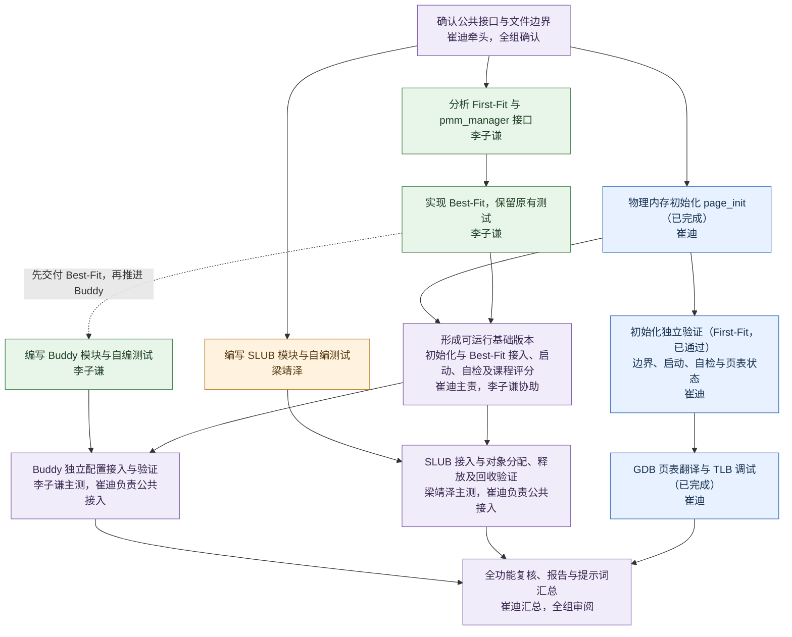

# 操作系统实验报告

## 实验基本信息

| 项目 | 内容 |
|------|------|
| **实验名称** | Lab 2：物理内存和页表 |
| **小组成员** | 2412439-崔迪、2412819-李子谦、2412852-梁靖泽 |
| **完成日期** | 待完成后填写 |

### 小组分工

以下为 Lab 2 的计划分工，具体完成情况和验证结果在实验结束后据实补充。
三人均需理解完整初始化与分配流程；代码按文件确定唯一主责人，公共接入文件由崔迪统一修改。

**练习与模块分工**

| 成员 | 负责的练习/模块 | 独立修改的代码文件 | 交付与验证 |
|------|----------------|-------------------|------------|
| 2412439-崔迪 | 功能模块一：物理内存探测与页描述符初始化；公共构建与启动接入；GDB 页表/TLB 调试；可选内存探测 Challenge | `code/kern/mm/pmm.c`、`code/kern/init/init.c`、`code/Makefile`；启动、设备树、公共头文件和调试配置如需改动也统一由本人处理 | 完成 `page_init()`；接入 Best-Fit、Buddy 和 SLUB；默认验收使用 Best-Fit；整理构建、评分及地址翻译调试记录 |
| 2412819-李子谦 | 功能模块二任务一：First-Fit 分析；任务二：Best-Fit；任务三：Buddy System 及自编测试 | `code/kern/mm/best_fit_pmm.c`、`best_fit_pmm.h`；新增 `buddy_pmm.c`、`buddy_pmm.h` 和必要的 `buddy_check.c`，均位于 `code/kern/mm/` | 完成两种页分配模块，保留原有 Best-Fit 测试不变；说明 First-Fit/Best-Fit 改进空间；提交 Buddy 的实现与测试两份提示词、测试结果和边界分析 |
| 2412852-梁靖泽 | 功能模块二任务四：SLUB 内存对象分配及自编测试 | 新增 `code/kern/mm/slub.c`、`slub.h`、`slub_check.c` | 基于 `alloc_pages()` / `free_pages()` 实现不同大小对象的分配和释放；提交实现与测试两份提示词、测试结果和边界分析 |

#### 功能实现顺序与依赖（DAG）

下图安排本组的开发与验收顺序。实线表示下游接入或验证的前置条件；虚线表示同一负责人的工作优先级。每个节点均标注负责人，完成状态见节点说明和第五章验证表。



- **第一阶段可并行开发：** 崔迪完成初始化，李子谦分析 First-Fit 并实现 Best-Fit，梁靖泽编写 SLUB 及测试。各自先确定 spec、接口和测试方案，并同步记录个人草稿。
- **基础版本需要两项汇合：** `page_init()` 与 Best-Fit 实现完成后，由崔迪统一接入并验证。默认 Best-Fit 构建仍会编译未完成的 `best_fit_pmm.c`。新增的显式 `PMM=first_fit` 配置可以先验证初始化并开展 GDB 调试；最终课程基线仍需等 Best-Fit 实现完成后汇合。
- **基础版本完成后分路验收：** Buddy、SLUB 按图接入最终基线；GDB 调试可在 First-Fit 初始化验证通过后提前开展。Buddy 与 SLUB 相互独立，SLUB 通过公共页面分配接口工作；最终默认运行和课程评分保持使用 Best-Fit。公共接入改动仍由崔迪集中处理。
- **报告随开发记录，最后统一汇总：** 模块实现者提交实际提示词、迭代过程、测试记录及个人报告草稿。内存探测 Challenge 由崔迪选做，完成后补入报告，不作为主流程的前置条件。

**公共文件与接口约定**

1. 李子谦、梁靖泽只修改各自负责的实现、头文件及自编测试；需要修改 `pmm.c`、`init.c`、`Makefile`、`pmm.h` 或 `memlayout.h` 时，先把接口需求交给崔迪统一接入。
2. Best-Fit、Buddy 都遵循 `struct pmm_manager`；SLUB 通过 `alloc_pages()` / `free_pages()` 使用底层页面分配器，避免依赖另一位成员分配器的内部变量。新增模块的接口和测试入口声明在各自头文件中。
3. 最终默认运行与课程评分使用 `best_fit_pmm_manager`。Buddy 采用独立测试配置验收，由崔迪统一安排切换；SLUB 测试分配后应释放对象并核对页面回收。各成员不自行修改全局分配器选择。
4. `best_fit_pmm.c` 内的 `basic_check()`、`best_fit_check()`，以及 `tools/test_lab2.c`、`test_lab2.h`、`inject.py`、`grade.sh` 保持课程原样；发现脚本与环境不兼容时先记录原因，由崔迪统一处理运行方式。
5. 新增实现保留实验标记，并按实际作者将 `YOUR CODE` 替换为学号。三人都需在完成初始化接入后亲自构建、运行并复核自己模块的结果。
6. 三人可以并行编写各自文件；崔迪优先提交初始化公共基线，其他成员同步后开展内核运行测试。模块私有状态尽量使用文件内 `static`，新增外部符号使用 `buddy_`、`slub_` 等明确前缀，减少链接时的同名冲突。

**实验报告分工**

| 成员 | 独立撰写的草稿 | 负责的报告内容 |
|------|----------------|----------------|
| 2412439-崔迪 | `report/members/2412439-崔迪.md` | 实验目的、环境、整体逻辑；初始化模块、GDB 调试与可选 Challenge；汇总第五章测试、最终报告及提示词索引 |
| 2412819-李子谦 | `report/members/2412819-李子谦.md` | First-Fit 分析与改进问题；Best-Fit 和 Buddy 的 spec、提示词、实现迭代、测试；页分配与 OS 原理的对应关系 |
| 2412852-梁靖泽 | `report/members/2412852-梁靖泽.md` | SLUB 的 spec、提示词、实现迭代、测试；页分配与对象分配的关系；第六章总结初稿，由全组审阅 |

成员在各自草稿中按时间顺序记录原始提示词、失败迭代和真实结果，由崔迪统一汇入 `report.md` 和 `prompt.md`。
截图分别使用 `2412439_`、`2412819_`、`2412852_` 前缀，存入 `report/images/`，避免同名覆盖。
三人开发时各自使用独立 clone；开始修改前同步远程 `lab2`，按本人负责文件提交，推送前拉取最新提交并处理合并。
公共接入改动由崔迪汇总，其他成员不并行修改最终报告和公共文件。

---

## 一、实验目的

<!-- 说明本次实验的主要目标和预期成果 -->

本实验的主要目的是：

1. 理解页表的建立和使用方法。
2. 理解物理内存的探测、页描述符布局和管理方法。
3. 理解连续物理页分配和内存对象分配，并学习通过 spec、提示词和测试验证 AI 生成的实现。

---

## 二、实验环境

填写三位成员在 Lab 2 中实际使用的 AI 工具、底层模型及开发环境；姓名和学号沿用 Lab 1，工具版本与环境重新核实。

| 成员 | AI 编程工具 | 底层模型 | 备注 |
|------|------------|---------|------|
| 2412439-崔迪 | Codex（本次会话） | 待按客户端显示核实 | 完成初始化、测试工具与 GDB 调试记录 |
| 2412819-李子谦 | | | |
| 2412852-梁靖泽 | | | |

**说明：**

- **AI 编程工具**：指具体使用的终端工具、编辑器插件、桌面应用或浏览器界面
- **底层模型**：指该工具使用的大语言模型及版本

**崔迪本轮实测环境：** macOS / ARM64 宿主机，Ubuntu 22.04 / aarch64 的原有 OS 实验容器；RISC-V GCC 10.2.0，QEMU 4.1.1，GDB 12.1，内置 OpenSBI v0.4。容器补充了 `python3`、`libc6-dev`、`bc`。另外两位成员的实际环境由本人填写。

---

## 三、实验整体逻辑分析

### 3.1 本章节的逻辑主线

本章把一段由硬件描述的 RAM 转换为可分配的物理页。`entry.S` 先建立启动页表并开启 Sv39，使 C 初始化函数运行在内核虚拟地址空间；随后 DTB 解析提供 RAM 范围，`page_init()` 在内核镜像之后安排 `Page` 描述符，保留已有占用并登记空闲页面。页面分配由 `pmm_manager` 的函数指针接口统一提供，后续可接入 Best-Fit 或 Buddy；SLUB 在页面分配之上组织不同大小的内存对象。

### 3.2 功能的逐步实现

1. **启动映射与硬件信息。** 汇编入口保存 hartid 和 DTB 地址、设置 SATP，随后进入 C 入口清理 `.bss` 并解析 DTB。
2. **选择管理器。** `pmm_init()` 先调用 `init_pmm_manager()` 初始化分配器内部状态；本轮验证显式选择已有 First-Fit，最终默认配置为待完成的 Best-Fit。
3. **建立可分配页面。** `page_init()` 建立描述符数组、保留内核与元数据，借助 `init_memmap()` 登记完整空闲页面。
4. **分配、回收和自检。** `alloc_pages()`、`free_pages()` 统一转交当前管理器，`check_alloc_page()` 调用其自检。Best-Fit 与 Buddy 属于这一层，SLUB 则调用这组接口取得底层页面。
5. **观察地址翻译。** 内核 GDB 检查页表和页状态，宿主机 GDB 在 QEMU 源码中跟踪一次真实数据读取的 TLB 未命中、页表解析与缓存填充。开发依赖与可并行任务见前面的 DAG。

---

## 四、实验内容与实现

本节按指导书练习顺序填写。崔迪负责的初始化与独立验证已完成；Best-Fit、Buddy、SLUB 仍由对应负责人实现，最终集成与课程评分尚待开展。

### 功能模块一：物理内存探测与页描述符初始化

**负责人：** 2412439-崔迪

**状态：** 已实现，已通过独立边界测试、First-Fit 配置的 QEMU 启动与分配自检、GDB 页面状态检查。

#### 模块功能描述

**实际修改的代码文件：** `code/kern/mm/pmm.c`、`code/Makefile`。新增验证工具为 `code/tools/check_page_init.py`、`code/tools/verify_init.sh`。完整修改范围见 [崔迪的文件改动记录](changes/2412439-initialization.md)。

**核心函数与接口：**

```c
static void page_init(void);
static void init_pmm_manager(void);
```

**功能说明与 spec：**

1. 通过 `get_memory_base()`、`get_memory_size()` 使用现有 DTB 解析结果；零地址、零长度和范围加法溢出均触发 `panic()`。
2. 把 DTB 末端限制在框架支持的 `PHYSICAL_MEMORY_END` 以内，再向下按页对齐。设置固定虚实地址偏移；确认 RAM 覆盖内核起点及内核末端。
3. `npage` 表示可管理物理页号的排他上界，实际描述符数量为 `npage - nbase`。`pages` 位于虚拟地址 `end` 之后并向上按页对齐；使用 `PADDR()` 计算其物理位置。
4. 检查描述符数组能完整放入可管理内存后，初始化所有描述符：保留标志置位、引用计数和块长度清零、链表节点自指。
5. 描述符数组末端再次向上按页对齐，得到空闲起点。只有空闲起点小于可管理末端时才调用 `init_memmap()`；OpenSBI、内核、描述符及不完整尾页均不会进入空闲区。
6. `Makefile` 默认 `PMM=best_fit`，等待 Best-Fit 实现接入；显式 `PMM=first_fit` 使用课程已提供的 First-Fit，排除未完成的 Best-Fit 源文件。配置内容戳确保切换模式时重新编译对象文件，防止复用旧宏配置。

#### 最终提示词

本次由 Codex 根据既有分工、课程约束和上述 spec 完成实现与验证，用户原始请求为：

```text
OK，那先把我能做的部分你先完成，记得记录一下我的改动文件的范围
```

完整实现、验证过程与原始请求见 [崔迪个人记录](members/2412439-崔迪.md)。

#### 实现迭代过程

初始化实现的首版通过所覆盖的边界用例和 QEMU 分配自检。验证流程中发现并处理了以下问题：

- 本机 Docker 服务未运行，现有容器缺少 `python3`、本机 C 头文件和 `bc`；启动已有 OS 实验容器并补齐容器内依赖。
- 默认构建包含其他成员尚未完成的 Best-Fit 文件；增加显式 First-Fit 验证配置，保留最终 Best-Fit 默认配置和课程测试原样。
- GDB 把最高位为 1 的 SATP 显示为负数；验证脚本将其规范为 64 位无符号值后再检查 MODE 和 PPN。
- 验证脚本最初在 GDB 失败时提前退出、清理临时文件，导致错误输出丢失；改为先保留并打印错误输出，再返回失败状态。

#### 测试与问题回答

`python3 tools/check_page_init.py` 编译真实 `page_init()` 函数体进行宿主机测试，仅替换链接器 `end` 符号声明并模拟 DTB、控制台和空闲区注册。12 个用例均通过，覆盖正常 RAM、未对齐末端、128 MiB 管理上限、无完整空闲页、非法范围、溢出和描述符空间不足；它不替代 RISC-V 运行测试。

`bash tools/verify_init.sh` 在 Linux 容器中验证真实内核：First-Fit 构建、64/128/256 MiB 三种 RAM 的启动与原有分配自检、GDB 保留页及页表状态检查。分配器切换检查仅编译并检查 `pmm.o` 的管理器引用，不代表 Best-Fit 算法已实现。

完整输出见 [初始化验证日志](logs/2412439-initialization.txt)。本轮未宣称课程 `make grade`、Best-Fit、Buddy 或 SLUB 已通过。

---

### 功能模块二任务一：理解 First-Fit 连续物理内存分配算法

**负责人：** 2412819-李子谦

[待结合 `default_init()`、`default_init_memmap()`、`default_alloc_pages()`、`default_free_pages()`，解释空闲区初始化、连续分配、释放与相邻块合并。]

**思考题：** 原有 First-Fit 算法是否有进一步的改进空间？

[待回答。]

---

### 功能模块二任务二：Best-Fit 连续物理内存分配

**负责人：** 2412819-李子谦

#### 模块功能描述

**需要实现/修改的文件：** `code/kern/mm/best_fit_pmm.c`、`best_fit_pmm.h`；管理器切换由崔迪接入

**核心函数与接口：**

```c
// 由负责人依据 struct pmm_manager 列出实际管理函数签名。
```

**功能说明与 spec：**

[待负责人按实际实现填写。要求：自行设计内部状态和管理函数，定义 best_fit_pmm_manager；保持 basic_check() 与 best_fit_check() 不变。]

#### 最终提示词

[待填写：本任务的实现提示词。完整原始交互按时间顺序保存在本人草稿中，再由崔迪汇总。]

#### 实现迭代过程

- 实际迭代次数：待记录。
- 遇到的问题、错误信息与原因：待记录。
- 提示词和代码的修正策略：待记录。
- 最终结果：尚未实现、尚未测试；完成后据实填写。
- 关键改进点：待总结。

#### 测试与问题回答

[待填写：记录原有测试结果，并回答：你的 Best-Fit 算法是否有进一步的改进空间？]

---

### 功能模块二任务三：Buddy System 伙伴分配器

**负责人：** 2412819-李子谦

#### 模块功能描述

**需要实现/修改的文件：** 新增 `code/kern/mm/buddy_pmm.c`、`buddy_pmm.h` 和必要的 `buddy_check.c`

**核心函数与接口：**

```c
// 由负责人列出 buddy_pmm_manager 及自编测试的实际接口。
```

**功能说明与 spec：**

[待负责人按实际实现填写。要求：按 2 的幂大小组织存储块；从零实现并接入 pmm_manager 框架；明确分配、拆分、合并及非 2 次幂请求的处理约定。]

#### 最终提示词

[待填写：两份提示词：一份生成 Buddy 实现，一份生成相应测试。完整原始交互按时间顺序保存在本人草稿中，再由崔迪汇总。]

#### 实现迭代过程

- 实际迭代次数：待记录。
- 遇到的问题、错误信息与原因：待记录。
- 提示词和代码的修正策略：待记录。
- 最终结果：尚未实现、尚未测试；完成后据实填写。
- 关键改进点：待总结。

#### 测试与问题回答

[待填写：说明自编测试覆盖的核心行为与边界，并解释这些测试如何检验正确性。记录独立 Buddy 测试配置及其编译、运行结果。]

---

### 功能模块二任务四：SLUB 内存对象分配

**负责人：** 2412852-梁靖泽

#### 模块功能描述

**需要实现/修改的文件：** 新增 `code/kern/mm/slub.c`、`slub.h`、`slub_check.c`

**核心函数与接口：**

```c
// 由负责人列出对象分配、释放、初始化和测试的实际接口。
```

**功能说明与 spec：**

[待负责人按实际实现填写。要求：底层使用 alloc_pages()/free_pages()，上层分配任意大小对象；允许简化实现，但需体现两层分配思想并明确接口约定。]

#### 最终提示词

[待填写：两份提示词：一份生成 SLUB 实现，一份生成相应测试。完整原始交互按时间顺序保存在本人草稿中，再由崔迪汇总。]

#### 实现迭代过程

- 实际迭代次数：待记录。
- 遇到的问题、错误信息与原因：待记录。
- 提示词和代码的修正策略：待记录。
- 最终结果：尚未实现、尚未测试；完成后据实填写。
- 关键改进点：待总结。

#### 测试与问题回答

[待填写：验证不同大小对象的分配、释放和回收；解释测试覆盖的核心行为、边界以及有效性。]

---

### 分支任务：GDB 调试页表查询过程

**负责人：** 2412439-崔迪

**状态：** 已完成本轮 First-Fit 基线的真实内核和 QEMU 源码调试，完整输出见 [MMU/TLB 调试日志](logs/2412439-mmu.txt)。

#### 调试方式与复现

新增 `code/tools/debug_mmu.py`。按指导书允许的条件断点方案，宿主机 GDB 直接启动 QEMU 并按目标地址暂停；另一次运行使用 RISC-V GDB 核对同一内核镜像的访存指令。两次运行分开，避免把调试器读取内存触发的翻译误认为 guest CPU 的真实访存。

本次从现有 Docker 环境的 `qemu-builder` 阶段取得 QEMU 4.1.1 源码和构建目录中的未剥离二进制，放在 OS 容器的 `/tmp/qemu`。已检查构建目录文件包含 `.debug_info`、`.debug_line`；系统已安装文件的调试符号已被剥离，不能混用。

```bash
# Linux/WSL 中准备好相同版本的带符号 QEMU 构建目录后：
cd code
python3 tools/debug_mmu.py --qemu-source /tmp/qemu
```

具体源码准备与环境记录见 [崔迪个人记录](members/2412439-崔迪.md#qemu-源码准备与复现)。

#### 关键调用路径与分支

本次真实数据读取的调用栈为：

```text
TCG 生成的访存代码
  → full_le_ldul_mmu / load_helper
  → tlb_fill
  → riscv_cpu_tlb_fill
  → get_physical_address
  → tlb_set_page / tlb_set_page_with_attrs
```

QEMU 4.1.1 的 `accel/tcg/cputlb.c:load_helper()` 通过 `tlb_index()`、`tlb_entry()` 取得软件 TLB 条目，检查 `tlb_hit()`；未命中时检查 victim TLB，仍未命中才填充。实测目标页读取前的 `addr_read` 标签是旧的 `0xffffffffc0200000`，与目标页不同，因此进入上述慢路径。

`target/riscv/cpu_helper.c:get_physical_address()` 根据特权与 SATP.MODE 选择直通或分页路径；Sv39 下计算根表基址、VPN 索引并读取 PTE。关键分支包括 V 位是否合法、是否为下级表指针、访问权限与大页对齐检查。必要时更新 A/D 位；成功后返回物理页基址和权限，再由调用方通过 PMP 检查并填充软件 TLB。

#### 实际访存与页表翻译

本次内核在 `PC=0xffffffffc020028a` 执行 `lw a5,0(a4)`，读取 DTB 头部；`a4=0xffffffffc2200000`。RISC-V GDB 单步后确认读取的低 32 位为 `0xedfe0dd0`，对应内存中的 DTB 大端魔数字节 `d0 0d fe ed`。

宿主机 GDB 对该地址的真实 CPU 读取暂停并单步：

| 项目 | 实际值 |
|------|--------|
| SATP | `0x8000000000080205` |
| 根页表物理地址 | `0x80205000` |
| Sv39 总层数 / 当前循环 | `levels=3`，`i=0` |
| VPN[2] / 当前 ptshift | `511` / `18` |
| PTE 物理地址 / 内容 | `0x80205ff8` / `0x200000cf` |
| 翻译结果 / 权限 | `PA=0x82200000` / `prot=7` |
| 填充后的 TLB 读标签 | `0xffffffffc2200000` |

根项已设置 R/W/X，是 1 GiB 叶子，本次无需继续走到下两级。QEMU 合并叶子物理页号与低位 VPN 得到 `0x82200000`，然后以 4 KiB 为粒度填充本次访问的缓存条目。通过 TLB 的 host RAM 加数读取到同样的 DTB 魔数字节，完成从 guest 指令到宿主机内存的核对。

#### QEMU TLB 与硬件地址翻译的区别

还在 SATP=0 时跟踪了 `0x80200000` 的取指：翻译结果为同一物理地址，QEMU 仍调用 `tlb_set_page_with_attrs()` 填充软件 TLB。软件 TLB 同时服务 guest 地址、host RAM 地址及访问属性的映射，裸地址模式下也有用途；它的 host 地址加数、缓存粒度与路径不能直接等同于真实 CPU 的微架构 TLB。

#### 调试发现与 AI 协作记录

本轮发现：构建目录和已安装 QEMU 的符号信息不同；1 GiB 叶子会提前结束多级页表遍历；软件 TLB 在裸地址模式下也被填充；GDB 对 SATP 的有符号显示需单独处理。Codex 帮助定位具体源码、设计条件断点、对比标签与物理地址并自动保存日志，原始任务和实际排查过程保存在个人记录中。

---

### Challenge：未知硬件的可用物理内存范围获取（选做）

**负责人：** 2412439-崔迪

**问题：** 如果 OS 无法提前知道当前硬件的可用物理内存范围，有何办法获取？

可以约定由固件或 bootloader 提供硬件内存描述，OS 启动后解析，而无需编译时写死全部 RAM 范围。本实验中 QEMU 的 `hw/riscv/virt.c:create_fdt()` 把 RAM 基址和容量写入 `/memory@.../reg`；启动流程把 DTB 地址传给内核，`dtb_init()` 解析后由 getter 提供给 `page_init()`。

更完整的平台还应处理多段 RAM、固件保留区及内存映射设备，并在登记空闲页时排除占用。本次框架只处理已提供的单段 RAM 信息，不能把“描述出的 RAM”直接等同为“全部可分配页面”。本题方案已记录，选做加分是否通过仍以助教验收为准。

---

## 五、测试与验证

**负责人：** 崔迪汇总，三人分别提交本人模块的真实记录。

| 验证内容 | 主责 | 当前状态 |
|----------|------|----------|
| `page_init()` 12 个宿主机边界用例 | 崔迪 | 全部通过；DTB、控制台和注册接口使用测试替身 |
| First-Fit 配置的真实 RISC-V 构建 | 崔迪 | 通过，ELF 入口为 `0xffffffffc0200000` |
| 64/128/256 MiB QEMU 启动与原有分配自检 | 崔迪 | 全部通过；256 MiB 场景按框架上限仅管理到 `0x88000000` |
| First-Fit/Best-Fit 配置切换后的对象引用 | 崔迪 | 通过；仅验证管理器选择及重新编译机制 |
| GDB 描述符、保留页、空闲计数、SATP 与 Sv39 映射 | 崔迪 | 通过；真实内核运行，详见日志 |
| First-Fit 分析及 Best-Fit 算法原有测试 | 李子谦 | First-Fit 分析待填写，Best-Fit 待实现、待验证 |
| Buddy 自编测试与独立运行配置 | 李子谦，崔迪负责配置接入 | 待实现、待验证 |
| SLUB 自编测试与回收检查 | 梁靖泽，崔迪负责启动接入 | 待实现、待验证 |
| 默认 Best-Fit 运行与 `make grade` 课程评分 | 崔迪 | 等待 Best-Fit 实现后开展 |
| QEMU 源码中的页表翻译、TLB 未命中/填充及裸地址对比 | 崔迪 | 已通过；另用 RISC-V GDB 核对实际 DTB 读取指令 |

**复现命令：** 在已安装课程工具链、QEMU、GDB、Python 3 和本机 C 编译器及头文件的 Linux/WSL 环境中执行：

```bash
cd code
make PMM=first_fit
make qemu PMM=first_fit
# 退出交互 QEMU 后执行：
bash tools/verify_init.sh
```

本机已有容器可执行 `docker exec os-labs-lab-1 bash tools/verify_init.sh`；源码调试可执行 `docker exec os-labs-lab-1 python3 tools/debug_mmu.py --qemu-source /tmp/qemu`。完整终端证据保存在 [初始化验证日志](logs/2412439-initialization.txt)，宿主机部分测试另可直接运行 `python3 code/tools/check_page_init.py`。

**测试截图：**

[本人后续交互复核时按课程要求补充真实截图，文件名使用学号前缀；当前证据为以上实际运行日志。]

---

## 六、实验总结与收获

**负责人：** 梁靖泽整理初稿；崔迪、李子谦补充各自模块，最终由全组审阅。

### 对操作系统的理解

1. 列出你们认为本实验中重要的知识点，以及与对应的 OS 原理中的知识点，并简要说明二者的含义、关系和差异
2. 列出你们认为 OS 原理中很重要、但在本实验中没有对应上的知识点

### AI 协作开发的经验

[写出你们在与 AI 协作过程中实际收获的经验或者感悟]

---
