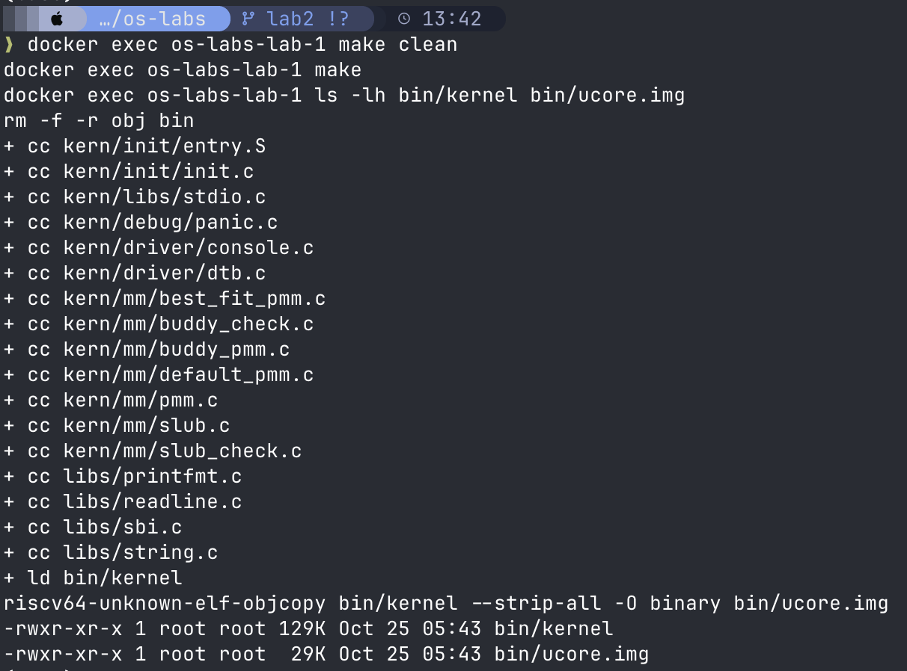
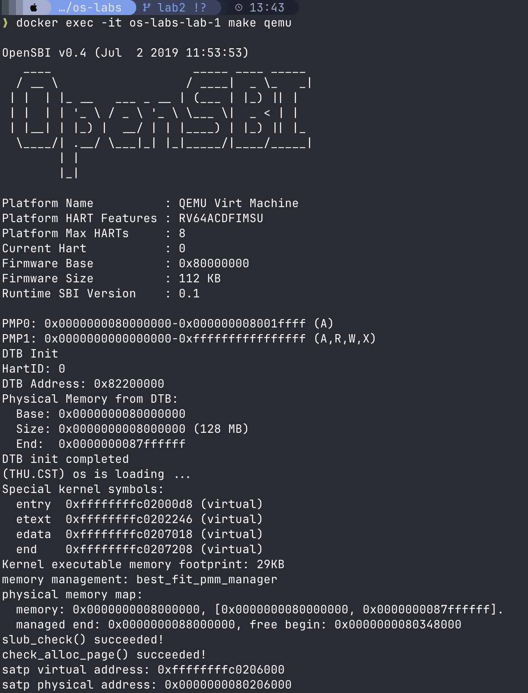
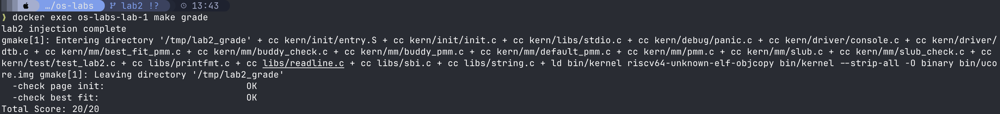
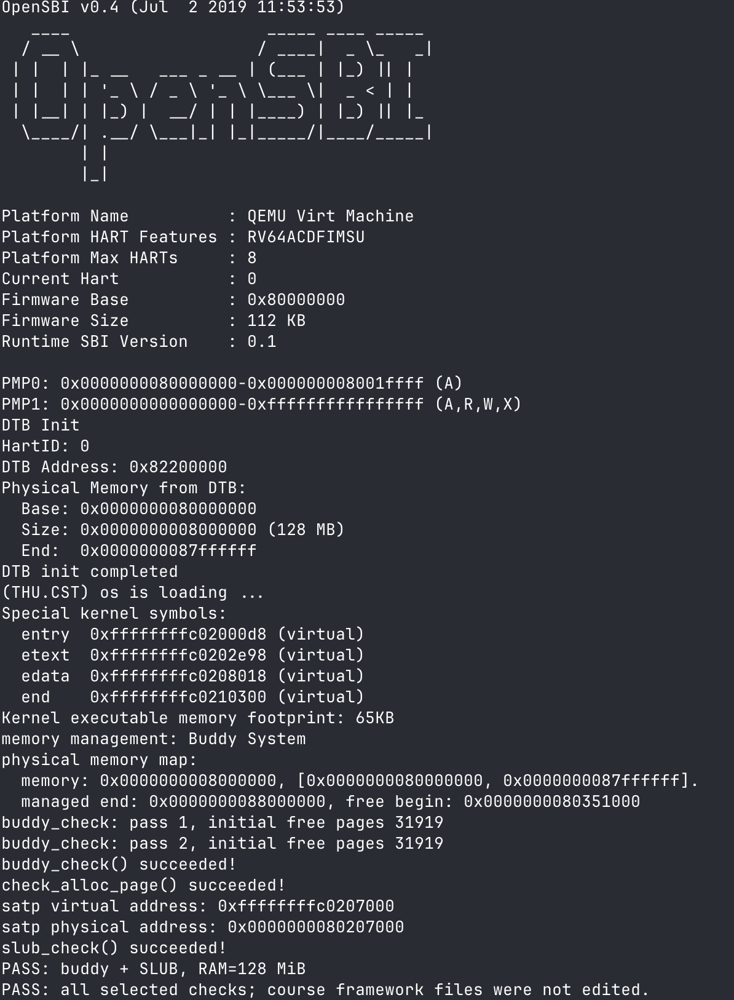
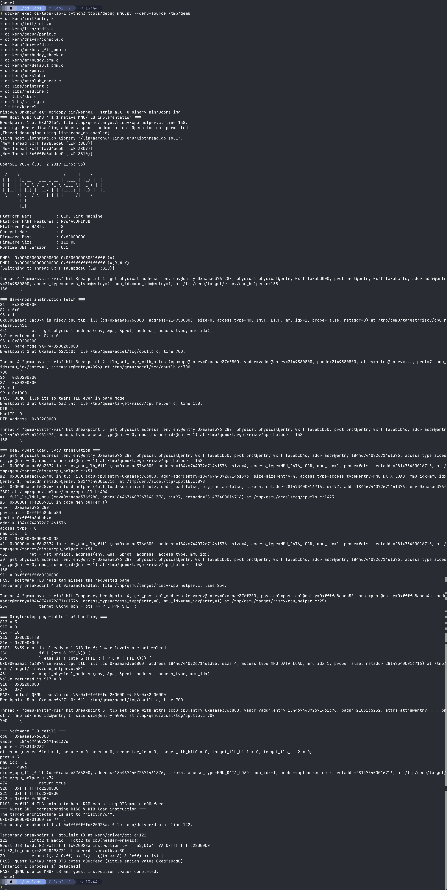

# 操作系统实验报告

## 实验基本信息

| 项目 | 内容 |
|------|------|
| 实验名称 | Lab 2：物理内存和页表 |
| 小组成员 | 2412439-崔迪、2412819-李子谦、2412852-梁靖泽 |
| 完成日期 | 2026-10-25 |

### 小组分工

| 成员 | 实验任务 | 报告内容 |
|------|----------|----------|
| 2412439-崔迪 | 物理内存初始化、SLUB 公共检查接入、GDB 页表与 TLB 调试、集成验证 | 实验目的与环境、整体逻辑、初始化与调试分析、测试结果及报告整合 |
| 2412819-李子谦 | First-Fit 分析、Best-Fit 实现、Buddy 实现及独立测试 | 页分配算法的规格、提示词、实现过程、测试分析与思考题 |
| 2412852-梁靖泽 | SLUB 对象分配及独立测试 | 对象分配的规格、提示词、问题修正、测试分析与实验总结 |

## 一、实验目的

1. 理解从硬件内存描述到物理页管理的初始化过程，掌握页描述符、保留区和空闲区的组织方法。
2. 理解连续物理页分配策略，实现 Best-Fit 和 Buddy System，分析分配、拆分、回收与合并的正确性条件。
3. 在页分配器之上实现 SLUB 对象分配，理解页级管理与对象级管理的关系。
4. 通过 GDB 和 QEMU 源码跟踪 Sv39 地址翻译及软件 TLB 的查询、未命中和填充过程。
5. 学习依据真实接口编写功能规格和提示词，并通过独立测试验证 AI 辅助生成的内核代码。

## 二、实验环境

### 2.1 开发与运行环境

| 成员 | 宿主机与 Linux 环境 | RISC-V GCC / binutils | QEMU / GDB |
|------|---------------------|----------------------|------------|
| 崔迪 | macOS ARM64；Docker Ubuntu 22.04 / aarch64 | 10.2.0 / 2.35.1 | 4.1.1 / gdb-multiarch 12.1 |
| 李子谦 | Windows WSL2；Ubuntu 24.04.4 LTS / x86_64 | 10.2.0 / 2.35 | 4.1.1 / riscv64-unknown-elf-gdb 10.1 |
| 梁靖泽 | Windows WSL2；Ubuntu 22.04 / x86_64 | 15.1.0 / 2.45 | 4.1.1 / riscv64-unknown-elf-gdb 16.3.90.20250610-git |

本实验内核的虚拟链接基址为 `0xffffffffc0200000`，镜像加载物理地址为 `0x80200000`，页大小为 4096 字节。

### 2.2 AI 编程工具

| 成员 | AI 编程工具 | 底层模型 | 
|------|-------------|----------|
| 崔迪 | Claude Code | deepseek-v4-flash | 
| 李子谦 | Claude Code | deepseek-v4-flash  |
| 梁靖泽 | Claude Code | deepseek-v4-flash  |

## 三、实验整体逻辑分析

### 3.1 本章节的逻辑主线

本实验围绕物理内存的发现、登记、分配和回收展开。启动汇编建立初始页表并开启 Sv39，使内核能够在虚拟地址空间中运行。DTB 解析提供 RAM 的基址和容量，`page_init()` 据此安排 `Page` 描述符，排除固件、内核和管理元数据占用的区域，再将完整空闲页交给物理页分配器。

`pmm_manager` 通过统一接口封装不同的页分配算法。First-Fit 与 Best-Fit 使用连续空闲块链表，区别在于候选块的选择策略；Buddy 按阶组织空闲块，通过拆分和伙伴合并管理连续页。SLUB 位于这些页分配器之上，将页面进一步划分为不同大小的对象，并在对象全部释放后归还页面。

### 3.2 功能的逐步实现

1. **建立启动映射并读取硬件信息。** `entry.S` 保存启动参数并设置 SATP，C 入口清理 `.bss`、解析 DTB，为后续内存管理提供地址映射与 RAM 范围。
2. **完成物理页初始化。** `pmm_init()` 初始化管理器，`page_init()` 建立描述符、保留占用页，并通过 `init_memmap()` 登记空闲区。只有此步骤完成后，分配器才有可用页面。
3. **实现连续物理页分配。** 通过 `alloc_pages()`、`free_pages()` 和 `nr_free_pages()` 验证 Best-Fit 与 Buddy 的分配、回收和资源守恒。
4. **实现对象分配。** SLUB 使用上述页面接口建立对象缓存，验证页内切分、对象复用和页面回收。
5. **验证地址翻译与整体行为。** 通过内核 GDB 检查页状态，通过宿主机 GDB 跟踪 QEMU 中真实访存的页表解析和 TLB 填充，再运行课程评分及组合测试。

## 四、实验内容与实现

本章按照实验练习顺序组织。功能模块依次给出模块功能描述、最终提示词、实际实现迭代及验证结论；思考题与 Challenge 分别给出分析和解答。

### 4.1 功能模块：物理内存探测与页描述符初始化

**负责人：** 2412439-崔迪。

#### 模块功能描述

**实现文件：** `code/kern/mm/pmm.c` 的 `page_init()` 实验填空及指定管理器选择。

**需要实现/修改的函数：**

```c
static void page_init(void);
static void init_pmm_manager(void);
```

`page_init()` 的输入为 DTB 解析结果和内核链接符号，输出为虚实地址偏移、物理页号上界 `npage`、描述符数组 `pages` 以及登记到分配器的空闲区。实现遵循以下约束：

1. 通过 `get_memory_base()`、`get_memory_size()` 取得 RAM 范围，拒绝零地址、零长度及范围加法溢出。
2. 将可管理末端限制在 `PHYSICAL_MEMORY_END` 内并向下按页对齐，检查 RAM 是否覆盖内核起点和末端。
3. 将链接器虚拟地址 `end` 向上按页对齐，得到描述符数组起点，再通过 `PADDR()` 转换为物理地址，检查数组能否完整放入可管理内存。
4. 初始化所有描述符为保留状态，引用计数和块长度清零，链表节点自指。数组元素 `pages[i]` 对应物理页号 `nbase + i`，描述符数量为 `npage - nbase`。
5. 将描述符数组末端向上对齐，得到空闲起点。仅当空闲起点小于管理末端时调用 `init_memmap()`；固件、内核、描述符和不足一页的尾部均不进入空闲区。

`npage` 是物理页号的排他上界，不能直接作为描述符数量。先统一保留、再登记空闲区的方式，使内核及管理结构占用的页面不会被提前分配。

<a id="initialization-prompt"></a>

#### 最终提示词

````text
[PROMPT]
**任务**：补全 code/kern/mm/pmm.c 中的物理内存初始化功能，根据设备树提供的 RAM 信息建立页描述符布局，排除已有占用，将完整空闲页面交给当前物理内存管理器。
**操作要求**：必须修改工程中的实际文件，只补充 page_init() 的实验标记位置；init_pmm_manager() 仅按实验要求选择 best_fit_pmm_manager。保留 lab2 标记，将本人填空位置的 YOUR CODE 替换为 2412439。不得改动入口汇编、DTB 解析、公共头文件、pmm_init()、Makefile 或课程测试。
**输出要求**：依据以下真实接口和行为规格完成实现，说明实际修改范围、边界处理和验证结果；未执行的检查应明确注明。

[RELY]
code/kern/driver/dtb.h 已提供：
```c
uint64_t get_memory_base(void);
uint64_t get_memory_size(void);
```
code/kern/mm/memlayout.h 中的真实描述符布局为：
```c
struct Page {
    int ref;
    uint64_t flags;
    unsigned int property;
    list_entry_t page_link;
};
```
现有宏定义：
```c
#define PGSIZE 4096
#define PGSHIFT 12
#define DRAM_BASE 0x80000000
#define KERNEL_BEGIN_PADDR 0x80200000
#define PHYSICAL_MEMORY_END 0x88000000
#define PHYSICAL_MEMORY_OFFSET 0xFFFFFFFF40000000
```
pmm.c 已有 pages、npage、nbase、va_pa_offset；其中 nbase = DRAM_BASE / PGSIZE，pages[i] 对应物理页号 nbase + i。链接器符号 end[] 是内核末端的虚拟地址。PADDR() 使用 va_pa_offset 进行虚实转换，PPN() 提取页号，ROUNDUP()/ROUNDDOWN() 用于对齐。可调用现有 init_memmap(struct Page *base, size_t n)、pa2page()、页状态宏、set_page_ref()、list_init() 和 panic()；这些依赖均保持原样。

[GUARANTEE]
必须补全或按限定范围修改：
```c
static void page_init(void);
static void init_pmm_manager(void);
```
允许在学生实现区域增加必要的局部变量或 static 辅助函数，不新增公共接口。

[SPECIFICATION]
## page_init
**Pre-Condition**：启动映射已建立，DTB 解析完成，当前 pmm_manager 已初始化但尚未接管空闲页；调用处于单核启动阶段。
**Post-Condition**：va_pa_offset 正确描述固定映射；npage 是可管理物理页号的排他上界；pages 指向有效描述符数组，数组包含 npage - nbase 个元素。固件、内核、描述符及其他未交付区间保持保留状态，分配器仅接管排除已有占用后的完整空闲页。
**Case 1**：RAM 范围合法且能够容纳内核和全部描述符时，描述符布局有效，引用计数等初始状态正确，空闲区间不与已用空间重叠。
**Case 2**：RAM 超出 PHYSICAL_MEMORY_END，或末端不是页边界时，仅管理框架范围内的完整页面，不登记被截断部分或不完整尾页。
**Case 3**：描述符可以完整放置，但其后不足一个完整空闲页时，不调用 init_memmap()，不将零长度区间交给分配器。
**Case 4**：RAM 基址或长度为零、范围加法溢出、未覆盖内核，或描述符无法放入管理范围时，通过 panic() 终止；在此之前不得越界写描述符或注册无效空闲区。
**Requirements**：区分虚拟地址、物理地址、物理页号和描述符指针；不能把 npage 直接作为数组元素数。对齐和地址转换不得引入溢出，使用 PADDR() 前必须满足其偏移前提。

## init_pmm_manager
**Pre-Condition**：Best-Fit 管理器已在工程中声明，尚未开始登记或分配页面。
**Post-Condition**：pmm_manager 指向 best_fit_pmm_manager，并按原流程初始化其状态。
**Requirements**：仅调整要求的管理器选择，保留原初始化顺序、输出和调用关系；不增加构建配置或切换分支。
````

#### 实现迭代过程

##### 第一次迭代：初始化功能实现

**实现内容：** 核对 DTB getter、地址转换宏、`Page` 布局和分配器接口，完成内存范围校验、描述符布局、占用页保留及空闲区登记。

**阶段结果：** 所覆盖的宿主机边界用例和真实 RISC-V 启动检查通过，未观察到初始化算法断言失败。

##### 第二次迭代：验证流程修正

**遇到的问题：** 容器缺少 Python 3、C 头文件和 `bc`；GDB 将最高位为 1 的 SATP 按有符号数解释，导致 MODE 判断错误；验证失败时临时文件过早清理，诊断输出未被保留。

**问题解决策略：** 补齐运行依赖；将 SATP 规范为 64 位无符号值后再提取字段；先保留并输出失败信息，再执行清理。

##### 第三次迭代：框架约束检查

**遇到的问题：** 早期独立验证依赖新增的构建配置，不符合保留课程框架的要求。

**问题解决策略：** 将 `Makefile` 恢复为课程原版，改在临时副本中选择 First-Fit，保留仓库默认 Best-Fit 配置及原初始化调用关系。

**最终结果：** 初始化边界用例、真实内核页状态检查及课程评分通过。

**关键改进点：** 明确物理页号上界与描述符数量的区别，完整核算描述符自身占用，并将算法验证与课程框架修改分离。

#### 测试与验证

宿主机测试编译真实 `page_init()` 函数体，仅模拟 DTB、控制台及空闲区注册接口，并替换链接器 `end` 声明。12 个用例全部通过，覆盖正常范围、未对齐末端、管理上限、无完整空闲页、零范围、加法溢出、未覆盖内核及描述符空间不足。

真实内核另在 64、128、256 MiB RAM 下完成启动与 First-Fit 自检。GDB 确认保留页和空闲数正确；128 MiB 的独立初始化配置中初始空闲页为 31929 页。该数值依赖内核及元数据布局，不与其他构建配置的空闲页数混用。完整记录见 [初始化与页表状态日志](logs/20261025-initialization.txt)。

### 4.2 练习：First-Fit 连续物理内存分配算法分析

**负责人：** 2412819-李子谦。

#### 练习内容

分析课程提供的 `code/kern/mm/default_pmm.c`，说明页面登记、分配、释放和合并的行为，并回答改进空间问题。
**涉及的已有函数：**

```c
static void default_init(void);
static void default_init_memmap(struct Page *base, size_t n);
static struct Page *default_alloc_pages(size_t n);
static void default_free_pages(struct Page *base, size_t n);
static size_t default_nr_free_pages(void);
```

<a id="first-fit-prompt"></a>

#### 最终提示词

````text
[PROMPT]
任务：阅读 code/kern/mm/default_pmm.c，更新 report/report.md 的 4.2 First-Fit 分析和改进思考题。
操作要求：只用 apply_patch 修改该章节，不修改代码、其他章节或其他文档；以当前源码为准，不从 Git 历史复制答案。
输出要求：说明初始化、分配、释放、合并和改进代价，不把课程已有实现算作本人新增代码。

[RELY]
真实 free_area_t 包含 list_entry_t free_list 和 unsigned int nr_free；Page 的 property 记录空闲块页数，PG_property 标记块首，page_link 连接空闲链。pmm.c 将公开页面操作转交当前管理器。参考 default_pmm.c、pmm.h、memlayout.h 和 libs/list.h。

[GUARANTEE]
完成本章对以下已有函数的分析，不重新实现：
```c
static void default_init(void);
static void default_init_memmap(struct Page *base, size_t n);
static struct Page *default_alloc_pages(size_t n);
static void default_free_pages(struct Page *base, size_t n);
static size_t default_nr_free_pages(void);
```

[SPECIFICATION]
## 流程分析
Pre-Condition：已经阅读真实实现，区间和调用满足各函数的合法输入约定。
Post-Condition：解释空链和计数初始化、页面登记的标记和引用状态、首个适配选择及余块拆分、地址有序释放和相邻合并，说明各步骤的计数变化。
Case：说明恰好匹配、需要拆分、连续空间不足和前后邻块可合并的不同情况；总空闲页足够不保证连续分配成功。
## 改进思考题
Pre-Condition：已明确当前地址有序链表策略。
Post-Condition：回答搜索和插入的复杂度，分析减少搜索成本、缓解外部碎片的可选方案及索引维护代价；不能认为 Best-Fit 总是优于 First-Fit。
````

#### 练习分析与问题回答

本节仅分析课程已经提供的 `default_pmm.c`，未重新实现或修改这些函数，不将其计入本人新增代码。`pmm.c` 的公开 `alloc_pages()`、`free_pages()` 和 `nr_free_pages()` 通过 `pmm_manager` 转发给当前管理器，因此只有选择 First-Fit 管理器时，公开接口才调用以下 `default_*` 实现。

**数据结构与有效状态。** `static free_area_t free_area` 包含链表头 `list_entry_t free_list` 和空闲页总数 `unsigned int nr_free`。链表按地址递增，仅把每个空闲块首个 `Page` 的 `page_link` 接入链中；块首的 `PG_property` 有效时，`property` 才表示该块连续空闲页数。空闲块长度之和等于 `nr_free`。`Page` 是页描述符而非物理页内容，连续描述符对应连续物理页；非块首页的 `PG_property` 为零，并不能据此断言它已经分配。

**初始化与页面登记。** `default_init()` 用 `list_init(&free_list)` 使双向循环链表头的前后指针都指向自身，并将 `nr_free` 设为零；这一步还没有登记物理页。`default_init_memmap(base, n)` 要求 `n > 0`、区间合法且未登记，逐页断言 `PageReserved(p)`，清零 `flags`、`property` 和引用计数。随后只在 `base` 设置 `property = n` 和 `PG_property`，把块首按地址插入链表，并使 `nr_free` 增加 `n`。当前登记函数没有相邻合并步骤，不能把释放路径的合并行为写成初始化时也会执行。

**首个适配分配。** `default_alloc_pages(n)` 先断言 `n > 0`；若 `n > nr_free`，直接返回 `NULL`。否则从链表头顺序查找，遇到首个 `property >= n` 的块即停止，因此选择的是低地址方向的首个适配块，而非最小适配块。找到后保存原节点的前驱并摘链：恰好匹配时不建立余块；块较大时，交付块首起的前 `n` 页，以 `page + n` 为新块首，令其长度为原长度减 `n`、设置 `PG_property`，再插回原前驱之后，保持地址有序。两种成功情况都只让 `nr_free` 减少 `n`，并清除交付块首的 `PG_property`；源码没有将交付页原有的 `property` 数值清零，也没有逐页重新设置引用，不能将残留数值误认为仍有效的空闲块长度。

若扫描完仍无合适块，则返回 `NULL`，链表、标记及计数均不改变。例如不相邻空闲块分别为 2 页和 3 页，虽然 `nr_free = 5`，申请 4 个连续页仍然失败。按地址排列的块长度为 8、5、12 页时，申请 4 页会从第一块 8 页中拆出 4 页，而不是选择后面的 5 页块。

**页面释放与相邻合并。** `default_free_pages(base, n)` 的前提是归还合法持有、尚未释放的连续 `n > 0` 页；源码逐页断言既非保留页也非空闲块首，清零 `flags` 和引用计数，再在 `base` 写入 `property = n`、设置 `PG_property`。这些断言不是完整的所有权或重复释放检测，合法调用仍由调用者保证。函数按地址插入新块，`nr_free` 只增加本次归还的 `n`，不会因合并再次增加。

插入后先检查前驱：若 `p + p->property == base`，则将本次块长度加到前驱，清除旧 `base` 的块首标记并摘链，再令 `base = p`。然后用更新后的块首检查后继：若 `base + base->property == p`，就累加后继长度、清除后继块首标记并摘链。由此覆盖不合并、只向前合并、只向后合并和同时连接前后块的情况。例如前块 2 页、本次归还 1 页、后块 3 页且三者物理连续时，最终保留一个 6 页块，但空闲计数只增加 1。地址有序使物理相邻块只能出现在链表邻居中，等式判断确保不会跨过占用页或保留区；合并不会搬移物理页。源码每侧只检查一个邻块，并非循环合并任意多个相邻登记块。

**空闲统计。** `default_nr_free_pages()` 直接返回 `nr_free`，单位是页而非字节，不扫描链表。初始化置零、登记和归还各增加 `n`、成功分配减少 `n`、合并不改变总数，共同维持计数准确。

**思考题：First-Fit 是否有进一步的改进空间？**

有，但需要区分搜索成本、碎片和实现维护成本。设空闲块数为 F，一次首个适配搜索和一次地址有序插入的最坏复杂度均为 O(F)；找到位置后的链表摘挂、余块拆分以及前后各一次合并均为 O(1)。考虑逐页状态处理，登记和释放整体为 O(n + F)，分配最坏为 O(F)，空闲计数查询为 O(1)。

- **减少重复扫描：** Next-Fit 从上次位置继续寻找，可能改善特定请求序列的平均搜索开销，但最坏仍为 O(F)，且会改变候选选择及碎片分布。新增游标还必须在摘链、拆分、合并和重置时同步维护，不能指向已失效节点。
- **建立索引：** 若必须保留按地址的 First-Fit 语义，可用按地址平衡树，并在子树保存最大块长度，将查找首个适配块和插入降为 O(log F)；代价是旋转、拆分、合并时同步更新树节点及最大长度。按大小分级的空闲链、大小有序树或非空桶位图也可加快容量定位，但通常会改变放置策略；为了快速寻找物理邻块，还需保留地址索引或增加边界元数据。拆分和合并必须同时维护各索引，并增加元数据空间，不能只计算查询的收益。单纯使用逐页位图也不保证任意长度连续段的查找变为常数时间。
- **缓解外部碎片：** 当前源码已经在释放时合并相邻块，这是课程已有机制，不是本人的新增优化；它不能把被占用页隔开的空闲块合起来。可以按请求大小和寿命调整放置策略，或采用伙伴系统以规则拆分、合并换取更简单的管理，但后者按阶取整可能引入内部碎片。Best-Fit 在上述 8、5、12 页例子中会选择 5 页块，眼前余块更小，却也可能积累难利用的小洞；线性链上的完整候选搜索仍为 O(F)，并不保证整体速度或长期碎片优于 First-Fit。

因此应结合请求分布测量扫描长度、最大连续块、失败率和元数据成本，再决定是否值得引入索引或改变策略。以上都是可选改进分析，本节未实际实现；放置策略只决定选择哪段空闲物理页，不改变页大小、物理连续性要求或虚拟地址翻译机制。

### 4.3 功能模块：Best-Fit 连续物理页分配

**负责人：** 2412819-李子谦。

#### 模块功能描述

**实现文件：** `code/kern/mm/best_fit_pmm.c`。原有 `best_fit_pmm.h` 已提供所需声明。

**需要实现/修改的函数与注册结构：**

```c
static void best_fit_init(void);
static void best_fit_init_memmap(struct Page *base, size_t n);
static struct Page *best_fit_alloc_pages(size_t n);
static void best_fit_free_pages(struct Page *base, size_t n);
static size_t best_fit_nr_free_pages(void);
const struct pmm_manager best_fit_pmm_manager;
```

**功能说明：**

Best-Fit 保留地址有序空闲链，以便在释放时检查前后邻块；分配时扫描候选块，选择能够满足请求的最小块，同大小时选择低地址块。

- 初始化与区间登记必须正确维护保留标记、引用计数、块长度和空闲计数。
- 成功分配仅交付请求的 n 页，余块重新登记；无合适连续块时返回 `NULL`，分配器状态保持不变。
- 释放支持课程测试使用的合法分段归还，只合并物理相邻的空闲块，不跨越占用页或保留区。
- 通过 `struct pmm_manager` 注册初始化、登记、分配、释放、计数和检查接口；课程原有 `basic_check()`、`best_fit_check()` 均保持不变。

公共检查通过学生新增的 `static void best_fit_and_slub_check(void)` 组合原 Best-Fit 检查与 SLUB 自检，该接入由崔迪完成，原测试函数不变。

<a id="best-fit-prompt"></a>

#### 最终提示词

````text
[PROMPT]
任务：从 lab2 初始框架补全 code/kern/mm/best_fit_pmm.c 的 Best-Fit 分配器。
操作要求：用 apply_patch 修改这个真实文件；保留 lab2，填入学号 2412819。不得修改 basic_check()、best_fit_check()、组长的 best_fit_and_slub_check()、公共文件或他人模块。不从 Git 历史复制旧实现，不运行构建、提交或新增其他文件。
输出要求：按下面真实接口和规格完成代码，说明设计、实际改动与未验证项。

[RELY]
阅读 default_pmm.c、pmm.h、memlayout.h、libs/list.h。真实定义为：
```c
struct Page { int ref; uint64_t flags; unsigned int property; list_entry_t page_link; };
typedef struct { list_entry_t free_list; unsigned int nr_free; } free_area_t;
```
可用页标记宏、set_page_ref、le2page 和链表接口。连续描述符对应连续物理页。原测试直接保存和恢复 free_list/nr_free，并合法分段归还页面；组长已提供 Best-Fit 与 SLUB 的组合检查函数。

[GUARANTEE]
```c
static void best_fit_init(void);
static void best_fit_init_memmap(struct Page *base, size_t n);
static struct Page *best_fit_alloc_pages(size_t n);
static void best_fit_free_pages(struct Page *base, size_t n);
static size_t best_fit_nr_free_pages(void);
const struct pmm_manager best_fit_pmm_manager;
```
内部辅助函数和状态设为 static；管理器名称为 best_fit_pmm_manager，check 指向保留的 best_fit_and_slub_check。

[SPECIFICATION]
## best_fit_init
Pre-Condition：尚无活动分配。
Post-Condition：空闲链为空，空闲数为零。
## best_fit_init_memmap
Pre-Condition：n>0，区间合法、保留且未登记。
Post-Condition：全部 n 页进入空闲集合，引用归零，计数增加 n，区间外页面不变。
## best_fit_alloc_pages
Pre-Condition：已初始化，n>0，串行调用。
Post-Condition：选择最小可容纳块，同大小选低地址；交付恰好 n 页，余块可继续分配。无合适块返回 NULL，状态不变。
## best_fit_free_pages
Pre-Condition：归还合法持有的 n>0 个连续页，支持合法分段归还，不重复释放。
Post-Condition：计数增加 n，与前后物理相邻空闲块合并，不跨越占用页或保留区。
## best_fit_nr_free_pages / 注册
Pre-Condition：管理器已初始化。
Post-Condition：空闲计数准确，接口注册完整，兼容原测试状态保存与恢复，保留 SLUB 组合检查。
````

#### 实现迭代过程

##### 第一次迭代：从初始框架重新生成

**实现内容：** 2026-10-25 先移除本人原有 Best-Fit 实现，保留 lab2.zip 的两个课程测试和组长的 SLUB 组合回调；将上面的提示词实际发送给子 agent，由其重新生成管理函数及注册结构，不从 Git 历史复制旧实现。

**需要满足的约束：** 保留原测试的状态保存、恢复及合法分段释放约定。初始化只登记当前传入区间；释放按地址插入并循环合并物理相邻块。管理器检查仍连接组长的组合回调，未改 Makefile、pmm.c 或其他成员代码。

##### 编译与运行验证

由主 agent 在隔离副本中统一编译，运行课程评分和不同 RAM 下的 Best-Fit、SLUB 组合检查；当前版本的命令和输出见 [测试记录](logs/2412819-tests.txt)，结果见第五章。

**最终结果：** 本轮重新生成后编译通过，四种 RAM 的 Best-Fit 与 SLUB 组合检查通过，课程 page init、best fit 均 OK，总分 **20/20**。未修改原课程测试，未发生需要再次修改 Best-Fit 实现的运行失败。

**关键改进点：** 提示词明确要求从初始学生区域实现，而不是检查已有代码；地址有序链负责合并，完整扫描负责最小适配，相同大小时选低地址。

#### 问题回答

**思考题：Best-Fit 是否有进一步的改进空间？**

当前最小适配查找仍为 O(F)。可按块大小建立平衡树、分级链表或位图索引，但需要同时维护地址邻接信息以支持回收合并。Best-Fit 最小化的是单次分配余量，并不保证全局外部碎片最少；较小余块能否再次利用取决于后续请求分布。

### 4.4 功能模块：Buddy System 伙伴分配器

**负责人：** 2412819-李子谦。

#### 模块功能描述

**实现文件：** `code/kern/mm/buddy_pmm.c`、`buddy_pmm.h`；独立测试位于 `buddy_check.c`。

**需要实现的函数与注册结构：**

```c
static void buddy_init(void);
static void buddy_init_memmap(struct Page *base, size_t n);
static struct Page *buddy_alloc_pages(size_t n);
static void buddy_free_pages(struct Page *base, size_t n);
static size_t buddy_nr_free_pages(void);
const struct pmm_manager buddy_pmm_manager;
void buddy_check(void);
```

**功能说明：**

Buddy 维护 0–15 阶空闲链，覆盖当前框架最多 128 MiB 的管理窗口。登记空闲区间时，依据物理页号对齐将区间拆成若干 2 的幂块，保证未对齐起点和非 2 次幂长度不会造成丢页。

分配 n 页时，将容量向上取整为最小的 2 次幂，从对应阶或更高阶取得空闲块并逐级拆分，空闲计数扣除实际容量。释放时依据调用者传回的原请求重新计算容量；例如申请 3 页实际占用 4 页，释放仍传 3，完整归还 4 页。本轮实现不另存原请求，调用者必须遵守整块配对释放的前置条件，不保证识别所有错误的释放参数。

伙伴关系依据物理页号与块容量异或确定。仅同阶、空闲且属于管理范围内的真正伙伴能够合并，不能仅凭地址相邻判断。释放必须使用原分配首指针和原始请求，不支持分段或重复释放；零请求、超范围请求和无法满足的请求返回 `NULL`，且不改变状态。

#### 最终提示词

以下记录本轮重新实现、独立测试和静态复核修正时实际发送给子 agent 的提示词。

<a id="buddy-implementation-prompt"></a>

##### 分配器实现提示词

````text
[PROMPT]
任务：从零创建 code/kern/mm/buddy_pmm.c、buddy_pmm.h，实现 Buddy 物理页分配器。
操作要求：用 apply_patch 创建真实文件，保留 lab2 和学号 2412819；不改 Page、pmm.c、Makefile、其他模块或测试，不从 Git 历史复制旧实现，不运行构建或提交。其他管理器由现有 tools/lab2_verify.py 在临时副本中接入。
输出要求：依据下面规格完成代码，说明取整容量、释放约定及未验证项。

[RELY]
阅读 pmm.h、memlayout.h、libs/list.h，真实结构为：
```c
struct Page { int ref; uint64_t flags; unsigned int property; list_entry_t page_link; };
```
PGSIZE=4096，pages[i] 对应物理页号 nbase+i，有效描述符数为 npage-nbase；当前物理管理窗口最多 128 MiB。可用页状态宏、page2ppn/page2pa、set_page_ref、链表接口，不使用 malloc。独立文件将提供 void buddy_check(void)。

[GUARANTEE]
```c
static void buddy_init(void);
static void buddy_init_memmap(struct Page *base, size_t n);
static struct Page *buddy_alloc_pages(size_t n);
static void buddy_free_pages(struct Page *base, size_t n);
static size_t buddy_nr_free_pages(void);
const struct pmm_manager buddy_pmm_manager;
```
头文件声明管理器和 buddy_check；check 指向 buddy_check，名称为 Buddy System；辅助函数和状态为 static。

[SPECIFICATION]
## buddy_init
Pre-Condition：首次使用，没有活动分配。
Post-Condition：各阶空闲集合为空，计数为零。
## buddy_init_memmap
Pre-Condition：n>0，区间合法、保留且未登记；多次登记不重叠。
Post-Condition：全部 n 页可管理，引用归零，计数增加 n；未对齐起点、非 2 次幂长度不丢页，不纳入区间外或保留页。
## buddy_alloc_pages
Pre-Condition：已初始化，单核串行调用。
Post-Condition：成功返回不小于 n 的最小 2 次幂容量，物理页号按容量对齐，与活动块不重叠，扣除实际容量。
Case：零请求、超范围、取整溢出、页面不足或无合适连续块时返回 NULL，状态不变。
## buddy_free_pages
Pre-Condition：传回原首指针及原始请求 n，分配仍有效；不支持子段或重复释放。
Post-Condition：完整归还实际容量，仅与同阶空闲的真正伙伴逐级合并，不影响其他分配。申请 3 页占用 4 页，释放传 3，回收 4 页。
Requirements：按实际物理页号判断伙伴，不能把仅相邻的块误合并；不承诺安全识别任意野指针。
## buddy_nr_free_pages / 注册
Pre-Condition：已初始化。
Post-Condition：空闲计数准确，管理器和头文件接口完整，支持独立测试及当前管理窗口。
````

<a id="buddy-test-prompt"></a>

##### 独立测试提示词

````text
[PROMPT]
任务：从零创建 code/kern/mm/buddy_check.c，独立验证 Buddy 分配器。
操作要求：用 apply_patch 创建真实文件，保留 lab2 和学号 2412819；只改这个文件。不读 buddy_pmm.c 的私有实现，不改算法、框架或课程测试，不从 Git 历史复制旧测试，不运行构建或提交。
输出要求：说明覆盖的行为、为何有效、实际改动和测试局限，不把未执行的检查写成已通过。

[RELY]
真实公开接口来自 pmm.h、buddy_pmm.h：
```c
struct Page *alloc_pages(size_t n);
void free_pages(struct Page *base, size_t n);
size_t nr_free_pages(void);
extern const struct pmm_manager buddy_pmm_manager;
```
可用 pages、npage、nbase、pmm_manager、PageReserved、page2ppn/page2pa、va_pa_offset、assert、cprintf。PGSIZE=4096，内核栈 8 KiB。Buddy 按最小 2 次幂容量分配，释放用原首指针和原请求；失败返回 NULL 且状态不变。

[GUARANTEE]
```c
void buddy_check(void);
```
辅助函数设为 static，大记录数组放静态存储，不新增日志或工具。

[SPECIFICATION]
## buddy_check
Pre-Condition：当前管理器是 Buddy，初始化后无其他活动分配，单核串行；标准启动空闲区至少 64 页，并存在 16 页对齐的连续区域。
Post-Condition：所有测试分配配对释放，空闲页数恢复、保留状态不变；完整重复两轮且所有断言通过后才输出 buddy_check() succeeded!。
Case 1：验证 1/2/3/4/5/8/9 页请求的取整容量、物理对齐、描述符范围和完整占用区间互不重叠。
Case 2：在每页首部、中部、末尾写标记，后续分配及释放后复查存活数据，检查误覆盖。
Case 3：检查零请求、超大请求、耗尽及碎片导致的失败，确认空闲计数和存活内容不变。
Case 4：检查真正伙伴合并、相邻非伙伴不误合并、多阶合并后再次拆分，以及非 2 次幂请求按原请求释放。
Requirements：只检查公开行为，不读取私有链表、阶数编码或私有计数；根据实际物理地址识别伙伴，不假设申请顺序决定相邻，不重置分配器掩盖泄漏。
````

##### 测试修正提示词

````text
[PROMPT]
任务：修正 code/kern/mm/buddy_check.c 的描述符记录数组上限。
操作要求：仅用 apply_patch 修改这个文件，不修改算法、其他文件或测试断言，不运行构建或提交。
输出要求：说明上限计算为何错误、实际修正及未验证项；每轮打印轮次与初始空闲页数，最终成功标记保持不变。

[RELY]
KMEMSIZE=0x7e00000，只描述内核映射窗口；PHYSICAL_MEMORY_END=0x88000000，DRAM_BASE=0x80000000，PGSIZE=4096。描述符数量 npage-nbase 包括前 2 MiB 的保留页，所以 128 MiB 配置有 32768 个描述符，而 KMEMSIZE/PGSIZE 只有 32256。

[GUARANTEE]
保留 void buddy_check(void)，修正私有 BUDDY_CHECK_MAX_PAGES 及对应静态记录数组的容量。

[SPECIFICATION]
## buddy_check 的容量与输出
Pre-Condition：标准启动、描述符覆盖当前物理管理窗口，保留页也必须记录。
Post-Condition：静态记录能容纳 (PHYSICAL_MEMORY_END-DRAM_BASE)/PGSIZE 个描述符，不截断、不跳过保留状态检查；完整两轮通过后才输出成功，每轮输出轮次和初始空闲页数。
````

#### 实现迭代过程

##### 第一次迭代：分别生成分配器与独立测试

**实现内容：** 删除原有 Buddy 实现、头文件和独立测试后，将两份提示词分别交给不同子 agent 从零创建。实现 agent 只负责分配器和头文件，测试 agent 不读取分配器私有实现；主 agent 使用组长已有的临时副本验证工具接入，不增加构建切换选项。

##### 第二次迭代：修正静态记录数组上限

**遇到的问题：** 主 agent 在构建前静态复核发现，测试以 KMEMSIZE/PGSIZE 作为描述符记录容量，只能覆盖 32256 项；而 128 MiB RAM 的描述符包含前 2 MiB 保留区，共有 32768 项，原上限不足。

**问题解决策略：** 实际发送上面的测试修正提示词，改用 (PHYSICAL_MEMORY_END-DRAM_BASE)/PGSIZE 计算上限。保留完整描述符和保留状态检查，没有截断数组范围或放宽断言；32 KiB 主记录数组使用静态存储，不占内核栈。每轮输出轮次与初始空闲页数。

**验证方式：** 修正后由主 agent 统一编译，运行四种 RAM 下的两轮 Buddy 自检及 SLUB 组合检查，结果见第五章和 [测试记录](logs/2412819-tests.txt)。

**最终结果：** 64、70、128、256 MiB 配置均完成两轮 Buddy 自检及 SLUB 检查，空闲计数恢复，验证命令正常返回；本轮发现的问题是上述静态容量上限错误，修正后未发生运行时断言失败。

**关键改进点：** 区分内核映射窗口与物理描述符覆盖范围；按实际物理页号判断伙伴，按公开接口检查容量、存活内容及资源恢复。

#### 测试覆盖与结果分析

| 核心行为或边界 | 测试方法及检验作用 |
|----------------|--------------------|
| 容量取整、对齐与互斥 | 申请 1/2/3/4/5/8/9 页，核对实际容量、物理对齐及整个分配区间是否重叠 |
| 内容保持 | 在各页首部、中部和末尾写入标记，后续分配与释放后检查存活块，发现误覆盖或误释放 |
| 分配失败 | 检查零请求、超大请求、耗尽及碎片场景，确认失败不改变空闲计数及存活数据 |
| 伙伴合并与再拆分 | 依据实际物理地址识别伙伴，检查真正伙伴合并、相邻非伙伴不误合并及多阶合并后再分配 |
| 释放配对与资源恢复 | 使用原请求释放非 2 次幂分配，按不同顺序释放，并重复运行整套检查 |

2026-10-25 在 WSL2 中对本轮重新生成版本的实际组合结果如下，完整输出见 [李子谦测试记录](logs/2412819-tests.txt)：

| QEMU RAM | Buddy 初始空闲页数 | 结果 |
|----------|--------------------|------|
| 64 MiB | 15695 | 两轮 Buddy 自检及 SLUB 检查通过 |
| 70 MiB | 17216 | 两轮 Buddy 自检及 SLUB 检查通过 |
| 128 MiB | 31919 | 两轮 Buddy 自检及 SLUB 检查通过 |
| 256 MiB | 31919 | 两轮 Buddy 自检及 SLUB 检查通过，管理末端仍为 `0x88000000` |

测试通过公开接口检查资源守恒和可观察行为，不读取私有链表或阶数编码。当前验证未覆盖并发、非法释放、全部高阶组合及每页全部字节。
### 4.5 功能模块：SLUB 内存对象分配

**实现负责人：** 2412852-梁靖泽；**公共检查接入与复验：** 2412439-崔迪。

#### 模块功能描述

**实现文件：** `code/kern/mm/slub.c`、`slub.h`；独立测试位于 `slub_check.c`。

**需要实现的函数：**

```c
int slub_init(void);
void slub_shutdown(void);
void *slub_alloc(size_t size);
int slub_free(void *object);
size_t slub_nr_slabs(void);
size_t slub_nr_live_objects(void);
int slub_check(void);
```

SLUB 使用物理页分配器提供的页面组织对象。小对象采用 8、16、32、64、128、256、512、1024、2048 字节九个缓存，按请求大小向上选择最近的缓存。每个 slab 通过 `alloc_pages(1)` 取得一页，页首保存管理信息，其余空间组织固定大小槽位；对象头记录所属 slab、状态及空闲链信息。

超过 2048 字节的对象通过独立连续页路径分配，页头记录释放所需信息，并与用户可写范围隔离。空 slab 立即归还底层页面；`slub_shutdown()` 回收仍持有的缓存页和大对象页，清空统计并退出初始化状态。

分配失败返回 `NULL`，释放状态使用 `SLUB_OK`、`SLUB_ERR_INVALID`、`SLUB_ERR_DOUBLE_FREE` 和 `SLUB_ERR_UNINITIALIZED`。`slub_free(NULL)` 为空操作。实现面向单核串行环境，不保证安全识别任意无效指针。

#### 最终提示词

对象分配器与独立测试分别使用以下两份提示词。

<a id="slub-implementation-prompt"></a>

##### 对象分配器实现提示词

````text
[PROMPT]
**任务**：在 code/kern/mm/slub.c、slub.h 中实现页分配器之上的 SLUB 对象管理，支持不同大小对象的分配、释放、统计和整体关闭。
**操作要求**：必须修改两个实际文件，只实现本模块接口和内部辅助函数；不修改 Page、pmm.c、init.c、Makefile、课程测试或 slub_check.c，不使用 libc malloc()/free()。保留 lab2 和 2412852 标记。
**输出要求**：使用以下真实依赖实现模块，说明对象与页面的生命周期、错误处理和实际验证结果。

[RELY]
pmm.h 已提供：
```c
struct Page *alloc_pages(size_t n);
void free_pages(struct Page *base, size_t n);
size_t nr_free_pages(void);
extern uint64_t va_pa_offset;
```
PGSIZE=4096；page2pa() 将 Page 描述符转成物理地址，page2pa(page)+va_pa_offset 为对应内核虚拟地址。可使用 libs/list.h、string.h 的已有接口，不访问具体页分配器的私有状态。Buddy 可能保留向上取整的页容量，释放时必须传回底层申请的原始页数。
slub.h 的现有状态码为：
```c
#define SLUB_OK 0
#define SLUB_ERR_INVALID -1
#define SLUB_ERR_DOUBLE_FREE -2
#define SLUB_ERR_UNINITIALIZED -3
```

[GUARANTEE]
必须实现并在 slub.h 保持一致声明：
```c
int slub_init(void);
void slub_shutdown(void);
void *slub_alloc(size_t size);
int slub_free(void *object);
size_t slub_nr_slabs(void);
size_t slub_nr_live_objects(void);
```
保留现有 int slub_check(void) 声明，测试实现由独立任务负责。允许内部 static 类型、状态和辅助函数，不新增公共分配接口。

[SPECIFICATION]
## slub_init
**Pre-Condition**：底层页面接口可用，处于单核串行环境。
**Post-Condition**：模块进入可分配状态；首次初始化时对象、slab 和大对象跟踪状态为空。
**Case 1**：首次初始化返回 SLUB_OK，不遗留活动分配。
**Case 2**：已初始化时重复调用返回 SLUB_OK，不破坏存活对象及其统计。

## slub_alloc
**Pre-Condition**：参数表示所需可写字节数；正常分配要求模块已初始化。
**Post-Condition**：成功返回至少容纳 size 字节、按 8 字节对齐且与其他存活对象不重叠的地址，存活对象数增加一；失败返回 NULL，状态与资源占用不产生泄漏。
**Case 1**：未初始化或 size 为零时返回 NULL，不改变状态。
**Case 2**：1 至 2048 字节请求使用 8/16/32/64/128/256/512/1024/2048 字节缓存中最小可容纳档位；同类对象可以共享 slab 页面。
**Case 3**：超过 2048 字节的对象获得足够的连续页面，保存完整回收所需信息，用户可写范围不能覆盖管理元数据。
**Case 4**：底层页面不足，或头部大小、对齐与页数计算存在溢出时返回 NULL；不得登记不完整对象。

## slub_free
**Pre-Condition**：非空参数正常情况下必须是本模块返回且仍存活的原对象指针；不支持任意地址探测。
**Post-Condition**：有效释放后对象数减少一，存储可复用或页面被回收，其他存活对象不受影响。
**Case 1**：object 为 NULL 时作为空操作返回 SLUB_OK。
**Case 2**：有效小对象释放成功；所属 slab 全空时归还页面。对尚未被回收、重用的缓存对象重复释放时返回 SLUB_ERR_DOUBLE_FREE，不破坏空闲链和统计。
**Case 3**：有效大对象释放时，将其底层页面按原申请页数完整归还。
**Case 4**：未初始化时非空释放返回 SLUB_ERR_UNINITIALIZED；可辨认的非法对象状态返回 SLUB_ERR_INVALID，不将其错误计为成功释放。
**Requirements**：不承诺检测已归还或重新分配内存上的任意悬空指针，错误返回不能破坏现有存活对象。

## slub_shutdown
**Pre-Condition**：底层分配器仍可用，关闭后调用者不再访问原对象。
**Post-Condition**：归还本模块持有的全部缓存页和大对象页，计数归零并回到未初始化状态；之后可重新初始化。
**Case 1**：存在存活小对象或大对象时，仍完成全部页面回收。
**Case 2**：未初始化时重复关闭为空操作。

## slub_nr_slabs / slub_nr_live_objects
**Pre-Condition**：无额外前置条件。
**Post-Condition**：分别返回当前缓存 slab 数与全部存活对象数；大对象计入对象数，不将其页数混作缓存 slab 数。回收和关闭后的统计与实际状态一致。
**Requirements**：本实验不要求 NUMA、per-CPU 缓存或并发锁；元数据必须与用户可写范围隔离，底层页分配和释放严格配对。
````

<a id="slub-test-prompt"></a>

##### 独立测试提示词

````text
[PROMPT]
**任务**：在 code/kern/mm/slub_check.c 中实现独立对象分配自检，检验尺寸边界、内容保持、复用、错误处理和页面回收。
**操作要求**：必须修改实际自检文件，只通过公开接口观察行为，不修改 slub.c、页分配器、公共启动文件、Makefile 或课程测试。现有学生组合检查入口和临时副本验证工具负责调用自检，不另改框架接入。
**输出要求**：说明覆盖场景及其检验作用，提供实际构建与运行结果；不得把编译通过、外部超时或单一成功字符串作为全部测试正确的依据。

[RELY]
slub.h 提供以下真实接口和 SLUB_OK、SLUB_ERR_DOUBLE_FREE 等状态码：
```c
int slub_init(void);
void slub_shutdown(void);
void *slub_alloc(size_t size);
int slub_free(void *object);
size_t slub_nr_slabs(void);
size_t slub_nr_live_objects(void);
```
pmm.h 提供 size_t nr_free_pages(void)，PGSIZE=4096；可使用 assert()、cprintf() 和 memset()。slab 全空会回收底层页；shutdown 也回收尚存活对象的页面，之后原指针失效。

[GUARANTEE]
必须实现：
```c
int slub_check(void);
```
允许添加本文件 static 辅助函数，不依赖 SLUB 私有结构或私有统计变量。

[SPECIFICATION]
## slub_check
**Pre-Condition**：物理页分配器可用，SLUB 无其他调用者的活动对象，空闲页足以运行测试；无并发代码改变观察到的计数。
**Post-Condition**：测试分配全部回收，存活对象和 slab 数为零，底层空闲页数恢复初值，模块能够在 shutdown 后重新初始化；成功返回 SLUB_OK 并输出 slub_check() succeeded!。
**Case 1**：零尺寸返回 NULL，释放 NULL 返回 SLUB_OK，相关统计不变。
**Case 2**：检查 1、7、8、15、24、63、64、127、128、255、256、511、512、1024、2048、2049 字节请求；每个成功对象的完整请求范围可写可读，存活对象不重叠。
**Case 3**：交错释放不同尺寸对象后，存活对象内容保持；同一缓存再次分配可正常使用，全部释放后 slab 可回收，统计归零。
**Case 4**：让同缓存另一个对象保持存活，使被释放对象的 slab 仍受模块管理，再次释放原对象应返回 SLUB_ERR_DOUBLE_FREE；随后其他对象仍可正常释放。
**Case 5**：分配超过两页的对象，写入并读回整个请求范围后释放，确认大对象页面完整回收。
**Case 6**：同时保留小对象和大对象后执行 shutdown，确认统计清零、未初始化时分配失败；重新初始化成功，最终空闲页数与测试开始一致。
**Requirements**：不能访问 shutdown 后的旧对象，不能通过修改分配器、重置底层计数或删除断言掩盖错误。测试应能在 First-Fit、Best-Fit 和 Buddy 后端下复用，按各后端公开契约使用页面。
````

#### 实现迭代过程

##### 第一次迭代：缓存与大对象路径实现

**实现内容：** 建立固定尺寸缓存、连续页大对象路径和自检接口。

**阶段结果：** 编译通过，随后进入对象内容读写及回收验证。

##### 第二次迭代：管理元数据修正

**遇到的问题：** 大对象用户数据写入覆盖了释放所需的链表元数据，说明可写范围与管理信息未被正确隔离。

**问题解决策略：** 使用固定公共对象头和独立大对象记录，明确用户区域与元数据边界，并重新执行完整请求范围的读写和释放检查。

##### 第三次迭代：大对象记录扩展与集成验证

**遇到的问题：** 固定数量的大对象记录限制了同时存活的大对象数量。

**问题解决策略：** 改用每个大对象页头自带链表节点；默认内核通过学生组合检查回调，在原 `best_fit_check()` 后执行 `slub_check()`，不修改课程启动流程。

**最终结果：** 三种页分配器与四种 RAM 的 12 组组合检查均通过；测试结束时存活对象数和 slab 数为零，空闲页数恢复初值。

**关键改进点：** 隔离元数据与用户数据，明确大小对象的回收配对关系，并以底层空闲页数验证页面归还。

#### 测试覆盖与有效性

测试覆盖零尺寸分配和空指针释放，以及 1、7、8、15、24、63、64、127、128、255、256、511、512、1024、2048、2049 字节请求。每个对象写入并读回完整请求范围，同时检查存活对象互不重叠，用于发现槽位选择、边界计算和元数据覆盖错误。

部分释放与再次分配检查对象复用；重复释放检查错误码及其他存活对象是否受影响；跨页大对象检查连续页路径。最后检查空 slab 回收，以及存在活跃小对象、大对象时的 shutdown 和重新初始化。自检结束时存活对象数和 slab 数均为零，`nr_free_pages()` 恢复初值，从而检验底层页面是否泄漏。

First-Fit、Best-Fit、Buddy 与 64/70/128/256 MiB RAM 的 12 组组合检查均通过。实现未覆盖 NUMA、per-CPU 缓存、并发锁及完整 Linux SLUB 的其他机制。

### 4.6 功能模块：GDB 页表与 TLB 调试

**负责人：** 2412439-崔迪。

#### 模块功能描述

**实现与记录文件：** `code/tools/debug_mmu.py` 及本报告的调试分析。

**需要实现/完善的函数：**

```python
def line_containing(path, needle): ...
def run(command, cwd): ...
def main(): ...
```

`line_containing()` 唯一定位源码锚点，`run()` 执行有时间边界的命令并保留输出，`main()` 组织宿主机及 guest 两次独立调试运行。模块用于观察真实 CPU 访存的 TLB 查询、PTE 解析、物理地址生成和缓存填充，并核对相应内核指令及数据；课程内核、QEMU 源码和启动框架不作修改。

<a id="qemu-mmu-prompt"></a>

#### 最终提示词

````text
[PROMPT]
**任务**：完善 code/tools/debug_mmu.py，通过宿主机 GDB 跟踪 QEMU 4.1.1 的真实访存翻译，并用 guest GDB 核对对应内核指令；将方法、调用链和实测结果记录到 report/report.md 的调试章节。
**操作要求**：必须操作实际工具和报告文件，不修改内核入口、DTB 代码、页表常量、Makefile、课程测试或 QEMU 源码。验证内核只在临时副本中生成，仓库默认 Best-Fit 配置保持不变。
**输出要求**：保存可追溯的断点、单步、调用栈和数值结果，说明 TLB 查询位置、页表关键分支、异常信息及其影响；环境不满足时明确说明，不填入预设的成功结果。

[RELY]
已有 tools/lab2_verify.py 提供 prepare_tree(source, destination, backend, slub_check=True)，可生成独立验证副本。debug_mmu.py 使用 Python argparse、pathlib、subprocess 和 tempfile，现有命令行参数为 --qemu-source、--gdb、--port。
目标为 QEMU 4.1.1 的带符号原生构建，相关源码位置：
- target/riscv/cpu_helper.c：get_physical_address、riscv_cpu_tlb_fill。
- accel/tcg/cputlb.c：load_helper、tlb_set_page_with_attrs。
- include/exec/cpu_ldst.h：tlb_index、tlb_entry。
课程内核使用 Sv39，镜像加载在 0x80200000。128 MiB virt 配置下可跟踪 DTB 所在页的真实加载；目标地址和断点必须依据本次源码、符号及寄存器确认，host 指针不能视为固定值。

[GUARANTEE]
必须保持并完善现有 Python 接口：
```python
def line_containing(path, needle): ...
def run(command, cwd): ...
def main(): ...
```
交付可运行的调试工具及主报告中的调用路径、翻译示例、TLB 对比和排查记录。允许新增文件内部辅助函数及 GDB 命令文本，不新增内核接口。

[SPECIFICATION]
## line_containing
**Pre-Condition**：path 指向目标版本源码，needle 为期望定位的源码锚点。
**Post-Condition**：仅在匹配唯一时返回包含文件路径和行号的位置，避免对错误版本或歧义源码设置断点。
**Case 1**：唯一匹配时返回正确位置。
**Case 2**：缺失或存在多个匹配时明确报错，不任意选取行号继续验证。

## run
**Pre-Condition**：命令参数和工作目录有效，命令执行受时间边界约束。
**Post-Condition**：保留并显示标准输出与错误信息，成功返回输出文本；非零退出或超时应向上报告失败，不能丢失诊断。

## main
**Pre-Condition**：具备 RISC-V 工具链、支持目标架构的 GDB，以及 QEMU 4.1.1 源码和未剥离构建；调试端口可用。
**Post-Condition**：完成真实访存的 TLB 未命中、PTE 解析、物理地址生成和 TLB 填充核对，guest 指令数据与 host 观察一致；记录全部必要证据并清理临时文件和子进程。
**Case 1**：Sv39 数据读取时，确认访问类型、SATP、根页表地址、实际访问的 PTE、叶子权限、翻译结果和填充后的标签。遇上层大页叶子时允许提前结束遍历，不能强制假设读满三层。
**Case 2**：裸地址模式下跟踪真实访存，对比 VA/PA 关系及软件 TLB 是否仍被填充，解释 QEMU 软件缓存与真实 CPU TLB 的逻辑区别。
**Case 3**：通过独立 guest 调试运行核对访存指令、寄存器与加载数据，避免将调试器读内存触发的查询混作 guest CPU 访存。
**Case 4**：缺少符号、断点未命中、翻译或数据不符时明确失败；ASLR 权限告警与优化变量信息需结合后续检查判断，不能仅凭告警判定内核错误。
**Requirements**：对 SATP 等寄存器按正确位宽解释；host 与 guest 地址层次分开记录；只在真实断点和数据检查成功后输出成功标记，不硬编码预期地址来替代观察。
````

#### 实现迭代过程

##### 第一阶段：源码与调试符号准备

**遇到的问题：** 系统安装版 QEMU 与源码构建目录的符号条件不同，普通安装二进制不足以保证源码断点可用。

**问题解决策略：** 使用 QEMU 4.1.1 源码与带符号、未剥离的原生构建，保留系统安装版本，并在调试前确认目标文件和源码锚点。

##### 第二阶段：真实访存与数值核对

**观察到的现象：** Sv39 在根级 1 GiB 叶子提前结束遍历；裸地址模式下 QEMU 仍填充软件 TLB；SATP 的有符号显示可能影响字段判断。

**处理方式：** 按实际 PTE 类型解释遍历过程，对比 bare/Sv39 路径，按 64 位无符号值解释寄存器；将 host 源码调试与 guest 指令核对放在独立运行中，避免混淆调试器读取与 CPU 真实访存。

**最终结果：** 软件 TLB 未命中、页表叶子处理、翻译结果、缓存填充及对应 DTB 指令数据检查通过。

**关键改进点：** 使用条件断点限定真实目标访问，按地址层次解释观测值，并区分页表映射粒度与软件缓存填充粒度。

#### 调试方法与结果分析

<a id="qemu-source-setup"></a>

##### 调试环境与复现

源码调试要求 QEMU 4.1.1 源码及带调试符号、未剥离的构建文件，普通安装版二进制不足以保证源码断点可用。实际复验使用容器 `/tmp/qemu` 下已有构建，系统安装的 QEMU 保持不变。

新 Linux/WSL 环境可按以下步骤准备构建目录；该步骤作为复现说明，实际复验复用已有容器构建。

```bash
sudo apt-get update
sudo apt-get install -y gcc g++ make pkg-config python3 wget xz-utils bzip2 \
  libglib2.0-dev libpixman-1-dev libfdt-dev gdb-multiarch
wget https://download.qemu.org/qemu-4.1.1.tar.xz
tar -xJf qemu-4.1.1.tar.xz
cd qemu-4.1.1
./configure --python=python3 --target-list=riscv64-softmmu \
  --enable-debug --disable-strip --disable-werror --disable-docs \
  --disable-tools --disable-guest-agent --disable-capstone
make -j4
```

在仓库 `code/` 中执行 `python3 tools/debug_mmu.py --qemu-source /path/to/qemu-4.1.1`，将参数替换为实际源码目录。

##### 关键调用路径与分支

本次真实 DTB 数据读取的调用路径为：

```text
TCG 生成的访存代码
  → full_le_ldul_mmu / load_helper
  → tlb_fill
  → riscv_cpu_tlb_fill
  → get_physical_address
  → tlb_set_page / tlb_set_page_with_attrs
```

QEMU 4.1.1 的 `accel/tcg/cputlb.c:load_helper()` 通过 `tlb_index()`、`tlb_entry()` 获取软件 TLB 条目并检查标签；主条目和 victim TLB 均未命中后进入填充路径。目标页读取前的读标签为 `0xffffffffc0200000`，与请求页 `0xffffffffc2200000` 不同，确认发生未命中。

`target/riscv/cpu_helper.c:get_physical_address()` 根据特权级和 SATP.MODE 选择直通或分页路径。Sv39 下从根表取得 PTE，检查有效位、叶子类型、访问权限和大页对齐；必要时更新 A/D 位，成功后返回物理地址与权限。调用方完成 PMP 检查并填充软件 TLB。

##### 实际访存与翻译结果

临时 First-Fit 内核在 `PC=0xffffffffc020028a` 执行 `lw a5,0(a4)`，其中 `a4=0xffffffffc2200000`，目标为 DTB 头部。单步后的低 32 位为 `0xedfe0dd0`，对应 DTB 魔数字节 `d0 0d fe ed` 的小端加载结果。

| 检查项 | 实测值 |
|--------|--------|
| SATP | `0x8000000000080205` |
| 根页表物理地址 | `0x80205000` |
| Sv39 层数 / 当前循环 | `levels=3` / `i=0` |
| VPN[2] / ptshift | `511` / `18` |
| PTE 物理地址 / 内容 | `0x80205ff8` / `0x200000cf` |
| 翻译结果 / 权限 | `PA=0x82200000` / `prot=7` |
| 填充后的 TLB 读标签 | `0xffffffffc2200000` |

根项已设置 R/W/X，为 1 GiB 叶子，因此本次无需继续访问下两级页表。QEMU 合并叶子物理页号与低位 VPN，得到 `0x82200000`，再以 4 KiB 粒度填充该次访问的缓存条目。通过软件 TLB 的 host RAM 加数定位后，读得相同的 DTB 魔数字节，完成 guest 指令、页表翻译与宿主机数据的核对。

##### 软件 TLB 与硬件翻译的区别

在 SATP=0 的裸地址模式下跟踪 `0x80200000` 取指，结果仍为同一物理地址，QEMU 也调用 `tlb_set_page_with_attrs()` 填充软件 TLB。软件 TLB 同时维护 guest 地址、host RAM 地址和访问属性，裸地址模式下仍有用途。

因此，页表叶子的 1 GiB 映射范围与 QEMU 软件 TLB 的 4 KiB 填充粒度含义不同，不能直接据此推断真实 CPU 的微架构 TLB 行为。host 指针还会随进程地址布局变化，不应作为固定物理地址写入结论。完整输出见 [MMU/TLB 调试日志](logs/20261025-mmu.txt)。

### 4.7 Challenge：未知硬件的可用物理内存范围获取

**负责人：** 2412439-崔迪。该题为选做分析。

#### 问题描述

说明操作系统如何在不能预先写死 RAM 容量时取得可用物理内存范围，并区分硬件描述、可管理范围和实际可分配页面。

**涉及的已有接口：**

```c
void dtb_init(void);
uint64_t get_memory_base(void);
uint64_t get_memory_size(void);
```

该题分析现有接口的数据来源及使用关系，不新增或修改这些函数。

<a id="challenge-memory-prompt"></a>

#### 最终提示词

````text
[PROMPT]
**任务**：在 report/report.md 的 Challenge 章节说明操作系统如何在未知硬件上取得可用物理内存范围，并联系本实验 DTB 的产生、传递和解析过程。
**操作要求**：实际更新报告对应章节，依据已有代码分析，不修改 DTB 解析、启动参数或内存初始化框架，不将设计建议描述为已经实现的功能。
**输出要求**：交代内存描述的提供者、启动传递过程、内核使用方式和必要的范围排除，区分当前实现与完整平台需求。

[RELY]
QEMU 4.1.1 的 hw/riscv/virt.c:create_fdt() 生成 memory 节点；本工程入口保存 DTB 地址，code/kern/driver/dtb.c 进行解析，dtb.h 已提供：
```c
void dtb_init(void);
uint64_t get_memory_base(void);
uint64_t get_memory_size(void);
```
page_init() 消费解析后的单段 RAM 信息，并受 PHYSICAL_MEMORY_END 及内核、描述符占用限制。这些函数均为已有接口，本任务只分析其关系。

[GUARANTEE]
完成报告中的内存范围获取方案，覆盖硬件描述来源、启动参数传递、RAM 与保留区区分，以及多段 RAM 的扩展需求。此任务不新增或修改 C 接口，不生成替代实现。

[SPECIFICATION]
## 内存范围获取方案
**Pre-Condition**：内核无法事先写死全部 RAM 容量，启动环境能够提供硬件内存描述。
**Post-Condition**：方案说明如何从可信启动信息取得范围，并指出登记空闲页前必须排除固件、内核、描述符和设备等占用；不将硬件描述容量直接当作可分配容量。
**Case 1**：单段 DTB RAM 描述有效时，联系现有 getter 和 page_init() 解释当前实验的数据流。
**Case 2**：描述缺失或非法时，说明需要明确失败或采用经过验证的平台机制，不能猜测内存上界并直接登记。
**Case 3**：存在多段 RAM、固件保留区或内存映射设备时，说明完整实现需要额外解析和区间排除；明确这些能力未由本实验单段 getter 完整提供。
**Requirements**：区分方案分析与已完成代码；不把探测 RAM、限定管理范围和计算空闲页混为同一概念。
````

#### 分析与问题回答

操作系统可以从固件或 bootloader 提供的硬件描述获取 RAM 范围，无需在编译时写死全部容量。本实验中，QEMU 的 `hw/riscv/virt.c:create_fdt()` 将 RAM 基址和容量写入 DTB 的 memory 节点，启动参数传递 DTB 地址，`dtb_init()` 解析后通过 getter 向 `page_init()` 提供内存范围。

完整平台还需处理多段 RAM、固件保留区及内存映射设备，并在登记空闲页时排除已有占用。本实验仅使用框架提供的单段 RAM 信息；硬件描述的 RAM 容量、框架可管理范围和实际可分配页面需要分别计算。

## 五、测试与验证

### 5.1 验证范围与结果

2026-10-25，使用 RISC-V GCC 10.2.0、QEMU 4.1.1 对当前版本重新测试，结果如下。

| 检查项目 | 结果 |
|----------|------|
| First-Fit、Best-Fit、Buddy × 64/70/128/256 MiB，与 SLUB 组合运行 | 12 组全部通过；Buddy 每组完成两轮自检 |
| `page_init()` 边界用例 | 12/12 通过 |
| 原课程 `make grade` | page init、best fit 均 OK，**20/20** |

完整输出见 [测试日志](logs/2412819-tests.txt)。MMU/TLB 调试见 4.6 节，本轮未重测。

### 5.2 构建与复现命令

在 Linux/WSL 或课程容器的仓库 `code/` 中执行：

```bash
make clean
make
make qemu
# 自检成功后，用 Ctrl+A、再 X 退出 QEMU，随后评分
make grade
```

独立验证命令如下，其中管理器切换及额外检查只作用于临时副本，不写回课程框架：

```bash
python3 tools/lab2_verify.py --ram 64 70 128 256
python3 tools/lab2_verify.py --backend buddy --ram 128
python3 tools/check_page_init.py
bash tools/verify_init.sh
python3 tools/debug_mmu.py --qemu-source /tmp/qemu
```

macOS 宿主机可通过 `docker exec os-labs-lab-1 ...` 执行容器命令，交互启动使用 `docker exec -it os-labs-lab-1 make qemu`。容器名沿用既有环境，挂载内容为当前 Lab 2 的 `code/`。原 `Makefile` 不提供 `PMM` 切换参数；完整复现使用上述验证工具。

内核完成自检后进入永久循环，验证工具在确认成功标记后有界停止，因此不能仅凭外部超时判断测试失败。

### 5.3 实验结果截图

五张截图对应构建、默认启动、课程评分、Buddy 与 SLUB 组合验证以及 MMU/TLB 调试。图片保留原始内容与分辨率；第五张为完整长图，可通过原图链接查看细节。

#### 图 1：清理、编译与构建产物



编译、链接和镜像导出均成功。`bin/kernel` 为包含符号等信息的 ELF 文件，大小为 129K；`bin/ucore.img` 由 `objcopy --strip-all -O binary` 导出，大小为 29K。两种产物格式不同，大小差异符合预期。

#### 图 2：默认 Best-Fit 与 SLUB 启动自检



管理器为 `best_fit_pmm_manager`，`slub_check()` 和 `check_alloc_page()` 均输出 `succeeded!`。RAM 为 128 MiB，范围为 `0x80000000` 至 `0x87ffffff`，管理结束边界为 `0x88000000`。根页表虚拟地址 `0xffffffffc0206000` 对应物理地址 `0x80206000`，与直接映射关系一致。

#### 图 3：课程评分



page init、best fit 均为 OK，总分为 **20/20**。`lab2 injection complete` 与 `/tmp/lab2_grade` 为课程脚本注入测试及临时构建的正常输出；编译信息合并显示不影响评分结果。

#### 图 4：Buddy 与 SLUB 组合验证



管理器为 `Buddy System`，两轮初始空闲页数均为 31919，页面分配和 SLUB 检查均通过。计数与地址范围一致：`(0x88000000 - 0x80351000) / 4096 = 31919`。

该临时内核的内存占用为 65KB，默认内核为 29KB。管理器、检查代码和数据不同，使空闲起点和页表位置相应变化，二者属于不同配置。

#### 图 5：MMU/TLB 源码与指令调试



[查看完整原图（2932 × 5818）](images/2412439-mmu-full.png)

裸地址模式下 `VA=PA=0x80200000`；Sv39 下 `0xffffffffc2200000` 翻译为 `0x82200000`。页表叶子、TLB 填充和 DTB 数据与第四章分析一致，最后输出 `PASS: QEMU source MMU/TLB and guest instruction traces completed.`。

GDB 的 `Error disabling address space randomization: Operation not permitted` 表示容器环境下未能关闭地址随机化。后续断点、单步及数据检查均成功，该告警未阻断验证。`<optimized out>` 为变量优化信息，线程切换与末尾的 `detached` 为正常调试过程输出。

## 六、实验总结与收获

### 对操作系统的理解

#### 实验知识点与操作系统原理

| 实验内容 | 对应原理及联系 | 实现中的区别与边界 |
|----------|----------------|--------------------|
| DTB 与 `page_init()` | 硬件资源发现和启动内存管理 | RAM 描述、框架管理上限、实际可分配页数不同 |
| `Page` 与保留区 | 页框状态、元数据及资源所有权 | 描述符不是物理页本身，`pages[i]` 对应 `nbase+i` 页号；内核及描述符占用不进入空闲区 |
| First-Fit / Best-Fit | 连续空间放置策略与外部碎片 | 选择策略不改变地址翻译，最小适配也不保证全局碎片最少 |
| Buddy | 分级管理、拆分及伙伴合并 | 同阶 XOR 伙伴才能合并，请求向上取整产生内部碎片 |
| SLUB | 页内对象缓存和两层内存管理 | 对象复用与页面回收分属不同层次，缓存为空后才能归还底层页 |
| 页表与 TLB | 虚实地址映射、权限和翻译缓存 | Sv39 可在上层叶子终止遍历；QEMU 软件 TLB 还承担 host RAM 访问映射 |
| 回收自检 | 资源守恒与接口契约 | 对象释放、slab 回收和空闲页数恢复需要分别检查 |

#### 重要但本实验尚未涉及的 OS 原理知识点

1. **进程地址空间与隔离。** 操作系统通常为不同进程建立独立地址空间，通过页表和访问权限隔离资源。本实验使用启动阶段的内核映射，未实现用户进程、进程页表切换或跨进程内存保护。
2. **按需分页与缺页异常处理。** 按需分页允许先建立虚拟区域，在首次访问缺失页面时通过异常分配物理页并更新映射。本实验直接管理已有物理页，未实现这一缺页处理流程；连续页分配失败也不等同于发生缺页异常。
3. **页面置换与交换。** 物理内存不足时，操作系统可以选择驻留页换出到外存，并在需要时换入。本实验的 First-Fit、Best-Fit 和 Buddy 只选择空闲空间，不选择换出页面，也没有实现置换算法或交换区管理。
4. **多核同步与 TLB 一致性。** 多核同时分配或释放内存时，需要同步保护共享管理结构；页表映射变化还可能需要通知其他核使旧 TLB 项失效。本实验在单核串行条件下验证，未实现并发分配的锁机制或跨核 TLB 失效通知。
5. **进程调度与资源回收。** 完整操作系统需要根据调度策略切换进程，并在进程退出时回收其资源。本实验尚未建立进程生命周期，页面和对象由自检代码主动归还，不能等同于进程级资源管理。

### AI 协作开发的经验

规格需要同时描述真实依赖、公开接口、前后置条件和失败行为。Buddy 的伙伴计算必须依据物理页号，SLUB 的大对象元数据必须与用户可写范围隔离，这些条件需要在实现和测试要求中明确表达。

测试应依据公开契约检查可观察行为，而非重复实现内部逻辑。对象内容读写、地址互斥、失败时状态不变和最终空闲页数恢复，分别检验不同的错误类型。SLUB 的元数据覆盖问题也表明，编译成功不足以保证运行时正确性。

验证时应区分内核错误、工具解释错误和环境问题。SATP 的有符号显示、GDB 的地址随机化告警以及内核自检后的永久循环，均需要结合实际断点、数值和成功标记判断。保留原课程测试并使用临时副本开展扩展验证，使算法正确性与框架完整性能够分别核查。
