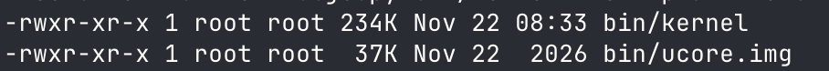

# 操作系统实验报告

## 实验基本信息

| 项目 | 内容 |
|------|------|
| **实验名称** | Lab 4：进程管理 |
| **小组成员** | 2412439-崔迪、2412819-李子谦、2412852-梁靖泽 |
| **完成日期** | 2026-11-21 |

### 小组分工

**练习分工**

| 成员 | 负责的练习/模块 |
|------|----------------|
| 2412439-崔迪 | `page_insert()`、`page_remove()`、`alloc_proc()`、`proc_init()` |
| 2412819-李子谦 | `kernel_thread()`、`do_fork()`、`copy_thread()`、`copy_mm()` |
| 2412852-梁靖泽 | `cpu_idle()`、`schedule()`、`proc_run()`、`switch_to()` |

**实验报告分工**

崔迪整理页映射、PCB 分配与进程初始化部分，李子谦整理线程创建与首次运行现场，梁靖泽整理调度与上下文切换。三人分别记录所负责函数的规格、提示词、实现过程和测试结果，共同完成整体联调、Challenge 和报告合并。测试截图由组长统一整理。

---

## 一、实验目的

1. 理解从页表和虚拟内存管理到内核线程创建、调度的整体关系。
2. 为内核线程申请独立的 PCB、内核栈并登记 PID，掌握失败时的资源回收。
3. 理解 trapframe 与 context 的区别，构造能沿现有恢复入口首次运行的线程现场。
4. 使用四段式提示词描述功能规格，通过交叉编译、专项测试和课程评分验证实现。

---

## 二、实验环境

| 成员 | AI 编程工具 | 底层模型 | 备注 |
|------|------------|---------|------|
| 2412439-崔迪 | Claude Code | DeepSeek V4 Flash | macOS Docker 交叉编译，GCC 10.2.0、QEMU 4.1.1 |
| 2412819-李子谦 | Claude Code | DeepSeek V4 Flash | WSL2 专项测试，GCC 10.2.0、QEMU 4.1.1 |
| 2412852-梁靖泽 | Claude Code | DeepSeek V4 Flash | WSL 整体联调，GCC 15.1.0、QEMU 4.1.1 |

---

## 三、实验整体逻辑分析

### 3.1 本章节的逻辑主线

Lab4 先完善页映射和虚拟内存管理，再把内核中的执行流组织成线程，最后通过调度和上下文切换让线程真正运行。整体顺序是：

`kern_init → pmm_init → pic_init / idt_init → vmm_init → proc_init → clock_init / intr_enable → cpu_idle → schedule → proc_run → switch_to`。

三个模块分别解决地址映射、线程创建和调度切换的问题。内存管理为 PCB 与内核栈的分配提供基础；创建线程时准备好资源和执行现场；调度器再从就绪线程中选择目标，把 CPU 交给它执行。

### 3.2 功能的逐步实现

1. 启动入口先启用预置的内核页表。随后 `pmm_init()` 初始化物理页分配，检查页映射的建立、替换与撤销，再初始化 `kmalloc()`，为后续 PCB 与栈的分配做好准备。`vmm_init()` 检查已有的 VMA 管理。
2. `proc_init()` 将当前执行流登记为 `idleproc`，再通过 `kernel_thread()` 创建 `initproc`。
3. `kernel_thread()` 准备入口和参数，`do_fork()` 组织 PCB、内核栈、地址空间处理、现场复制及全局登记。任何可失败的准备步骤都在登记之前完成。
4. `cpu_idle()` 观察到初始调度请求，通过 `schedule()` 从进程表选择就绪线程。`proc_run()` 更新 `current`、写入 Sv39 的 `satp` 并刷新 TLB，`switch_to()` 恢复目标的栈与返回地址。新线程沿 `forkret → forkrets → __trapret → kernel_thread_entry → fn(arg)` 首次运行。已有线程从它上一次调用 `switch_to()` 的位置继续执行。

---

## 四、实验内容与实现

### 功能模块一：虚拟内存页操作

**负责人：** 2412439-崔迪

#### 模块功能描述

本模块位于 `code/kern/mm/pmm.c`，负责建立、更新和撤销虚拟页到物理页的映射。

**需要实现/修改的函数**

```c
int page_insert(pde_t *pgdir, struct Page *page, uintptr_t la, uint32_t perm);
void page_remove(pde_t *pgdir, uintptr_t la);
```

**功能说明**

| 操作 | 实现与行为规格 |
|------|----------------|
| 建立映射 | `get_pte(pgdir, la, 1)` 找到或按需建立通往叶级页表项的路径。成功后增加目标页的引用计数，写入页号和权限，并使该地址的 TLB 翻译失效。 |
| 同一物理页重复映射 | 抵消本次新增引用，重新写入 PTE 并使 TLB 翻译失效。映射数保持一致，调用者仍可更新权限。 |
| 替换物理页 | 先增加新页的引用，再调用 `page_remove()` 撤销旧映射，最后写入新 PTE。旧页在最后一个引用撤销后释放。 |
| 删除映射 | 用 `get_pte(pgdir, la, 0)` 查找已有项。路径不存在或 PTE 无效时直接返回。有效时清零 PTE，先使 TLB 翻译失效，再减少引用并在归零时释放物理页。 |
| 建立路径失败 | 返回 `-E_NO_MEM`。目标叶级映射与待映射物理页的引用计数保持原值。若上层页表已创建而下一层分配失败，现有 `get_pte()` 可留下已分配的中间页表。 |

删除的是一个虚拟地址的映射。若同一物理页还被别的地址映射，它会继续保留。中间页表仍可供同一路径下的其他映射使用。

#### 最终提示词

##### 页映射

````text
[PROMPT]
完成 Lab 4 的 page_insert() 和 page_remove()。先说明两处操作的规格和计划修改位置，获得确认后只在 code/kern/mm/pmm.c 的 LAB4 function1 填空中实现，保留实验标记并署名 2412439。以现有框架和课程检查为依据。

[RELY]
pmm.h 已声明这两个函数以及 get_pte() 和 tlb_invalidate()，并提供 pte_create()、page2ppn()、pte2page()、page_ref_inc()、page_ref_dec() 及 free_page()。get_pte(pgdir, la, 1) 可按需创建中间页表，失败返回 NULL；传入 0 只查看已存在的路径。PTE_V 表示页表项有效，PTE 的权限来自调用者的 perm；error.h 定义 E_NO_MEM。框架的 check_pgdir() 和课程 PMM 检查会检查映射、权限及物理页引用计数。

[GUARANTEE]
int page_insert(pde_t *pgdir, struct Page *page, uintptr_t la, uint32_t perm);
void page_remove(pde_t *pgdir, uintptr_t la);
使用现有签名和数据结构。写入范围仅限上述两函数的 LAB4 填空。

[SPECIFICATION]
page_insert()
前置条件：pgdir 是有效的页表根的内核虚拟地址，la 由该路径按 4 KiB 页映射，page 是可建立映射的受管理物理页。
后置条件：成功时叶级 PTE 记录 page 的物理页号和 perm，置有效位，更新受影响的 TLB 翻译并返回 0。
分支：新映射增加目标页一个引用。重复映射到同一页只更新 PTE，净引用计数不变。改映射到不同页时增加新页引用并移除旧映射，旧页失去最后一个引用时归还。若 get_pte() 返回 NULL，返回 -E_NO_MEM，不增加目标页引用或写入目标叶级映射；中间页表分配的副作用由框架 get_pte() 决定。

page_remove()
前置条件：pgdir、la 符合同样的页表访问约定。
后置条件：若有有效映射，清零叶级 PTE 并使对应 TLB 翻译失效，减少物理页一个引用，引用归零时释放物理页。
分支：页表路径不存在或叶级 PTE 无效时直接返回，不分配页表。保留中间页表供后续使用。
````

#### 实现迭代过程

##### 第一次迭代

**实现与检查**

实现时重点检查了同页重复映射、不同页替换以及删除未映射地址这几种情况，确保页表项、引用计数和 TLB 更新一致。页映射函数先完成交叉编译，再随其他模块一起进行运行检查。

**最终结果**

通过页表自检、启动阶段的实际别名访问检查以及课程 PMM 测试，结果见第五节。

---

### 功能模块二：线程创建与首次运行现场

**负责人：** 2412439-崔迪（PCB 分配与进程初始化）、2412819-李子谦（线程创建与首次运行现场）

#### 模块功能描述

**需要实现/修改的函数**

```c
static struct proc_struct *alloc_proc(void);
void proc_init(void);
int kernel_thread(int (*fn)(void *), void *arg, uint32_t clone_flags);
int do_fork(uint32_t clone_flags, uintptr_t stack, struct trapframe *tf);
static void copy_thread(struct proc_struct *proc, uintptr_t esp,
                        struct trapframe *tf);
static int copy_mm(uint32_t clone_flags, struct proc_struct *proc);
```

六个函数均位于 `code/kern/process/proc.c`，共同完成从 PCB 初始化到线程就绪的创建过程。

**功能说明**

##### PCB 分配与进程管理初始化

- `alloc_proc()` 通过 `kmalloc()` 分配 PCB。分配失败返回 `NULL`。成功后清零 PCB，设置 `PROC_UNINIT`、尚未分配的 PID `-1` 和内核根页表物理地址 `boot_pgdir_pa`，并初始化普通链表和 PID 哈希链表节点。该接口也供 `do_fork()` 使用。
- `proc_init()` 先初始化全局进程链表和 PID 哈希桶。将启动执行流登记为 `idleproc`，使其复用 `bootstack`、使用 PID 0、处于 `PROC_RUNNABLE`，并设置 `need_resched` 和 `current`。idle 计入进程总数，调度时经专门指针访问。随后以 `init_main()` 为入口调用 `kernel_thread()`，用返回的 PID 查出已登记的 `initproc` 并命名。启动阶段资源申请、线程创建或查询失败会进入 panic 或断言。

初始化顺序需要明确：先建立进程管理结构，再设置 `current=idleproc`，之后创建的 init 才能正确记录父线程。

##### 线程创建与首次运行现场

- `kernel_thread()` 将临时 trapframe 清零，用 `s0/s1` 保存函数和参数，`epc` 指向 `kernel_thread_entry`。设置 `SPP/SPIE`、清除 `SIE`，并将 `clone_flags | CLONE_VM` 交给 `do_fork()`，自身不执行线程函数。
- `copy_thread()` 在新内核栈顶部按 16 字节对齐保存独立的 trapframe，子现场的 `a0=0`；`esp=0` 时使用新现场地址作为恢复栈，否则使用传入的栈指针。清零 context，再设置 `ra=forkret`、`sp=新 tf 地址`，不保留指向父栈局部变量的引用。
- `copy_mm()` 只处理当前阶段的内核线程：`mm=NULL`，共享 `boot_pgdir_pa`。不复制用户地址空间；发现父线程 `mm` 非空时返回 `-E_INVAL`。
- `do_fork()` 先检查数量上限，再申请 PCB、记录父线程、申请内核栈、处理地址空间并复制现场。全部准备完成后，保存中断状态、分配 PID、登记链表和哈希、增加进程数、唤醒线程，最后恢复原中断状态并返回 PID。失败时按“内核栈 → PCB”的逆序清理，不登记半成品。

父线程得到的是新线程 PID，子现场中的 `a0=0` 是为恢复路径准备的返回值，两者不是同一个返回位置。当前阶段线程共享内核页表，但 PCB、内核栈和执行现场仍然各自独立。

#### 最终提示词

##### PCB 分配与初始化

````text
[PROMPT]
完成 Lab 4 的 alloc_proc() 和 proc_init()。先列出要修改的位置和行为，获得确认后在 code/kern/process/proc.c 的 LAB4 function2 填空补入本人两函数，保留实验标记并署名 2412439。该填空由两位成员共享，线程创建通过已有的 kernel_thread() 接口接入。

[RELY]
proc.h 定义 proc_struct、进程状态和 kernel_thread()。kmalloc()、memset()、list_init() 用来初始化 PCB。boot_pgdir_pa 是内核根页表物理地址，bootstack 是启动时使用的内核栈。proc.c 已有 proc_list、hash_list、nr_process、current、idleproc、initproc，以及 init_main()、find_proc() 和 set_proc_name()。创建子线程时，kernel_thread() 以 current 为父线程，成功返回新 PID，并由线程创建路径负责把子线程登记进链表和哈希表。

[GUARANTEE]
static struct proc_struct *alloc_proc(void);
void proc_init(void);
alloc_proc() 供同一文件的 do_fork() 复用；公共头文件和其他函数保持现有接口。

[SPECIFICATION]
alloc_proc()
前置条件：内核分配器已初始化，boot_pgdir_pa 有效。
后置条件：成功时返回尚未登记的 PCB，主体清零，state 为 PROC_UNINIT，pid 为 -1，pgdir 为 boot_pgdir_pa，两个链表节点各自初始化。其他状态由后续创建过程填写。
分支：内存申请失败返回 NULL。

proc_init()
前置条件：内存管理已初始化，内核正在启动栈上执行，进程管理子系统尚未启动。
后置条件：初始化全局链表和 PID 哈希桶。idleproc 使用 PID 0、bootstack 和 PROC_RUNNABLE，设置 need_resched，并成为 current。把 idle 计入进程数，保留普通进程链表给已登记的普通线程。用 kernel_thread() 创建以 init_main 为入口的线程，按返回 PID 找到 initproc 并设定名称。CPU 交接由后续调度完成。
分支：idle PCB 分配或内核线程创建失败时报告启动错误；按 PID 查询 init 失败时触发断言。队友入口尚未完成时先检查两个源文件的编译，完整启动与评分在合入后进行。
````

##### 首次现场构造

````text
[PROMPT]
任务：我负责 Lab4 的线程创建。请先在 code/kern/process/proc.c 中补全 kernel_thread() 和 copy_thread()，把函数和参数准备成线程第一次运行的现场。
操作要求：请用 apply_patch 直接改真实文件，只补这两个函数和必要的 static 声明，署名 2412819，保留 LAB4 标记。队友的 alloc_proc()、proc_init() 和其他模块别改，也不要新增文件、运行构建或提交 Git。
输出要求：按下面的真实接口和规格实现，最后说明改了哪里、现场怎样传递，还有哪些尚未验证。

[RELY]
请先读 proc.c、proc.h、trap.h、process/entry.S 和 trapentry.S。struct trapframe 由 gpr、status、epc、badvaddr、cause 组成，gpr 有 s0、s1、a0、sp 等字段；proc_struct 有 kstack、tf、context，context 保存 ra、sp、s0–s11。
KSTACKSIZE 是内核栈大小。已有 memset()、read_csr(sstatus)、SSTATUS_SPP/SPIE/SIE、do_fork()、forkret()。kernel_thread_entry 从 s0 取函数、s1 取参数；forkrets 从传入的 tf 恢复现场。pmm.h 定义 CLONE_VM=0x00000100，表示共享地址空间。

[GUARANTEE]
int kernel_thread(int (*fn)(void *), void *arg, uint32_t clone_flags);
static void copy_thread(struct proc_struct *proc, uintptr_t esp, struct trapframe *tf);
允许必要的文件内前置声明，不改公共结构和接口。

[SPECIFICATION]
## kernel_thread
Pre-Condition：当前线程有效，fn 是有效内核函数，arg 可为 NULL。
Post-Condition：准备清零的临时 trapframe，保留函数和参数，入口指向 kernel_thread_entry；经 do_fork(clone_flags | CLONE_VM, 0, &tf) 返回 PID 或原错误码，不留下指向局部 tf 的长期引用。
Requirements：status 保留其他位，置 SPP/SPIE、清 SIE，让新线程从 S 态入口运行；本函数只创建，不直接调用 fn。

## copy_thread
Pre-Condition：proc 已有 KSTACKSIZE 字节的独立内核栈；tf 有效；esp 为 0 或调用者提供的合法栈指针。
Post-Condition：在新内核栈顶部保存 tf 的独立副本，a0 置 0，context 从清零状态设置 ra=forkret、sp=新 tf 地址，原 tf 不变。
Case 1：esp=0 时，恢复用的 gpr.sp 指向新 tf，不能继续用父线程的栈。
Case 2：esp 非零时，gpr.sp 使用该值。
Requirements：按真实结构大小计算位置，保持 16 字节栈对齐，不增加另一套返回汇编。
````

##### 资源申请、登记与失败清理

````text
[PROMPT]
任务：我负责 Lab4 线程创建的另一部分。请在 code/kern/process/proc.c 中补全 copy_mm() 和 do_fork()，把 PCB、内核栈、首次现场和进程登记串起来。
操作要求：请用 apply_patch 直接修改文件，只补这两个函数及必要的 static 声明，署名 2412819，保留 LAB4 标记。已有的 kernel_thread()、copy_thread() 和队友代码不要改，不新增文件，不运行构建或提交 Git。
输出要求：以真实代码和下面的规格为准，说明资源申请、失败回收和登记顺序，不把未跑的测试写成通过。

[RELY]
请读 proc.c、proc.h、vmm.h、sync.h、error.h。proc_struct 的 parent、mm、pgdir、tf、context、list_link、hash_link 用于父子关系、地址空间、现场和登记；pgdir 是物理地址。
已有 alloc_proc()、setup_kstack()、put_kstack()、copy_thread()、get_pid()、hash_proc()、kfree()、wakeup_proc()、list_add()，以及 current、proc_list、nr_process、MAX_PROCESS、boot_pgdir_pa。local_intr_save/restore 保存和恢复原中断状态。
alloc_proc() 成功时 PCB 已清零，state=PROC_UNINIT、pid=-1、pgdir=boot_pgdir_pa；失败返回 NULL。只创建内核线程，current->mm 应为 NULL；pmm.h 中 CLONE_VM=0x00000100，本阶段不复制用户地址空间。

[GUARANTEE]
static int copy_mm(uint32_t clone_flags, struct proc_struct *proc);
int do_fork(uint32_t clone_flags, uintptr_t stack, struct trapframe *tf);
辅助函数只保留文件内作用域，不改公共结构。

[SPECIFICATION]
## copy_mm
Pre-Condition：current 和新 proc 有效，proc 尚未登记。
Post-Condition：内核线程共享内核页表，proc->mm 保持 NULL，pgdir 为 boot_pgdir_pa，返回 0；不分配或复制用户地址空间。
Case：current->mm 非 NULL 时返回 -E_INVAL，明确拒绝本实验未支持的情况，不把它当作成功。

## do_fork
Pre-Condition：单核环境，current 有效，tf 有效，进程管理结构已初始化；stack 为 0 或合法栈指针。
Post-Condition：成功返回唯一正 PID，parent=current；PCB、内核栈和首次现场准备完整后，才登记进程链表、PID 哈希和计数，并变为 PROC_RUNNABLE；不改变 current，不在这里调度。
Case 1：进程数达到 MAX_PROCESS，返回 -E_NO_FREE_PROC，不申请资源。
Case 2：PCB 或内核栈申请失败，返回 -E_NO_MEM，已申请的资源按逆序释放。
Case 3：copy_mm 失败，返回它的错误码，回收内核栈和 PCB。
Requirements：失败时链表、哈希和进程数不变，不释放父线程或内核共享页表；PID 分配、登记、计数及唤醒在保存中断状态的临界区完成，退出后恢复原状态。
````

#### 实现迭代过程

##### 第一次迭代

**遇到的问题：**

- 最初的提示词依赖说明漏查了 `pmm.h`，误以为框架没有定义 `CLONE_VM`。检查工程后确认已有定义，值为 `0x00000100`。
- 模块合并前，线程创建相关代码可以编译，但完整内核因 `cpu_idle()` 尚未实现而无法链接。这是调度接口尚未完成造成的阶段性问题，不是线程创建代码的编译错误。

**问题解决策略：**

- 根据实际头文件修正提示词，明确使用已有的共享地址空间标志，使 `kernel_thread()` 传入 `clone_flags | CLONE_VM`。
- 先在临时副本中单独检查线程创建、分配失败清理和首次恢复现场，调度代码合入后再进行完整内核的编译、运行和评分。

**最终结果：**

PCB 初始化、线程创建和失败清理检查通过；首次恢复能够在子线程自己的内核栈上进入指定函数并正确传参。合入后通过课程 Process Create 测试，整体结果见第五节。

**关键改进点总结：**

1. trapframe 必须复制到子线程自己的栈上，不能引用 `kernel_thread()` 的局部变量。
2. 在全局登记前完成可能失败的步骤，失败清理只归还本次申请的资源。
3. 不照搬其他版本的接口；`CLONE_VM`、结构布局和返回入口均以当前工程为准。

---

### 功能模块三：调度与上下文切换

**负责人：** 2412852-梁靖泽

#### 模块功能描述

**需要实现/修改的函数**

```c
void cpu_idle(void);
void schedule(void);
void proc_run(struct proc_struct *proc);
void switch_to(struct context *from, struct context *to);
```

本模块涉及 `code/kern/process/proc.c`、`code/kern/schedule/sched.c` 和 `code/kern/process/switch.S`，分别完成切换组织、就绪线程选择和底层寄存器保存恢复。

**功能说明**

- `cpu_idle()` 不断检查 `current->need_resched`，只有存在调度请求时才调用 `schedule()`。
- `schedule()` 保存原中断状态并清除当前调度请求。idle 从链表头之后开始查找，普通线程从自身之后循环查找，只选择 `PROC_RUNNABLE`，跳过链表哨兵及其他状态。找不到可运行的普通线程时选择 idle；只有自身可运行时继续运行自身。目标的 `runs` 加一，只有目标不是当前线程时才切换，不改变线程状态或链表顺序。
- `proc_run()` 在目标就是当前线程时直接返回；否则在临界区保存旧 `current`、设置新 `current`，将 `satp` 写为 `0x8000000000000000ULL | (proc->pgdir >> RISCV_PGSHIFT)`，调用 `flush_tlb()`，再交给 `switch_to()`。`pgdir` 为根页表物理地址，不能用虚拟地址或旧 Sv32 `lsatp()`。
- `switch_to()` 通过 `a0` 指向旧 context、`a1` 指向新 context，用 `sd/ld` 保存和恢复 `ra`、`sp`、`s0–s11`，最后 `ret` 进入目标 `ra`；不触碰 CSR、`current` 或 trapframe。

##### 上下文布局与中断恢复

`struct context` 的十四个 RV64 `uintptr_t` 共占 112 字节：`ra` 偏移 0、`sp` 偏移 8、`s0–s11` 偏移 16–104，步长 8。它保存跨 C 调用必须保留的寄存器；trapframe 则用于中断/异常返回的更完整现场，不能混用布局。

旧线程再次被切换回来后，会沿原调用链恢复保存的中断状态，不需要在 context 中额外保存这部分 CSR。新线程则不会返回旧线程的调用栈，而是利用预置 trapframe 的 `SPIE` 在 `sret` 时开启中断。嵌套临界区的具体过程见 Challenge 1。

#### 最终提示词

##### 单核线程调度链路

````text
[PROMPT]
任务：完成 Lab 4 单核内核线程的协作调度链路，让 idle 根据调度请求让出 CPU，按循环顺序选择 runnable 线程，并安全切换当前线程和 Sv39 页表。只修改 code/kern/process/proc.c 的 LAB4 function3 区域（cpu_idle、proc_run）和 code/kern/schedule/sched.c 的 LAB4 function3 区域（schedule）。
操作要求：在你的工作区用 apply_patch 修改真实文件；保留其他成员代码和公开接口，只将本人区域标记署名为 LAB4 function3 2412852，不新增代码内注释，不修改 switch.S（另一子 agent 负责），不编写文档，不提交 Git。可以运行针对性验证，但不能为通过验证修改其他模块。
输出要求：以工程实际定义和下列行为规格为准，直接完成代码，最后列出修改路径、关键实现和真实验证结果/未验证项。不要把步骤式伪代码当成规格。

[RELY]
读取 proc.c、proc.h、sched.c、sched.h、sync.h、riscv.h、pmm.h，以及 pmm.c 的 enable_paging()。current、idleproc 和 proc_list 是现有全局对象；idleproc 不在 proc_list 中。proc_struct 的 state（PROC_UNINIT/PROC_SLEEPING/PROC_RUNNABLE/PROC_ZOMBIE）、runs、volatile bool need_resched、list_link、context、uintptr_t pgdir 为相关字段；pgdir 是根页表物理地址，不是内核虚拟地址。list_next、list_empty、le2proc 为现有链表接口。local_intr_save/restore 保存和恢复原 SIE 状态，支持嵌套临界区。switch_to(struct context *from, struct context *to) 已在 proc.c 声明，其汇编由另一个 agent 完成。RISCV_PGSHIFT=12；pmm.c enable_paging 使用 write_csr(satp, 0x8000000000000000 | (boot_pgdir_pa >> RISCV_PGSHIFT))，需核对现有 flush_tlb() 接口。libs/riscv.h 的 lsatp(unsigned int) 是 Sv32 遗留，严禁调用。当前所有内核线程共享 boot_pgdir_pa，但仍须实现通用页表切换语义。无需实现抢占时钟策略或进程退出。

[GUARANTEE]
void cpu_idle(void);（保留 proc.h 的 noreturn 声明）
void schedule(void);
void proc_run(struct proc_struct *proc);
不修改公开签名或结构布局，无需新增辅助函数；若确有需要，只允许所属文件内 static 辅助函数。

[SPECIFICATION]
## cpu_idle
Pre-Condition：proc_init 已完成，current 为 idleproc，进程列表有效，单核内核环境。
Post-Condition：永久执行 idle 循环；当 current->need_resched 非零时请求 schedule，无调度请求时不调用 schedule；不得返回或自行改动进程生命周期。
Requirements：不无条件关闭中断，不增加未约定的 WFI/抢占机制。
## schedule
Pre-Condition：current、idleproc、proc_list 已初始化；普通进程的 list_link 属于 proc_list，idleproc 不在列表中。
Post-Condition：在受中断保护的临界区处理一次调度，清除发起调度线程的 need_resched；从当前普通线程之后开始循环扫描，idle 发起时从表头后开始；选择第一个 PROC_RUNNABLE 线程，绕过睡眠、未初始化和僵尸线程；目标 runs 增加一次，只有目标不同于 current 时调用 proc_run。
Case 1：列表为空或没有 runnable 普通线程，目标为 idleproc。
Case 2：扫描绕回后当前普通线程是唯一 runnable，允许继续选择自身，更新 runs 但不切换上下文。
Case 3：有多个 runnable 普通线程，依链表循环顺序轮转，不优先重复选当前线程，不把链表哨兵解释为 PCB。
Requirements：选择、need_resched、runs 维护和切换请求整体处于临界区；本线程从切换恢复后恢复调用 schedule 前的中断开关状态；不重排进程列表或改变线程 state。
## proc_run
Pre-Condition：proc 非 NULL 且 PROC_RUNNABLE，current 有效；proc->pgdir 是合法、页对齐的 Sv39 根页表物理地址；新旧 context 均符合 switch_to 约定。
Post-Condition：目标不同时，以原 current 为保存现场的对象，current 指向目标，satp 采用 RV64 Sv39 模式和目标根页表 PPN，TLB 失效后进入目标 context；原线程以后恢复时可正常从本调用返回，并恢复进入时的中断状态。
Case 1：proc==current 时无上下文或页表切换，无全局状态变化。
Case 2：目标不同，current、satp、TLB、寄存器上下文切换保持一致，切换窗口不可被中断观察到中间状态。
Requirements：satp 使用 64 位模式位，不能截断物理地址或沿用 Sv32 lsatp；TLB 刷新发生在页表切换后和目标现场执行前；不改 runs（由 schedule 负责），不保存 trapframe 或新增栈切换入口。
````

##### RV64 上下文保存与恢复

````text
[PROMPT]
任务：实现 Lab 4 RV64 内核线程上下文切换底层能力，与 C 层 proc_run 和线程首次运行现场兼容。唯一可写文件为 code/kern/process/switch.S，补全 LAB4 function3 区域。
操作要求：用 apply_patch 修改实际文件，标记署名 LAB4 function3 2412852；保留公开接口和其他代码，不新增代码内注释，不修改 proc.c、sched.c、proc.h、Trap 或入口汇编（调度链路由另一子 agent 完成），不编写文档，不提交 Git。允许针对性汇编/反汇编验证，不改其他模块以绕过问题。
输出要求：使用下面真实结构和行为规格完成代码，最后列出改动文件、寄存器布局依据以及真实验证/未验证项。

[RELY]
读取 code/kern/process/proc.h、proc.c、entry.S、switch.S 和 kern/trap/trapentry.S。struct context 按以下顺序含十四个 uintptr_t 字段：ra、sp、s0、s1、s2、s3、s4、s5、s6、s7、s8、s9、s10、s11；RV64 每字段 8 字节。proc.c 已声明 void switch_to(struct context *from, struct context *to)。RV64 ABI 用 a0 传 from，a1 传 to；C 调用者负责中断临界区、current 和页表切换。copy_thread 为新线程构造 context.ra=forkret、context.sp=新线程内核栈上的 trapframe 地址，forkret 经 forkrets 恢复 trapframe。常规切换需返回旧线程 switch_to 调用后的 C 续执行点。

[GUARANTEE]
void switch_to(struct context *from, struct context *to);（用 .globl switch_to 导出同名汇编入口）
不新增公开接口，不改变 struct context，不新增辅助函数或另一个 Trap 恢复入口。

[SPECIFICATION]
## switch_to
Pre-Condition：RV64 S 态，from、to 指向不同的有效 context，均有足够存储并符合 uintptr_t 对齐；调用者已保护临界区并完成 current 与页表切换；目标 sp、ra 为合法恢复现场。
Post-Condition：from 精确保留本次调用的 ra、sp、s0–s11；上述十四个寄存器从 to 恢复；控制流进入目标 ra，使用目标栈。目标 context 本身只读，其他进程/内存不受影响。
Case 1：目标为已有线程，恢复它上次保存的现场，使其像从此前 switch_to 返回一样继续运行。
Case 2：目标为新线程，使用 copy_thread 构造的 sp 和 ra 进入 forkret，再沿现有 forkrets/kernel_thread_entry 链路首次运行，不能额外调整 trapframe 或自行调用线程函数。
Requirements：严格按 proc.h 布局使用 RV64 64 位访存；不能漏保存/恢复 s0 或 s11，不能截断 ra/sp；无需保存 ABI caller-saved 寄存器、gp/tp、浮点寄存器或 CSR；访存期间 a0/a1 对应的 context 指针仍有效。不得操作 satp、中断开关或 current，不建立自己的额外栈帧。
````

#### 实现迭代过程

##### 第一次迭代

**遇到的问题**

生成代码的寄存器布局和调度选择逻辑检查通过，联调时主要遇到了工具链兼容问题：GCC 15 将框架 `kmalloc.c` 的整数转指针以及课程测试的函数指针类型不匹配诊断为错误，默认 QEMU 7 也未能正常进入内核。

**问题解决策略**

在 GCC 15 环境下，通过命令行传入 `-Wno-error=int-conversion -Wno-error=incompatible-pointer-types`，将上述已有类型问题降为警告，不修改框架或评分代码；运行统一使用 QEMU 4.1.1。最终截图使用 GCC 10.2.0，该版本可直接完成构建。

**最终结果**

反汇编确认了十四组寄存器的 64 位保存与恢复。QEMU 中能够从 idle 切到 init，课程调度测试中的多个线程也能轮流运行。额外的模拟测试用于检查调度选择和嵌套中断恢复，不能替代真实的硬件切换验证；详细过程保存在[调度与上下文切换日志](logs/2412852-lab4-tests.txt)，整体结果见第五节。

---

### Challenge 1：中断开关与嵌套临界区

**负责人：** 小组共同完成

`local_intr_save(intr_flag)` 通过 `__intr_save()` 读取 `sstatus.SIE`。若原先开启 S 态中断，`intr_disable()` 清除该位，同时返回 `true` 记录原状态。若原先已关闭，则返回 `false`。退出临界区时，`local_intr_restore(intr_flag)` 只在标记为 `true` 时调用 `intr_enable()`，通过置位 SIE 恢复原来的开启状态。若标记为 `false`，则保持关闭。这个约定要求临界区中的代码维持中断屏蔽状态。对应实现见 [sync.h](../code/kern/sync/sync.h) 和 [intr.c](../code/kern/driver/intr.c)。

以 `schedule()` 调用 `proc_run()` 为例，若外层进入时中断开启，外层记录 `true` 并关闭中断。内层进入时看到中断已关闭，记录 `false`，因此内层退出时仍保持关闭，最后由外层恢复。线程切换后，旧线程须等自身再次获得 CPU 才会沿原调用链执行恢复。这是单个 hart 上的中断保护，多核之间访问共享数据时还需要跨核同步。

---

### Challenge 2：比较 Sv32、Sv39、Sv48

**负责人：** 小组共同完成

三种模式都以 4 KiB 为基本页大小，页内偏移为 12 位。遍历从 `satp` 指定的根页表开始，按虚拟页号从高到低索引，遇到叶级映射后形成物理地址。支持的大页可在更高层结束遍历。各模式的索引宽度和表项大小如下。参考 [RISC-V 特权架构规范](https://docs.riscv.org/reference/isa/v20260120/priv/supervisor.html)。

| 模式 | 架构 | 有效虚拟地址位数 | VPN 拆分 | 页表层数 | 每级表项数 × 表项字节数 | 支持的页大小 |
|------|------|-----------------|----------|----------|-------------------------|--------------|
| Sv32 | RV32 | 32 | 10 + 10 | 2 | 1024 × 4 B | 4 KiB、4 MiB |
| Sv39 | RV64 | 39 | 9 + 9 + 9 | 3 | 512 × 8 B | 4 KiB、2 MiB、1 GiB |
| Sv48 | RV64 | 48 | 9 + 9 + 9 + 9 | 4 | 512 × 8 B | 4 KiB、2 MiB、1 GiB、512 GiB |

Sv39 要求虚拟地址的位 63–39 等于位 38，Sv48 要求位 63–48 等于位 47。Sv48 比 Sv39 多一级索引，扩大了可用的虚拟地址范围，也增加了逐级查找和按需分配的潜在成本。

**两段代码为何相似。** 本实验的 `get_pte()` 为普通 4 KiB 映射走 Sv39 路径。第一段按 `PDX1(la)` 访问根页表，第二段按 `PDX0(la)` 访问下一层。两段都在表项未建立时根据 `create` 决定是否分配页表页。创建成功后设置引用计数、清零新页并写入指向它的目录项，最后用 `PTX(la)` 返回叶级表项地址。Sv32 的普通页路径只需一次这样的下降，Sv48 则需要三次。代码对应 [pmm.c](../code/kern/mm/pmm.c) 和 [mmu.h](../code/kern/mm/mmu.h)。

**是否拆分查找和分配。** 现有 `create` 开关让两种操作共享一套遍历，对当前 Lab 4 足够简洁。调用者需要留意副作用，例如第二次分配失败时第一层可能已经挂接。若要扩展到更多分页模式，可保留共用的遍历逻辑，对外用不同名字表达只读查找和确保路径存在，并单独说明创建失败时由谁保留或回收已分配的页表页。本实验的思考题只讨论接口设计。

---

## 五、测试与验证

三个模块合并后完成了编译、启动和课程测试。以下截图使用 GCC 10.2.0 和 QEMU 4.1.1，结果如下。

| 检查项 | 结果 |
|------|------|
| 编译：`make clean`、`make` | 编译、链接成功，生成 `bin/kernel` 和 `bin/ucore.img` |
| 运行：`make qemu` | 通过物理页、页表和 VMA 自检，init 打印 PID、名称及 `Hello world!!` |
| 评分：`make grade` | PMM、Process Create、Schedule 三项均通过，各得 10 分，总分 **30/30** |

PMM 测试检查映射替换、同页重复映射、权限、引用计数和重复删除；Process Create 检查 idle/init 的基本状态与初始现场；Schedule 检查多个测试线程能够运行。除此之外，还检查了线程创建失败时的资源回收、栈与现场布局，以及调度的边界情况。详细方法和输出见[线程创建测试日志](logs/2412819-lab4-tests.txt)及[整体联调日志](logs/2412852-lab4-tests.txt)。

**测试截图**



图 1. 构建生成的内核 ELF 文件与裸镜像。


图 2. 内核自检与 init 线程输出。末尾的 `process exit!!.` 来自 init 返回后调用的框架 `do_exit()` 占位，并非线程启动失败；完整退出回收不在本次实现范围内。


图 3. 课程测试评分结果。

---

## 六、实验总结与收获

### 对操作系统的理解

#### 实验知识点与 OS 原理

| 实验知识点 | 对应 OS 原理 | 本实验的范围 |
|-----------|-------------|--------------|
| PTE、引用计数与 TLB | 分页把虚拟地址映射到物理页。撤销映射时必须维护共享页的生命周期，并处理缓存的地址翻译。 | 通过 Sv39 的普通页路径建立、替换、撤销映射。所有实验线程共享内核页表。 |
| PCB、PID 与内核栈 | 控制块描述线程的身份、状态和资源。独立内核栈保存每条内核执行流的调用现场。 | idle 复用启动栈，后续线程独立分配栈。在完成资源申请后登记线程，创建失败时清理已申请资源。 |
| trapframe 与 context | Trap 返回要重建被打断的执行现场，线程切换按 ABI 保存跨调用需要保留的寄存器。 | 新线程通过构造好的 context 进入 `forkret`，再恢复 trapframe；已有线程直接恢复到上一次切换点。 |
| 就绪选择与中断保护 | 调度决定下一条执行流；上下文切换完成 CPU 交接。临界区维护当前线程、页表和现场的一致性。 | 单核环境按进程链表循环选择就绪线程，切换期间保留原 SIE 状态。 |

#### 本实验未覆盖的 OS 知识点

- 用户态进程的地址空间复制与隔离、写时复制、按需调页和换页。
- 完整的退出与等待协议，包括僵尸进程和资源回收。
- 多核同步、跨核 TLB 失效、时钟抢占、优先级策略和负载均衡。

### AI 协作开发的经验

这次实验中，我们先按功能拆分任务，再用四段式提示词说明依赖、接口和预期行为。`CLONE_VM` 的依赖说明曾出现遗漏，说明提示词不能只凭印象编写，必须对照实际头文件检查。生成代码后，还需要结合引用计数、栈布局、寄存器约定和失败清理阅读实现，不能只看能否编译。各模块单独检查有助于定位问题，合并后仍要通过完整启动和课程测试，确认创建、调度与恢复现场能够衔接起来。

---
