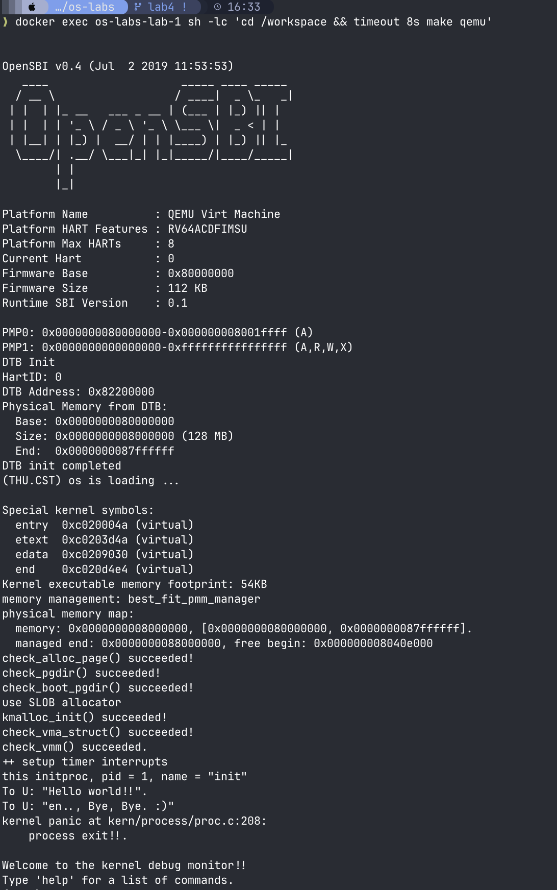
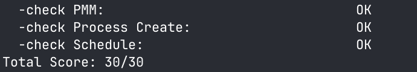

# 操作系统实验报告

## 实验基本信息

| 项目 | 内容 |
|------|------|
| **实验名称** | Lab 4：进程管理 |
| **小组成员** | 2412439-崔迪、2412819-李子谦、2412852-梁靖泽 |
| **代码验收日期** | 2026-11-20 |
| **Docker 复验日期** | 2026-11-22 |

### 小组分工

| 成员 | 负责的练习/模块 |
|------|----------------|
| 2412439-崔迪 | `page_insert()`、`page_remove()`、`alloc_proc()`、`proc_init()` |
| 2412819-李子谦 | `kernel_thread()`、`do_fork()`、`copy_thread()`、`copy_mm()` |
| 2412852-梁靖泽 | `cpu_idle()`、`schedule()`、`proc_run()`、`switch_to()` |

三人分别整理本人模块的规格、提示词、实现过程与测试结果，再共同完成整体联调、报告合并和 Challenge。截图由组长统一整理。完整分工见 [Lab4 分工方案](lab4-division.md)。

---

## 一、实验目的

1. 理解从页表和虚拟内存管理到内核线程创建、调度的整体关系。
2. 为内核线程申请独立的 PCB、内核栈并登记 PID，掌握失败时的资源回收。
3. 理解 trapframe 与 context 的区别，构造能沿现有恢复入口首次运行的线程现场。

---

## 二、实验环境

| 成员 | AI 编程工具 | 底层模型 | 备注 |
|------|------------|---------|------|
| 2412439-崔迪 | Claude Code | DeepSeek V4 Flash | 工具和模型由小组补充 |
| 2412819-李子谦 | Claude Code | DeepSeek V4 Flash | 工具和模型由小组补充 |
| 2412852-梁靖泽 | Codex CLI（主 agent + 两个代码子 agent） | DeepSeek V4 Flash | 模型由小组补充。主 agent 编写提示词并复核，子 agent 实现代码 |

崔迪的两个源文件在 macOS 的 `os-labs-lab-1` 容器中交叉编译。同一容器用于 11 月 22 日的复验，包含 Ubuntu 22.04.5 LTS / aarch64、RISC-V GCC 10.2.0、QEMU 4.1.1 和 GDB 12.1。李子谦的专项验证使用 Windows WSL2、Ubuntu 24.04.4 LTS / x86_64、RISC-V GCC 10.2.0 和 QEMU 4.1.1。

梁靖泽的整体联调使用 WSL / Ubuntu 22.04.5 LTS、RISC-V GCC 15.1.0 和 QEMU 4.1.1。该环境的 GCC 兼容选项和 QEMU 版本选择见模块三的调试记录。

---

## 三、实验整体逻辑分析

### 3.1 本章节的逻辑主线

Lab4 先完善页映射和虚拟内存管理，再把内核中的执行流组织成线程，最后通过调度和上下文切换让线程真正运行。整体顺序是：

`kern_init → pmm_init → pic_init / idt_init → vmm_init → proc_init → clock_init / intr_enable → cpu_idle → schedule → proc_run → switch_to`。

三个模块的分界是页映射、线程就绪和 CPU 交接。物理页管理和内核页表为 PCB 与内核栈提供存储，创建路径准备可恢复的现场并把线程置为就绪，调度路径选择目标并让它占用 CPU。

### 3.2 功能的逐步实现

1. 启动阶段建立内核映射。`pmm_init()` 初始化物理页分配，检查页映射的建立、替换与撤销，再初始化 `kmalloc()`，为后续 PCB 与栈的分配做好准备。`vmm_init()` 检查已有的 VMA 管理。
2. `proc_init()` 将当前执行流登记为 `idleproc`，再通过 `kernel_thread()` 创建 `initproc`。
3. `kernel_thread()` 准备入口和参数，`do_fork()` 组织 PCB、内核栈、地址空间处理、现场复制及全局登记。任何可失败的准备步骤都在登记之前完成。
4. `cpu_idle()` 观察到初始调度请求，通过 `schedule()` 从进程表选择就绪线程。`proc_run()` 更新 `current`、写入 Sv39 的 `satp` 并刷新 TLB，`switch_to()` 恢复目标的栈与返回地址。新线程沿 `forkret → forkrets → __trapret → kernel_thread_entry → fn(arg)` 首次运行。已有线程从它上一次调用 `switch_to()` 的位置继续执行。

---

## 四、实验内容与实现

### 功能模块一：虚拟内存页操作

**负责人：** 2412439-崔迪

#### 接口与实现

本模块在 `code/kern/mm/pmm.c` 的 `LAB4 function1` 区域完成，署名 `2412439`。

```c
int page_insert(pde_t *pgdir, struct Page *page, uintptr_t la, uint32_t perm);
void page_remove(pde_t *pgdir, uintptr_t la);
```

| 操作 | 实现与行为规格 |
|------|----------------|
| 建立映射 | `get_pte(pgdir, la, 1)` 找到或按需建立通往叶级页表项的路径。成功后增加目标页的引用计数，写入页号和权限，并使该地址的 TLB 翻译失效。 |
| 同一物理页重复映射 | 抵消本次新增引用，重新写入 PTE 并使 TLB 翻译失效。映射数保持一致，调用者仍可更新权限。 |
| 替换物理页 | 先增加新页的引用，再调用 `page_remove()` 撤销旧映射，最后写入新 PTE。旧页在最后一个引用撤销后释放。 |
| 删除映射 | 用 `get_pte(pgdir, la, 0)` 查找已有项。路径不存在或 PTE 无效时直接返回。有效时清零 PTE，先使 TLB 翻译失效，再减少引用并在归零时释放物理页。 |
| 建立路径失败 | 返回 `-E_NO_MEM`。目标叶级映射与待映射物理页的引用计数保持原值。若上层页表已创建而下一层分配失败，现有 `get_pte()` 可留下已分配的中间页表。 |

删除的是一个虚拟地址的映射。若同一物理页还被别的地址映射，它会继续保留。中间页表仍可供同一路径下的其他映射使用。行为规格和所依赖的接口见[崔迪的提示词整理版](prompt.md#2412439崔迪)。

#### 实现与验证记录

本组先确认只填写崔迪负责的区域，随后实现这两个函数和模块二的两个初始化函数。11 月 11 日在 Docker 中单独编译 `pmm.o` 与 `proc.o`，编译通过，并逐字节核对了两处填空外的框架。该次交叉编译记录没有记载需修复的 AI 生成缺陷。合入后的页表自检、启动阶段的实际别名访问以及课程 PMM 评分，见第五节。

---

### 功能模块二：线程创建与首次运行现场

#### PCB 分配与进程管理初始化（2412439 崔迪）

崔迪在 `code/kern/process/proc.c` 的 `LAB4 function2` 区域实现以下两个函数。

```c
static struct proc_struct *alloc_proc(void);
void proc_init(void);
```

- `alloc_proc()` 通过 `kmalloc()` 分配 PCB。分配失败返回 `NULL`。成功后清零 PCB，设置 `PROC_UNINIT`、尚未分配的 PID `-1` 和内核根页表物理地址 `boot_pgdir_pa`，并初始化普通链表和 PID 哈希链表节点。该接口也供 `do_fork()` 使用。
- `proc_init()` 先初始化全局进程链表和 PID 哈希桶。将启动执行流登记为 `idleproc`，使其复用 `bootstack`、使用 PID 0、处于 `PROC_RUNNABLE`，并设置 `need_resched` 和 `current`。idle 计入进程总数，调度时经专门指针访问。随后以 `init_main()` 为入口调用 `kernel_thread()`，用返回的 PID 查出已登记的 `initproc` 并命名。启动阶段资源申请、线程创建或查询失败会进入 panic 或断言。

规格把初始化顺序作为接口约束。必须先建立进程管理结构，再设定 `current`，这样创建路径才能把 idle 设为 init 的父线程。最终进程创建检查核对了两者的 PID、就绪状态、内核栈和初始现场。详见[初始化提示词整理版](prompt.md#2412439崔迪)。

#### 线程创建与首次运行现场（2412819 李子谦）

**需要实现/修改的函数：**

```c
int kernel_thread(int (*fn)(void *), void *arg, uint32_t clone_flags);
int do_fork(uint32_t clone_flags, uintptr_t stack, struct trapframe *tf);
static void copy_thread(struct proc_struct *proc, uintptr_t esp,
                        struct trapframe *tf);
static int copy_mm(uint32_t clone_flags, struct proc_struct *proc);
```

**修改文件：** 仅 `code/kern/process/proc.c` 的 `LAB4 function2` 区域，新增四个函数，署名 `2412819`。队友的函数、公共头文件、调度与汇编文件、Makefile 和课程评分工具均未修改。

**功能说明：**

- `kernel_thread()` 将临时 trapframe 清零，用 `s0/s1` 保存函数和参数，`epc` 指向 `kernel_thread_entry`。设置 `SPP/SPIE`、清除 `SIE`，并将 `clone_flags | CLONE_VM` 交给 `do_fork()`，自身不执行线程函数。
- `copy_thread()` 在新内核栈顶部按 16 字节对齐保存独立的 trapframe，子现场的 `a0=0`；`esp=0` 时使用新现场地址作为恢复栈，否则使用传入的栈指针。清零 context，再设置 `ra=forkret`、`sp=新 tf 地址`，不保留指向父栈局部变量的引用。
- `copy_mm()` 只处理当前阶段的内核线程：`mm=NULL`，共享 `boot_pgdir_pa`。不复制用户地址空间；发现父线程 `mm` 非空时返回 `-E_INVAL`。
- `do_fork()` 先检查数量上限，再申请 PCB、记录父线程、申请内核栈、处理地址空间并复制现场。全部准备完成后，保存中断状态、分配 PID、登记链表和哈希、增加进程数、唤醒线程，最后恢复原中断状态并返回 PID。失败时按“内核栈 → PCB”的逆序清理，不登记半成品。

父线程得到的是新线程 PID，子现场中的 `a0=0` 是为恢复路径准备的返回值，两者不是同一个返回位置。当前阶段线程共享内核页表，但 PCB、内核栈和执行现场仍然各自独立。

#### 行为规格与 AI 协作

李子谦把任务拆成首次现场构造和资源管理两部分。第一份规格规定 `kernel_thread()` 的入口、参数和状态位，以及 `copy_thread()` 的独立栈、16 字节对齐和恢复地址。第二份规格要求 `copy_mm()` 处理共享内核页表的情形，`do_fork()` 在完成资源申请后再登记线程，遇到 PCB、内核栈或地址空间处理失败时按已申请资源回收。两份原文分别发送给子 agent，主 agent 随后复核与验证。详见[李子谦的提示词记录](prompt.md#2412819李子谦)。

#### 实现迭代过程

##### 第一次迭代

**遇到的问题：**

- 最初的依赖说明漏查了 `pmm.h`，误以为没有 `CLONE_VM`。子 agent 阅读工程后指出实际定义为 `0x00000100`。
- 只实现本人的四个函数后，正式内核仍不能链接，因为 `cpu_idle()` 尚未实现。它属于队友的调度模块，不能为了让构建通过而在正式代码中代写或添加假实现。

**问题解决策略：**

- 核对 `pmm.h` 后修正依赖说明，明确共享地址空间标志，再发送修正版，使 `kernel_thread()` 使用 `clone_flags | CLONE_VM`。提示词记录保留了实际发送和执行的最终版本。
- 用经过允许的临时副本做线程创建专项测试。仅在副本中添加测试入口和分配失败注入，直接检查实际四个函数；没有给工作区补上调度器或更改队友函数。

**最终结果：**

- 四个函数所在源文件交叉编译通过。
- QEMU 4.1.1 下，64、70、128、256 MiB 四种配置均通过 11 组创建专项检查。
- 真实恢复链成功在子线程内核栈上进入指定函数并正确传参。
- 11 月 12 日的测试覆盖线程创建和首次进入，整组内核的链接、调度和评分随后在 11 月 20 日验收。

**关键改进点总结：**

1. trapframe 必须复制到子线程自己的栈上，不能引用 `kernel_thread()` 的局部变量。
2. 在全局登记前完成可能失败的步骤，失败清理只归还本次申请的资源。
3. 不照搬其他版本的接口；`CLONE_VM`、结构布局和返回入口均以当前工程为准。

---

### 功能模块三：调度与上下文切换

**负责人：** 2412852-梁靖泽

#### 模块功能与接口

```c
void cpu_idle(void);
void schedule(void);
void proc_run(struct proc_struct *proc);
void switch_to(struct context *from, struct context *to);
```

仅修改 `code/kern/process/proc.c`、`code/kern/schedule/sched.c` 和 `code/kern/process/switch.S` 的 `LAB4 function3` 区域，署名 `2412852`。保留其他成员函数、公共结构、Trap、课程评分工具和构建配置。

- `cpu_idle()` 永久循环，只在 `current->need_resched` 非零时请求调度，不额外加入 WFI 或抢占策略。
- `schedule()` 保存原中断状态并清除发起线程的请求。idle 从表头开始，普通线程从自身之后循环扫描，只选 `PROC_RUNNABLE`，跳过链表哨兵及其他状态。无 runnable 普通线程时回到 idle；唯一 runnable 是自身时继续运行。每次选中目标的 `runs` 加一，仅异目标触发切换，不改状态或重排链表。
- `proc_run()` 对自身目标直接返回；异目标在临界区保存旧 `current`、设置目标 `current`，将 `satp` 写为 `0x8000000000000000ULL | (proc->pgdir >> RISCV_PGSHIFT)`，调用 `flush_tlb()`，再交给 `switch_to()`。`pgdir` 为根页表物理地址，不能用虚拟地址或旧 Sv32 `lsatp()`。
- `switch_to()` 通过 `a0` 指向旧 context、`a1` 指向新 context，用 `sd/ld` 保存和恢复 `ra`、`sp`、`s0–s11`，最后 `ret` 进入目标 `ra`；不触碰 CSR、`current` 或 trapframe。

#### 行为规格与 AI 协作

前置条件包括单核环境、有效的 `current/idleproc`、完整进程列表、runnable 目标、页对齐的 Sv39 根页表物理地址以及合法 context。后置条件要求选择策略、请求标记、运行计数、当前线程、页表翻译和寄存器现场一致；空列表、全非 runnable、选中自身、新线程首次进入和已有线程恢复分别列为分支。

主 agent 先核对 Lab 0.5 指导和工程接口，再将 C 调度链路交给 Ptolemy，汇编上下文切换交给 Mill，随后统一复核。逐函数的前置条件、后置条件、分支行为以及两份实际发送的原文见[梁靖泽的提示词记录](prompt.md#2412852梁靖泽)。

#### 上下文布局与中断恢复

`struct context` 的十四个 RV64 `uintptr_t` 共占 112 字节：`ra` 偏移 0、`sp` 偏移 8、`s0–s11` 偏移 16–104，步长 8。它保存跨 C 调用必须保留的寄存器；trapframe 则用于中断/异常返回的更完整现场，不能混用布局。

中断状态不需要在 context 中另存 CSR。`schedule()` 与 `proc_run()` 的局部保存标记留在各自线程栈或被保存的寄存器中，旧线程恢复后才执行对应恢复语句。外层原先开中断、内层进入时已经关中断，则内层保持关闭，外层最终重新开启；原先关闭时两层都保持关闭。新线程首次执行不返回旧线程的 C 栈，而由预置 trapframe 的 `SPIE` 在 `sret` 时恢复其初始中断状态。

#### 实现与调试记录

代码一次完成，复核未发现需修改的布局或选择逻辑。子 agent 的模拟夹具覆盖 2562 个调度组合及自身/直接切换、高位物理地址和嵌套 SIE 恢复，主 agent 重新执行得到 PASS；汇编交叉编译及反汇编确认十四对 64 位访存和返回指令。

实际验证遇到三个环境问题：GCC 15 将框架 `kmalloc.c` 的整数转指针及课程测试线程的函数指针不匹配诊断为错误；默认 QEMU 7 未进入内核；课程评分脚本的 QEMU/GDB 本地端口被沙箱禁止。分别采用命令行 `-Wno-error=int-conversion -Wno-error=incompatible-pointer-types`、已有 QEMU 4.1.1、经授权在沙箱外执行课程评分解决。没有改源码或评分脚本来规避这些问题。

正式源码完成链接，在 QEMU 4.1.1 上真实从 idle 切到 init，打印 PID、名称和问候。init 返回后进入框架已有 `do_exit()` 的 `process exit!!.` panic，这是未实现的退出占位，不是本模块切换失败，本次不越界修改。注入课程测试的临时副本完成多个内核线程往返轮转，课程评分为 **30/30**（PMM、Process Create、Schedule 各 10 分）。

证据边界：模拟测试中的 satp/TLB/context 操作为替身，不单独证明硬件行为；课程动态测试补充首次运行与往返切换，但所有线程共享内核页表，不能证明不同用户地址空间、多核、抢占、完整退出回收或每个寄存器的穷尽动态验证。真实命令、输出和模拟夹具保存在 [梁靖泽验证记录](logs/2412852-lab4-tests.txt)。

---

### Challenge 中断开关与分页模式

#### 1. 中断开关与嵌套临界区

`local_intr_save(intr_flag)` 通过 `__intr_save()` 读取 `sstatus.SIE`。若原先开启 S 态中断，`intr_disable()` 清除该位，同时返回 `true` 记录原状态。若原先已关闭，则返回 `false`。退出临界区时，`local_intr_restore(intr_flag)` 只在标记为 `true` 时调用 `intr_enable()`，通过置位 SIE 恢复原来的开启状态。若标记为 `false`，则保持关闭。这个约定要求临界区中的代码维持中断屏蔽状态。对应实现见 [sync.h](../code/kern/sync/sync.h) 和 [intr.c](../code/kern/driver/intr.c)。

以 `schedule()` 调用 `proc_run()` 为例，若外层进入时中断开启，外层记录 `true` 并关闭中断。内层进入时看到中断已关闭，记录 `false`，因此内层退出时仍保持关闭，最后由外层恢复。线程切换后，旧线程须等自身再次获得 CPU 才会沿原调用链执行恢复。这是单个 hart 上的中断保护，多核之间访问共享数据时还需要跨核同步。

#### 2. 比较 Sv32、Sv39、Sv48

三种模式都以 4 KiB 为基本页大小，页内偏移为 12 位。遍历从 `satp` 指定的根页表开始，按虚拟页号从高到低索引，遇到叶级映射后形成物理地址。支持的大页可在更高层结束遍历。各模式的索引宽度和表项大小如下。参考 [RISC-V 特权架构规范](https://docs.riscv.org/reference/isa/v20260120/priv/supervisor.html)。

| 模式 | 架构 | 有效虚拟地址位数 | VPN 拆分 | 页表层数 | 每级表项数 × 表项字节数 | 支持的页大小 |
|------|------|-----------------|----------|----------|-------------------------|--------------|
| Sv32 | RV32 | 32 | 10 + 10 | 2 | 1024 × 4 B | 4 KiB、4 MiB |
| Sv39 | RV64 | 39 | 9 + 9 + 9 | 3 | 512 × 8 B | 4 KiB、2 MiB、1 GiB |
| Sv48 | RV64 | 48 | 9 + 9 + 9 + 9 | 4 | 512 × 8 B | 4 KiB、2 MiB、1 GiB、512 GiB |

Sv39 要求虚拟地址的位 63–39 等于位 38，Sv48 要求位 63–48 等于位 47。Sv48 比 Sv39 多一级索引，扩大了可用的虚拟地址范围，也增加了逐级查找和按需分配的潜在成本。参考 [RISC-V 特权架构规范](https://docs.riscv.org/reference/isa/v20260120/priv/supervisor.html)。

**两段代码为何相似。** 本实验的 `get_pte()` 为普通 4 KiB 映射走 Sv39 路径。第一段按 `PDX1(la)` 访问根页表，第二段按 `PDX0(la)` 访问下一层。两段都在表项未建立时根据 `create` 决定是否分配页表页。创建成功后设置引用计数、清零新页并写入指向它的目录项，最后用 `PTX(la)` 返回叶级表项地址。Sv32 的普通页路径只需一次这样的下降，Sv48 则需要三次。代码对应 [pmm.c](../code/kern/mm/pmm.c) 和 [mmu.h](../code/kern/mm/mmu.h)。

**是否拆分查找和分配。** 现有 `create` 开关让两种操作共享一套遍历，对当前 Lab 4 足够简洁。调用者需要留意副作用，例如第二次分配失败时第一层可能已经挂接。若要扩展到更多分页模式，可保留共用的遍历逻辑，对外用不同名字表达只读查找和确保路径存在，并单独说明创建失败时由谁保留或回收已分配的页表页。本实验的思考题只讨论接口设计。

---

## 五、测试与验证

### 5.1 线程创建专项验证（2026-11-12）

李子谦在调度模块合入前验证线程创建和首次运行现场。

| 检查项 | 结果及覆盖范围 |
|------|----------------|
| 正式代码交叉编译 | 四个函数所在文件编译通过；全内核链接因缺少 `cpu_idle` 失败 |
| 64 / 70 / 128 / 256 MiB | 每种配置均完成 11 组专项检查，QEMU 正常退出 |
| 现场复制 | 全 frame 复制、原 frame 不变、context 清零、栈内位置与 16 字节对齐；同时检查零/非零栈参数 |
| 成功创建 | 正 PID、父子关系、独立内核栈、共享内核页表、链表和哈希登记、就绪状态、原中断状态恢复 |
| 错误处理 | 进程数上限、PCB 申请失败、栈申请失败、不支持的用户 mm；核对返回码、释放次数、空闲页与登记状态 |
| 首次恢复 | 实际执行 `forkret/forkrets/sret/kernel_thread_entry`，验证函数、参数和子栈 |

**测试方法与边界：**

测试在 `/tmp/lab4-2412819-test-*` 临时副本中进行，直接编译实际四个函数。链接包装只用于控制分配失败和统计回收；测试入口通过现有 `forkret()` 进入新线程，不实现 `schedule()`、`proc_run()` 或 `switch_to()`。因此证明了创建和首次返回现场，但不证明完整的线程切换、轮转调度或多核并发正确性。256 MiB 配置仍受框架 128 MiB 管理上限约束。

实际命令、输出和临时夹具源码保存在[创建专项测试日志](logs/2412819-lab4-tests.txt)。

### 5.2 小组整体验收（2026-11-20）

| 检查项 | 真实结果与限制 |
|------|------|
| 默认交叉构建 | GCC 15 在框架 `kmalloc.c` 的类型转换处报错 |
| 命令行兼容构建 | 降低既有类型诊断级别后，全内核编译、链接及镜像生成通过 |
| 调度模拟 | 2562 个组合及自身目标、直接切换、高位根页表物理地址、嵌套中断恢复通过；不是真实硬件切换 |
| QEMU 4.1.1 正式镜像 | 从 idle 切换到 PID 1 的 init，打印名称与问候。init 返回后进入框架 `do_exit()` 占位的 panic |
| 课程原有注入与评分 | 临时副本调用 `tools/inject.py`、`tools/grade.sh -v`，PMM、Process Create、Schedule 各得 10 分，总分 **30/30** |

PMM 检查覆盖映射替换、权限写入、同页重复映射、引用计数和重复删除。Process Create 检查 idle/init 的 PID、就绪状态和初始现场，Schedule 检查两个测试线程均能运行。这是三人代码合入后的验收记录。GCC 兼容选项及早期 QEMU、端口失败的输出也随日志保留。详见[整体联调与课程评分日志](logs/2412852-lab4-tests.txt)。

### 5.3 Docker 复验与截图（2026-11-22）

使用 GCC 10.2.0 和 QEMU 4.1.1，在 `os-labs-lab-1` 容器的 `/workspace` 内重建内核。生成 `bin/kernel` 和 `bin/ucore.img`，启动打印页表和 VMA 自检结果以及 `this initproc, pid = 1, name = "init"`。课程 `make grade` 退出码为 0，三个评分项目均为 OK，总分 **30/30**。正式镜像在 init 返回后进入框架的退出占位，日志中的 `process exit!!.` 是该路径的提示。

在宿主终端依次运行以下命令可复现这三项检查。

```sh
docker exec os-labs-lab-1 sh -lc 'cd /workspace && make clean && make && ls -lh bin/kernel bin/ucore.img'
docker exec os-labs-lab-1 sh -lc 'cd /workspace && timeout 8s make qemu'
docker exec os-labs-lab-1 sh -lc 'cd /workspace && make grade'
```


图 1. 构建结束后的产物列表。ELF 文件 `bin/kernel` 约 234 KiB，裸镜像 `bin/ucore.img` 约 37 KiB。



图 2. QEMU 启动后通过页表和 VMA 自检，PID 1 的 `initproc` 打印了名称和问候。画面末尾保留了 `init` 返回后进入框架退出占位的输出。



图 3. PMM、Process Create、Schedule 三项均为 `OK`，总分 `30/30`。

---

## 六、实验总结与收获

### 6.1 实验知识点与 OS 原理

| 实验知识点 | 对应 OS 原理 | 本实验的范围 |
|-----------|-------------|--------------|
| PTE、引用计数与 TLB | 分页把虚拟地址映射到物理页。撤销映射时必须维护共享页的生命周期，并处理缓存的地址翻译。 | 通过 Sv39 的普通页路径建立、替换、撤销映射。所有实验线程共享内核页表。 |
| PCB、PID 与内核栈 | 控制块描述线程的身份、状态和资源。独立内核栈保存每条内核执行流的调用现场。 | idle 复用启动栈，后续线程独立分配栈。在完成资源申请后登记线程，创建失败时清理已申请资源。 |
| trapframe 与 context | Trap 返回要重建被打断的执行现场，线程切换按 ABI 保存跨调用需要保留的寄存器。 | 新线程通过构造好的 context 进入 `forkret`，再恢复 trapframe；已有线程直接恢复到上一次切换点。 |
| 就绪选择与中断保护 | 调度决定下一条执行流；上下文切换完成 CPU 交接。临界区维护当前线程、页表和现场的一致性。 | 单核环境按进程链表循环选择就绪线程，切换期间保留原 SIE 状态。 |

### 6.2 本实验未覆盖的 OS 知识点

- 用户态进程的地址空间复制与隔离、写时复制、按需调页和换页。
- 完整的退出与等待协议，包括僵尸进程和资源回收。
- 多核同步、跨核 TLB 失效、时钟抢占、优先级策略和负载均衡。

### 6.3 AI 协作开发的经验

四段式提示词把文件范围、框架依赖、接口和分支行为写清楚。共享 `proc.c` 时逐函数约定修改边界。评审页映射时核对旧映射和引用计数，评审线程创建时核对栈位置、状态位与错误清理，评审调度时核对 ABI 布局和临界区。李子谦对 `CLONE_VM` 的修订说明依赖要用实际头文件核验。专项测试可以隔离依赖并覆盖失败分支，完整验收则用课程测试确认各模块连起来后的行为。

---
